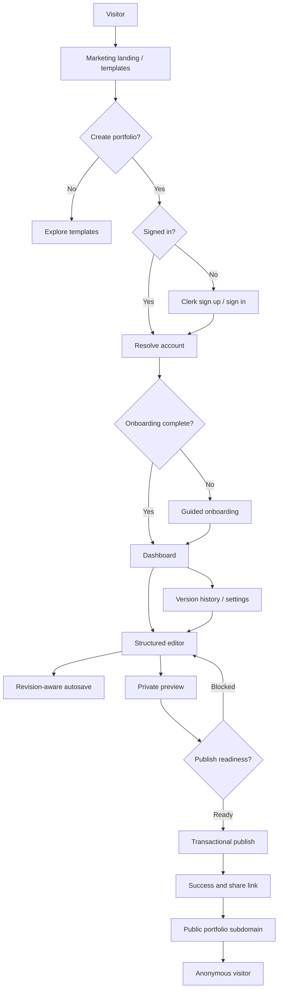
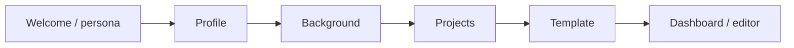
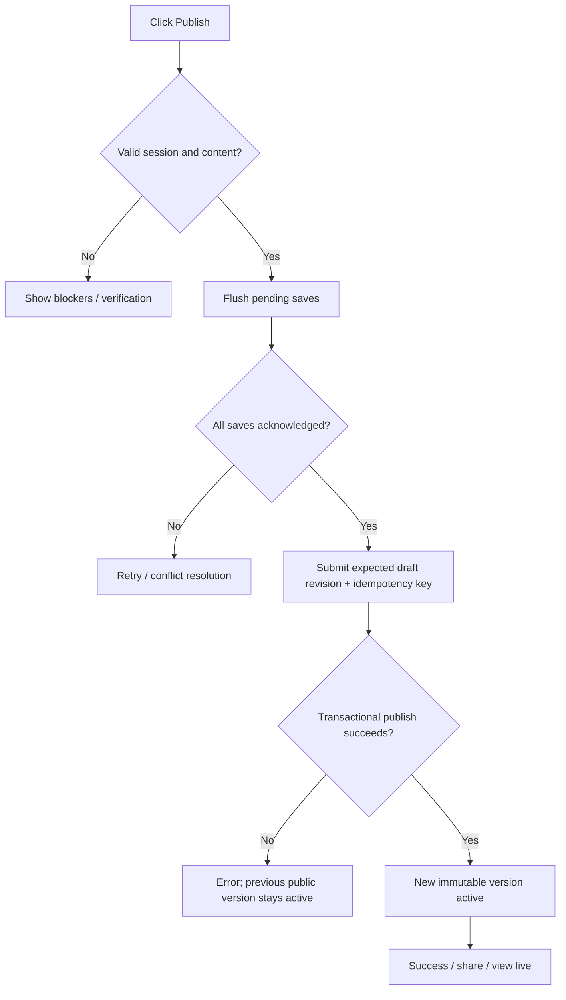
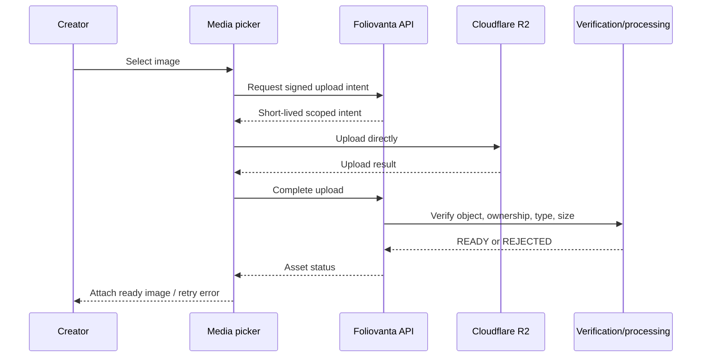

# Foliovanta — Application Flow & User Navigation Specification

> **Document:** `APP_FLOW.md`  
> **Version:** 1.0 — comprehensive navigation and interaction baseline  
> **Date:** 21 October 2026  
> **Status:** Design specification for review; no routes, UI, integrations, or behavior have been implementation-verified  
> **Inputs:** `PRD.md` v1.0; `TRD.md` v1.0; agreed architecture decisions  
> **Next companion documents:** `UI_UX_DESIGN_BRIEF.md`, `BACKEND_SCHEMA.md`, `IMPLEMENTATION_PLAN.md`

---

## 1. Purpose and authority

This document defines **how people navigate and interact with Foliovanta**, from first visit to published portfolio, including authentication, onboarding, editing, saving, previewing, publishing, version management, account settings, public visitors, abuse reports, and Super Admin operations. It specifies routes, guards, transitions, state-dependent UI, error/recovery paths, and testable navigation outcomes. It is intended for product, UX, frontend, backend, QA, and security review.

- **PRD:** owns product scope, outcomes, and business requirements.
- **TRD:** owns architectural constraints, technology, security, and technical behavior.
- **APP_FLOW:** owns navigation, screen-level interaction and state transitions.
- **UI/UX brief:** will own detailed layouts, visual hierarchy, responsive behavior, and component design.
- **Backend schema / API contracts:** will own exact persistence and request/response schemas.

**Labels:** **Agreed** = established product/architecture direction; **Baseline** = recommended default used for planning; **Proposed** = not yet approved; **Open** = needs a decision; **Future** = not part of MVP; **Verified** = only after executable testing. Nothing in this document is Verified.

**Core UX invariants:** (1) Unpublished draft edits never become public; (2) a successful save indicator means the server committed the change; (3) a stale editor cannot silently overwrite a newer revision; (4) publish is blocked until the latest intended edits are acknowledged; (5) a hidden section retains its data; (6) changing templates does not delete canonical content; (7) suspension/account restrictions override published status; (8) protected routes and mutations require server authorization, not only client redirects; (9) all recoverable failures offer a useful next action; (10) no navigation silently discards pending edits.

---

## 2. Product surfaces, origins, and navigation boundaries

| Surface | Proposed origin | Audience | Authentication | Primary purpose |
|---|---|---|---|---|
| Marketing | `https://foliovanta.com` | Anyone | None | Product information and template discovery |
| Creator application | `https://app.foliovanta.com` | Signed-in creators | Clerk-managed session | Onboarding, dashboard, editor, publishing, settings |
| Super Admin | `https://app.foliovanta.com/admin` | Authorized Super Admin | Clerk + DB role and account status | Operations, moderation, feedback, audit |
| Public portfolios | `https://<slug>.foliovanta.com` | Anyone | None | Published, SEO-indexable portfolio |

**Agreed:** one Next.js modular monolith; separate logical UI/server responsibilities, not independent FE/BE deployments. **Baseline:** marketing and creator app use the origins above. **Pending PoC:** Vercel wildcard DNS/TLS, host routing, reserved-subdomain enforcement, Clerk origin/session configuration and cache behavior. Do not assume cookies or auth state are automatically shared across origins; use Clerk-supported cross-origin flows and explicit redirect destinations.

### 2.1 Route interpretation

The paths in this document are **canonical UX route proposals**, consistent with the PRD. They are not a commitment to specific Next.js App Router route groups. Some screens can be nested routes or shared-shell panels. The chosen implementation must preserve bookmarkable URLs, browser back/forward behavior, refresh recovery, and accessible deep links.

### 2.2 Public versus private data boundary

- Marketing and published portfolio content are public.
- Dashboard, onboarding, editor, preview, settings, and private version history are authenticated and owner-scoped.
- `/admin/**` is Super Admin only; hide navigation for unauthorized users **and** enforce authorization on every server read/mutation.
- Public portfolio resolution uses only the active immutable published snapshot and current eligibility; it never reads mutable draft records to render content.
- User-provided redirects must be validated against an allowlist of internal destinations; never redirect to an arbitrary external URL based on untrusted query parameters.

---

## 3. Roles, account states, and navigation permissions

| Actor | Can visit marketing | Can create/edit own draft | Can publish | Can see published site | Can access `/admin` |
|---|---|---|---|---|---|
| Anonymous visitor | Yes | No | No | Yes, if eligible | No |
| Signed-in, unverified creator | Yes | Baseline: yes | No until verified | Yes | No |
| Verified active creator | Yes | Yes | Yes, if valid and within quotas | Yes | No |
| Suspended/restricted creator | Yes | According to restriction policy | No | Own public site may be unavailable | No |
| Super Admin | Yes | Own portfolio if also creator | According to creator policy | Yes | Yes |

**Agreed:** Clerk handles identity/session, internal PostgreSQL User controls roles/status, and ownership is checked server-side. **Baseline:** email verification gates publication, not drafting; exact account-restriction actions require policy sign-off. An admin does not acquire blanket draft-edit privileges simply by viewing an admin record; privileged moderation actions are separate, audited operations.

### 3.1 Session and authorization states

| State | UI/navigation response | Server rule |
|---|---|---|
| Unknown session (initial load) | Show bounded loading/skeleton; no protected-content flash | Verify via Clerk server integration |
| Signed out | Redirect private route to `/sign-in` with safe return target | Protected data inaccessible |
| Signed in, internal user not yet provisioned | Show bootstrap/retry state; reconcile user | Never infer ownership from Clerk ID alone |
| Signed in, onboarding incomplete | Route to next appropriate onboarding step; allow safe navigation to permitted screens | Enforce only genuinely required steps |
| Signed in, active | Open requested authorized route | Verify owner/role/status |
| Signed in, wrong owner | Show generic not-found or access-denied according to privacy policy | Return 403/404; no cross-tenant data |
| Session expired while editing | Preserve unsaved work locally where feasible; request re-auth; retry safely | Do not commit unauthorized mutation |
| Super Admin role revoked mid-session | Remove admin UI and deny next admin request | Fresh DB-backed role/status check |

**Baseline:** keep a safe `returnTo` value across sign-in and restore it after authorization. If the target no longer exists or is not permitted, go to `/dashboard`. Never bounce endlessly between `/sign-in`, onboarding and dashboard.

---

## 4. Global navigation and shared shells

### 4.1 Marketing shell

- Brand/home link; template gallery; primary CTA “Create your portfolio”; sign-in link.
- Desktop navigation and mobile menu are responsive and keyboard accessible.
- Authenticated users selecting the primary CTA go to dashboard or resume onboarding; anonymous users enter sign-up.
- Template previews can be explored without an account; choosing a template for personal use can preserve a validated `templateId` through authentication.

### 4.2 Creator application shell

- Persistent access to Dashboard, Editor, Preview/Publish, Settings, Feedback, and account controls where appropriate.
- Display current portfolio name/status, save status, and a prominent publish/update action within the editor context.
- The editor uses a shared shell with section navigation and responsive preview. Section changes must not destroy pending edits.
- Avoid presenting publish as successful until the server returns a committed published version.

### 4.3 Super Admin shell

- Distinct layout and navigation; users, portfolios, feedback, reports, audit logs; advanced analytics/settings remain future.
- Show administrative identity and audit-sensitive actions clearly; destructive/restrictive actions require confirmation and a reason.
- Do not mix creator and admin navigation in a way that implies shared privileges.

### 4.4 Universal navigation behavior

- Browser back/forward, refresh, direct deep links, and opening in a new tab must preserve the correct screen and authorization state.
- Use semantic links for navigation and buttons for actions; support keyboard operation and visible focus.
- Loading, empty, success, validation, conflict, offline, forbidden, and unexpected-error states are first-class screens/states.
- Preserve the last valid editor section on reload where supported; otherwise redirect to a safe editor entry.
- Explicitly distinguish **Saved draft**, **Published**, and **Live site**. They are not interchangeable.

---

## 5. Route inventory and route guards

All paths below are proposed canonical paths; the public portfolio origin is host-based.

| ID | Path / surface | Screen or state | Access | Entry / fallback |
|---|---|---|---|---|
| M01 | `/` (marketing) | Landing | Public | CTA → sign-up/dashboard |
| M02 | `/templates` | Template gallery | Public | Template detail / CTA |
| M03 | `/templates/[templateId]` | Template details/live demo | Public | Unknown ID → 404 |
| A01 | `/sign-up` | Clerk sign-up | Guest preferred | Signed-in → intended destination |
| A02 | `/sign-in` | Clerk sign-in | Guest preferred | Signed-in → intended destination |
| A03 | Provider callback/verification | Clerk-managed intermediate state | Auth flow | Success/failure routing |
| O01 | `/onboarding/welcome` | Persona/goal selection | Signed-in | Next/profile or skip |
| O02 | `/onboarding/profile` | Basic identity/headline | Signed-in | Continue/background |
| O03 | `/onboarding/background` | Experience/education/skills starter | Signed-in | Continue/projects or skip |
| O04 | `/onboarding/projects` | Initial projects | Signed-in | Continue/template or skip |
| O05 | `/onboarding/template` | Choose initial template | Signed-in | Create/complete → dashboard/editor |
| D01 | `/dashboard` | Portfolio overview | Signed-in | Onboarding/empty/portfolio states |
| E01 | `/editor/profile` | Profile editor | Owner | Shared editor shell |
| E02 | `/editor/about` | About editor | Owner | Shared editor shell |
| E03 | `/editor/experience` | Experience editor | Owner | Shared editor shell |
| E04 | `/editor/education` | Education editor | Owner | Shared editor shell |
| E05 | `/editor/projects` | Projects editor | Owner | Shared editor shell |
| E06 | `/editor/skills` | Skills editor | Owner | Shared editor shell |
| E07 | `/editor/certifications` | Certifications editor | Owner | Shared editor shell |
| E08 | `/editor/contact` | Contact/social editor | Owner | Shared editor shell |
| E09 | `/editor/design` | Template, palette, fonts, styling | Owner | Shared editor shell |
| E10 | `/editor/layout` | Sections visibility/order/layout | Owner | Shared editor shell |
| P01 | `/preview` | Private full portfolio preview | Owner | Return to editor / publish |
| P02 | `/publish` | Publish readiness/review | Owner | Publish or fix blockers |
| P03 | `/publish/success` | Publication confirmation | Owner | View site / share / edit |
| S01 | `/settings/portfolio` | Portfolio settings | Owner | Slug/status/settings |
| S02 | `/settings/portfolio/versions` | Version history/rollback | Owner | Version detail/confirm rollback |
| S03 | `/settings/account` | Account/profile/delete controls | Signed-in | Account actions |
| F01 | `/feedback` | Product feedback | Signed-in baseline | Submit success/error |
| U01 | `<slug>.foliovanta.com/` | Public published portfolio | Public if eligible | Render snapshot |
| U02 | Public not-found/unavailable | Invalid/unpublished/suspended | Public | Correct status, privacy-safe message |
| AD01 | `/admin` | Admin overview | Super Admin | KPIs/queues |
| AD02 | `/admin/users` | User list/search | Super Admin | User detail |
| AD03 | `/admin/users/[id]` | User detail/actions | Super Admin | Audit action |
| AD04 | `/admin/portfolios` | Portfolio list/search | Super Admin | Portfolio detail |
| AD05 | `/admin/portfolios/[id]` | Portfolio detail/moderation | Super Admin | Suspend/reinstate |
| AD06 | `/admin/feedback` | Feedback triage | Super Admin | Status updates |
| AD07 | `/admin/reports` | Abuse report queue | Super Admin | Investigation/action |
| AD08 | `/admin/audit-logs` | Audit log explorer | Super Admin | Filter/details |
| FUT | `/admin/analytics`, `/admin/settings` | Advanced admin capabilities | Future | Not in MVP navigation |

**Open:** whether routes include a portfolio identifier (`/editor/[portfolioId]/...`) or use the current single portfolio implicitly. **Baseline for MVP:** single-portfolio-friendly URLs as shown; keep service/API contracts portfolio-ID-based for future multi-portfolio support. Decide route strategy before implementing link generation.

---

## 6. End-to-end flow map



**Flow rule:** a template preview is not the user's published portfolio; a private preview is not public; a saved draft is not a published version.

---

## 7. Marketing and template discovery flows

### 7.1 Landing page (`M01`)

**Entry:** direct URL, search engine, social link, marketing campaign.  
**Content:** value proposition, benefits, representative templates, how it works, FAQ/CTA as approved by UI/UX.  
**Actions:** Explore Templates → `M02`; Create Portfolio → authentication/resume resolver; Sign In → `A02`.  
**States:** normal, slow asset loading, broken external asset fallback, mobile menu expanded.  
**Acceptance:** all CTAs resolve to safe destinations; unauthenticated users can browse without Clerk prompts.

### 7.2 Template gallery (`M02`)

- Show three MVP templates: **Minimal**, **Professional**, **Creative**.
- Cards show meaningful preview, supported characteristics, and an action to view details or select.
- Template gallery is public; choosing a template for a personal portfolio requires sign-in and then persists the selection through onboarding when possible.
- Invalid/retired template selections fall back to the template picker with an explanation, never silently replace a selected template during publish.

### 7.3 Template detail (`M03`)

- Preview representative sample data, responsive variants, and supported visual customization controls.
- Actions: back to gallery, select template, create portfolio.
- Template demos must not leak private creator data; use static curated samples.
- Unsupported template ID → true 404; retired template may show an unavailable explanation and alternatives.

---

## 8. Authentication, session, and account bootstrap flows

### 8.1 Sign-up (`A01`)

1. User selects Create Portfolio.
2. App checks existing session server-side; if signed in, resolve next destination.
3. Otherwise show Clerk-supported Google and email/password sign-up.
4. Clerk completes identity creation and verification workflow as configured.
5. App reconciles Clerk identity to internal `User` record idempotently.
6. User returns to a safe saved destination or onboarding start.

**Failure handling:** canceled provider flow returns to sign-up; duplicate email follows Clerk account guidance; unavailable identity provider shows retry; internal user bootstrap failure shows a non-destructive retry screen; never fabricate a successful internal account.

### 8.2 Sign-in (`A02`)

1. User visits sign-in directly or from a protected route.
2. Clerk authenticates and establishes managed session.
3. Server resolves internal account and account status.
4. Redirect to validated `returnTo` if authorized; otherwise resume onboarding or dashboard.

**Special cases:** already signed-in user; session expired; wrong account after account switch; disabled account; repeated redirect attempts. Prevent open redirects and loops.

### 8.3 Email verification

**Agreed baseline:** users may prepare drafts while unverified, but **Publish** is blocked until verified. Show clear verification status, resend affordance via Clerk-supported flow, and return to publish readiness after successful verification. Do not create a second homemade verification-token system.

### 8.4 Sign-out

- Confirm or immediately execute depending on UI policy; if unsaved edits exist, warn and offer save/retry/cancel before ending the session.
- Clerk clears the session; app clears or invalidates user-specific TanStack Query caches, editor state and any sensitive recovery state.
- Redirect to marketing or sign-in; no authenticated content remains visible after account switch or logout.

### 8.5 Account switching and expired session

- Revalidate identity on protected transitions and mutations.
- If identity changes while the editor is open, stop pending writes for the old account, isolate unsaved content, clear old user cache and redirect appropriately.
- On expiration, show a sign-in recovery route; do not silently discard unsaved edits or retry mutations under another account.

---

## 9. Onboarding flow (`O01`–`O05`)

### 9.1 Goals

Get users to a publishable portfolio quickly, with optional enrichment. Onboarding is a **guided shortcut**, not a mandatory exhaustive resume form.



**Agreed:** persona, profile, optional background, optional projects, template choice; optional steps skippable. **Open:** exact minimum profile fields and whether onboarding creates a portfolio before or after template choice. **Baseline:** create a draft portfolio early and update it incrementally, with idempotent initialization to avoid duplicate portfolios.

### 9.2 Welcome/persona (`O01`)

- Options reflect students, developers, designers, freelancers and professionals.
- Selection can influence helpful copy/defaults but must not lock content sections or templates.
- Continue/skip saves the current progress marker and proceeds.

### 9.3 Profile (`O02`)

- Capture display name and optional headline/bio/location/avatar according to finalized field requirements.
- Inline validation; preserve input on transient failures; show progress.
- Next → background; Back → welcome; optional fields can be skipped.

### 9.4 Background (`O03`)

- Add experience, education, skills using repeatable controls; no fixed schema limit on item count.
- Add/edit/remove/reorder as relevant; validate each item before save.
- Skip preserves prior entries and moves to projects.

### 9.5 Projects (`O04`)

- Add zero or more projects with title, description, links, and optional media; exact fields follow backend schema.
- Provide skip, add another, edit and remove; explain that projects can be added later.
- Upload failures should not force restarting onboarding.

### 9.6 Template (`O05`)

- Select Minimal, Professional, or Creative; show preview with entered content where feasible.
- Preserve previously selected marketing template if still supported.
- Confirm template, persist design default and complete onboarding; go to dashboard or editor per finalized first-run UX.
- If template becomes unavailable, require a new explicit selection.

### 9.7 Interrupted/resumed onboarding

- Reload, sign-out/sign-in, tab close, and transient network errors must resume from persisted progress.
- Returning users with completed onboarding should not be forced through it again.
- Invalid step URLs redirect to nearest valid step or dashboard.
- Users may revisit/edit onboarding information through the normal editor.

---

## 10. Dashboard flow (`D01`)

### 10.1 Dashboard states

| State | Visible information | Primary action | Secondary actions |
|---|---|---|---|
| No portfolio | Welcome/empty state | Create portfolio | Browse templates |
| Draft, never published | Draft status, last save, template | Continue editing | Preview, publish |
| Published, no pending edits | Public URL, live status, last publish | View live site | Edit, share, versions |
| Published with unpublished edits | Live version plus pending draft indicator | Review & publish update | Edit, preview, versions |
| Unpublished | Site unavailable indicator; history retained | Publish again | Edit, versions |
| Suspended/restricted | Clear policy-safe restriction message | View permitted details / appeal path if offered | Contact support |
| Load failure | Retry state | Retry | Support link if needed |

**Important:** the dashboard must not call a draft “live” merely because it has autosaved. Show the difference between **Last saved** and **Last published**.

### 10.2 Dashboard actions

- **Edit portfolio:** open shared editor at last valid section or profile.
- **Preview:** open private draft preview; server checks owner.
- **Publish / Update live site:** open readiness screen; not a direct optimistic success.
- **View live:** external/new-tab public URL only if eligible.
- **Versions:** open history; rollback subject to authorization and policy.
- **Settings:** portfolio settings; account settings.
- **Feedback:** submit product feedback.

---

## 11. Shared editor architecture and navigation (`E01`–`E10`)

### 11.1 Shared editor shell

**Agreed:** structured forms, not freeform page builder. The shell provides section navigation, main editing area, preview, save status, and publish access. Desktop may use a side-by-side layout; mobile uses a responsive editor/preview switch (exact breakpoints in UI/UX brief).

**Editor navigation groups:** Content (Profile, About, Experience, Education, Projects, Skills, Certifications, Contact), Appearance (Design), Structure (Layout). Each group supports direct deep links and keyboard access.

### 11.2 Section-level interaction contract

Each editor section must support: load current saved values; edit; inline validation; add/remove/reorder repeatable items where relevant; update immediate local preview; autosave; display save status; navigate without data loss; retry on failure; restore after refresh; and show permission/ownership errors safely.

| Screen | Main interactions | Important constraints |
|---|---|---|
| `E01` Profile | Name, headline, location, avatar | Publishing minimums and media ownership |
| `E02` About | Bio/intro and optional structured text | Safe formatting; no arbitrary HTML |
| `E03` Experience | Add/edit/delete/reorder jobs | Date validation; optional current role |
| `E04` Education | Add/edit/delete/reorder education | Date and field validation |
| `E05` Projects | Add/edit/delete/reorder/feature projects, media/links | URL validation; quotas; asset readiness |
| `E06` Skills | Add/edit/delete/reorder/group skills | Canonical names/ordering; quotas |
| `E07` Certifications | Add/edit/delete/reorder credentials | URL/date validation |
| `E08` Contact | Social links, contact destinations | Safe external links; no secrets in public snapshot |
| `E09` Design | Template, palette, fonts, spacing, radius, supported variants | Validated design tokens; no content loss |
| `E10` Layout | Section visibility/order and allowed layout variants | Hidden content retained; valid section keys |

### 11.3 Dynamic repeatable content

- “Add another” creates a stable local item identity; server assigns/returns stable persisted ID.
- Reorder uses keyboard-accessible interactions in addition to pointer drag-and-drop.
- Deletion of a draft item must not delete media still referenced by a published version.
- Quotas are configurable, enforced server-side and explained in UI. Do not hardcode fixed project/skill columns or imply infinite resources.
- Quota reached → disable further additions with actionable explanation, while retaining editing/removal access.

### 11.4 Design/template switching

1. User opens Design and chooses a supported template.
2. Local preview renders canonical content with the new template and validated design tokens.
3. User adjusts supported palette, typography, spacing, radius, theme, and layout options.
4. Changes autosave to draft; live published site remains unchanged.
5. Unsupported overrides are reset to documented defaults or flagged for review; never silently erase content.
6. User explicitly publishes to apply changes publicly.

**Open:** exact per-template control matrix and rich-text support. No arbitrary CSS/JavaScript injection or unconstrained visual editor.

### 11.5 Section visibility/order

- Hide a section → remove it from draft preview and future published snapshot rendering, **not** from stored draft data.
- Re-enable → restore existing content and prior reasonable position.
- Reorder → update draft revision; show result immediately in preview.
- Required system sections or inaccessible configurations must be validated server-side.

---

## 12. Autosave, preview, conflicts, and navigation safety

### 12.1 State model

| State | Meaning | UI treatment | Allowed actions |
|---|---|---|---|
| `saved` | All current edits acknowledged by server | “Saved” + optional timestamp | Navigate, preview, publish |
| `dirty` | Unsaved local changes | “Unsaved changes” | Continue editing; queue save |
| `saving` | Mutation in flight | “Saving…” | Continue editing; queue next patch |
| `offline` | Connection unavailable | “Offline — changes not saved” | Edit locally; retry when online |
| `error` | Save failed | Error + retry | Retry, continue carefully |
| `conflict` | Expected revision stale | Conflict resolution UI | Reload/reconcile; publish blocked |
| `unauthorized` | Session/account no longer eligible | Sign-in/recovery | No server mutation |

A “Saved” label is shown only after successful committed acknowledgement, not merely after a debounce timer.

### 12.2 Standard autosave flow

```mermaid
sequenceDiagram
    participant U as Creator
    participant F as Editor form
    participant C as Autosave coordinator
    participant A as API/service
    participant DB as PostgreSQL
    U->>F: Change field
    F->>C: Mark dirty; update preview
    C->>C: Debounce / queue changes
    C->>A: PATCH draft(expectedRevision, mutationId, changes)
    A->>DB: Atomic compare-and-swap + content transaction
    DB-->>A: Committed new revision
    A-->>C: revision + savedAt
    C-->>F: Acknowledge only included changes
    F-->>U: Saved (if no newer changes)
```

**Agreed baseline:** one in-flight save per portfolio draft, newer edits coalesced, monotonic revisions, mutation idempotency. Exact payloads will be specified in WP-03.

### 12.3 Switching sections while dirty

- Editor shell owns the save coordinator across section unmounts.
- Section navigation queues or flushes pending changes; it must not discard the active form's dirty values.
- If an unrecoverable save error/conflict exists, the user may continue locally, but must see a persistent warning and cannot publish.
- Hard navigation or closing the tab should warn when unacknowledged edits remain; a browser warning is not a persistence guarantee.

### 12.4 Multi-tab conflict flow

1. Tab A and Tab B load revision 12.
2. Tab A commits revision 13.
3. Tab B attempts mutation with expected revision 12.
4. Server returns 409; Tab B enters `conflict`.
5. UI explains another tab/device updated the draft; retains Tab B's local edits.
6. Offer reload latest, review/reconcile changes, or copy unsaved content as an escape hatch.
7. Do **not** automatically overwrite the latest server version or silently merge ambiguous changes.

`BroadcastChannel` may proactively signal another local tab, but server revision checks are authoritative.

### 12.5 Lost acknowledgement / duplicate save

- If a save committed but response was lost, retry with the **same mutation ID** and request fingerprint.
- Server returns the original committed outcome; it must not apply the patch twice or produce a false conflict.
- If payload differs for an already-used mutation ID, return a deterministic idempotency error.

### 12.6 Offline/reload recovery

- Keep unsaved work in memory while the page remains open; show explicit offline/error state.
- **Proposed:** persist a scoped, time-limited local recovery draft for accidental tab closure, excluding sensitive authentication data; encrypting browser-local data is not a substitute for server security. Exact privacy/retention policy requires approval.
- On reconnect, fetch latest revision before replaying pending writes; if stale, enter conflict resolution.
- Never claim an offline edit is saved to the server.

### 12.7 Preview modes

| Preview | Route/context | Source | Auth | Can be indexed? |
|---|---|---|---|---|
| Inline live preview | Editor shell | Saved draft + current unsaved changes | Owner | No |
| Full private preview | `/preview` | Owner-scoped draft; unsaved changes must be transferred or saved first | Owner | No |
| Template gallery demo | Marketing template detail | Curated sample data | Public | According to marketing SEO |
| Live public portfolio | `<slug>.foliovanta.com` | Active published snapshot only | Public if eligible | Yes if allowed |

**Baseline:** entering a separate full preview route flushes pending edits or carries a validated local projection explicitly. Do not show stale content without indicating that unsaved changes are excluded.

---

## 13. Publish readiness, publication, and post-publish flows

### 13.1 Publish readiness (`P02`)

The readiness screen summarizes portfolio title, template, public URL, content/design preview, current draft revision, verification state, policy/quota status, and blockers.

**Blocking conditions:** not authenticated/authorized; unverified email (baseline); missing minimum fields; invalid design/content; unresolved autosave; revision conflict; asset still processing where required; restricted account/portfolio; unsupported template version; service failure.

**Warnings (nonblocking):** optional sections empty, incomplete SEO description, no project images, incomplete social links. Final warning catalog belongs to product review.

### 13.2 Publish flow



**Required behavior:** disable duplicate publish submissions while pending; server checks expected revision and eligibility; creates validated snapshot and active-version pointer atomically; records audit/outbox; returns committed version. Cache invalidation follows commit; UI may show a propagation/pending state if public delivery is not yet confirmed.

### 13.3 Publish success (`P03`)

- Show canonical public URL and actions: Open live site, Copy link, Share (where supported), Continue editing, View versions.
- Show version/time and any propagation caveat. Do not claim instant worldwide cache freshness unless verified.
- A failed copy/share action must not invalidate the successful publish.

### 13.4 Updating an already published portfolio

1. User edits draft; dashboard/editor shows unpublished changes.
2. Existing public site remains on previous snapshot.
3. User previews and republishes after save acknowledgement.
4. New snapshot becomes active atomically; version history retains prior version.

### 13.5 Unpublish

- User selects Unpublish from an authorized setting/action.
- Confirm public visibility impact.
- Server updates publication state; history remains.
- Public resolver immediately checks eligibility; CDN/cache invalidation is triggered.
- Dashboard displays Unpublished and a clear Republish action.

### 13.6 Rollback/version history (`S02`)

- List versions with version number, publish date, template and optional actor/summary.
- Selecting a version shows an owner-only historical preview (never indexed).
- Rollback confirmation explains it changes **live version**, not the current editable draft.
- Server checks version belongs to portfolio and actor is authorized, then atomically changes active pointer and audits the action.
- **Open:** whether rollback also restores draft. **Baseline:** no automatic draft overwrite; offer a separate explicit “Restore version to draft” workflow later if needed.
- If a historical snapshot/template renderer is incompatible, disable rollback with an explanation and remediation path.

---

## 14. Portfolio settings and account management

### 14.1 Portfolio settings (`S01`)

- Display canonical slug/public URL, publication status, current template, indexing preferences where supported, and relevant portfolio controls.
- **Baseline:** slug immutable after allocation in MVP; show read-only slug. Future slug change requires redirect, uniqueness and SEO migration design.
- Unpublish action and access to versions; destructive actions require confirmation.
- Explain difference between unpublish and delete.

### 14.2 Version history (`S02`)

Covered in §13.6; must show both active version and historical versions, including an empty state before first publish.

### 14.3 Account settings (`S03`)

- Display internal profile/account details and verified email state from Clerk as appropriate.
- Authentication credential changes are delegated to Clerk-supported account-management flows.
- Sign out, feedback access, account deletion request.
- Deletion flow: explain impact on public site, drafts, media, versions, and recovery; require deliberate confirmation; execute server-authorized lifecycle transition.
- **Open:** recovery window, irreversible erasure timing, backup retention and legal/compliance requirements.

### 14.4 Account restriction and deletion states

- Restricted account: block disallowed mutations; explain support/appeal route if provided.
- Soft-deleted account: block login-to-app access or redirect to recovery flow according to policy; public portfolio unavailable.
- Permanent erasure: asynchronously remove/anonymize eligible data with observable status; do not promise instant erasure from immutable backups.

---

## 15. Media upload and management flows

### 15.1 Upload sequence



### 15.2 UI states and rules

- Selecting a file performs client-side early validation for user feedback; server validation remains authoritative.
- Show upload progress where supported; allow cancel/retry; preserve the associated form fields.
- Reject unsupported file type, oversized file, invalid dimensions, quota exhaustion, or failed content verification with specific guidance.
- Processing assets show a pending state; only `READY` assets can be used in a publishable snapshot.
- Removing an image from the draft detaches it; storage garbage collection must preserve media referenced by active or retained published versions.
- Image cropping is optional and must not distort the original; exact editor UI and image delivery strategy remain in UI/UX/TRD follow-up.

---

## 16. Public portfolio visitor flow (`U01`–`U02`)

### 16.1 Request resolution

1. Anonymous visitor opens `<slug>.foliovanta.com`.
2. Server validates hostname and reserved-slug policy.
3. Resolve portfolio by canonical slug.
4. Check owner/account eligibility, portfolio publication and moderation states.
5. Resolve active published version and compatible renderer.
6. Render responsive public portfolio with SEO metadata, canonical URL, OG and structured data.
7. Record privacy-compliant analytics where applicable.

**Do not redirect an invalid public slug to another creator's portfolio.** Do not reveal private moderation reasons or draft content to visitors.

### 16.2 Visitor interactions

- Browse visible sections in configured order; use accessible navigation/anchors where the template supports them.
- Open project and social links safely (validate URL protocols; external links use appropriate `rel` attributes).
- Use mailto/contact link as supported; **Open:** whether a native contact form is in MVP (baseline: external links/mailto, not a custom messaging backend).
- Share portfolio URL; browser back/forward works naturally.
- Optional abuse-report entry point according to final policy.

### 16.3 Public status behavior

| Condition | Public response | SEO behavior |
|---|---|---|
| Valid, published, clear, active owner | Render snapshot, 200 | Canonical/index per settings |
| Unknown/invalid slug | Not found, 404 | Noindex |
| Draft never published | Not found/unavailable, 404 baseline | Noindex |
| Unpublished | Not found/unavailable, 404 baseline | Noindex |
| Suspended | Generic unavailable response; status policy TBD | Noindex; no private reason |
| Soft-deleted/ineligible owner | Generic unavailable, 404/410 per policy | Noindex |
| Renderer/version incompatibility | Safe error page; alert operations | No draft fallback; avoid accidental indexing |
| Backend outage | Appropriate 5xx/fallback | Do not return misleading 200 empty page |

**Open:** exact HTTP status and public wording for suspended/deleted content; coordinate SEO, legal, privacy and abuse requirements. Public cache invalidation must be designed so moderation takes effect promptly.

### 16.4 Public performance and accessibility

- Server-rendered meaningful content, optimized media, mobile-first layout, keyboard navigation, semantic headings and appropriate contrast.
- Respect reduced-motion preferences; avoid animations that block content.
- Do not inject untrusted custom CSS/JS into the public renderer.
- Visitor analytics must not block rendering or leak sensitive creator/editor data.

---

## 17. Feedback and abuse reporting

### 17.1 Product feedback (`F01`)

- Signed-in creator opens Feedback from app navigation.
- Choose feedback category (proposed), enter message and optionally related context; validation prevents empty/oversized submission.
- Submit → pending → success confirmation; errors retain entered text and offer retry.
- Server records feedback with appropriate ownership/metadata and abuse/rate-limit protections.
- **Open:** attachments, anonymity, categories, and whether feedback is available to anonymous visitors.

### 17.2 Public abuse report

- Visitor chooses Report on a published portfolio if product policy includes this entry point.
- Explain what can be reported, collect reason/details and any required verification/captcha.
- Submission returns neutral acknowledgement; do not expose investigation status or reporter identity.
- Rate limit and abuse-protect anonymous submissions; moderation queue receives report.
- **Open:** anonymous versus authenticated reporting and reporter privacy policy.

---

## 18. Super Admin application flows (`AD01`–`AD08`)

### 18.1 Admin entry and authorization

1. Signed-in user requests `/admin`.
2. Server resolves internal user role and active account status.
3. If Super Admin → render admin shell and overview.
4. Otherwise deny access; do not render admin data or rely on hidden menu links.
5. Recheck authorization on every admin API operation and sensitive server render.

### 18.2 Overview (`AD01`)

- Operational summary: user/portfolio counts, moderation queue, recent feedback, system indicators available in MVP.
- Advanced behavioral analytics dashboards are **Future**; do not require them for initial admin release.
- Cards link to filtered user, portfolio, feedback, and reports lists.

### 18.3 User management (`AD02`, `AD03`)

- Search/filter/paginate users; inspect account status and associated portfolios.
- Open user detail; review permitted fields, history and relevant moderation context.
- Restrict/reactivate where policy allows, with reason and confirmation; record audit event.
- Prevent accidental privilege escalation, self-lockout and unsafe Super Admin role changes; exact policy to be specified in security document.

### 18.4 Portfolio management (`AD04`, `AD05`)

- Search/filter portfolios by slug, owner, publication state, moderation state and report count.
- Inspect safe summary and current public version; draft access is restricted to explicit privileged policy, not implicit.
- Suspend/reinstate with reason, confirmation and audit record.
- Public eligibility must change independently of whether the portfolio has a published version.
- Reinstatement does not automatically create a new publication or bypass other account restrictions.

### 18.5 Feedback triage (`AD06`)

- List feedback, inspect details, filter by status/category, assign or update triage status where supported.
- Record administrative changes; do not expose feedback publicly.

### 18.6 Abuse report queue (`AD07`)

- Filter new/in-review/resolved reports; inspect reported public resource and reason.
- Record investigation status, decision and moderation action where authorized.
- Prevent duplicate action effects; audit who acted, when and why.

### 18.7 Audit log explorer (`AD08`)

- Filter by actor, resource, action and time; pagination and access control.
- Audit logs are append-oriented; ordinary admin UI must not permit editing or deleting entries.
- Sensitive payloads/secrets must be redacted; retention policy requires sign-off.

### 18.8 Admin failure and security states

- 401: sign-in flow; 403: access denied; 404: missing record; 409: concurrent state change; 429: throttled; 5xx: safe retry/error page.
- Admin action success requires server confirmation; stale lists refresh after mutation.
- Revoked role mid-session immediately blocks subsequent requests and hides privileged navigation after revalidation.

---

## 19. Notification and system feedback flow

| Event | UX channel | Rule |
|---|---|---|
| Draft saving | Inline persistent status | Never use a transient toast as sole save indicator |
| Draft saved | Inline status, optional subtle feedback | Only after server acknowledgement |
| Save failed/conflicted | Persistent error with action | Must remain visible until resolved |
| Publish success | Dedicated success screen | Include canonical URL and next actions |
| Publish failed | Inline/page error | Keep prior live version and draft intact |
| Upload complete/failed | Progress and local status | Retry/cancel where safe |
| Account verification needed | Inline gate / Clerk flow | Explain how to proceed |
| Admin moderation action | Confirmation and audit reference | Never optimistic success for high-impact action |
| Product announcements | Optional email/in-app later | Respect consent/preferences |

**Baseline tools:** Sonner for transient UI feedback, Clerk for auth-related email, transactional email provider (Resend candidate) only for actual MVP use cases. Persistent notification inbox, realtime delivery and browser push are **Future** unless justified by scope.

---

## 20. Navigation decision tables

### 20.1 Post-authentication destination

| Authenticated? | Account status | Onboarding | Requested destination | Result |
|---|---|---|---|---|
| No | — | — | Protected URL | Sign-in, preserve safe return |
| Yes | Bootstrap pending | — | Any private URL | Provision/retry screen |
| Yes | Restricted | Any | Restricted operation | Restricted state |
| Yes | Active | Incomplete | Default app entry | Resume onboarding |
| Yes | Active | Complete | Authorized deep link | Requested route |
| Yes | Active | Complete | Unauthorized deep link | 403/404; safe fallback |
| Yes | Active | Complete | No deep link | Dashboard |
| Yes, Super Admin | Active | Any | `/admin` | Admin shell |
| Yes, non-admin | Active | Any | `/admin` | Access denied |

### 20.2 Editor → preview → publish

| Current condition | Preview allowed? | Publish allowed? | User-facing resolution |
|---|---|---|---|
| Dirty, save queued | Inline yes; full preview depends on transfer/flush | Not until acknowledged | Saving… |
| Saved, valid, verified | Yes | Yes | Review and publish |
| Saved, missing required field | Yes with warnings | No | Jump to invalid section |
| Save failed | Local inline preview yes | No | Retry save |
| Revision conflict | Local inline preview yes | No | Resolve conflict |
| Media processing | Preview placeholder yes | No if referenced required asset | Wait/retry/remove asset |
| Email unverified | Yes | No | Verify email |
| Portfolio suspended | Policy-defined private preview | No | Restricted state |
| Unsupported template version | Safe fallback/error | No | Select compatible template |

### 20.3 Public eligibility

Publicly render only when all conditions hold: valid canonical slug; eligible active owner; portfolio not suspended; publication status published; active version belongs to portfolio; snapshot/template renderer supported; content/media passes safety rules. A failure must not fall back to the current draft.

---

## 21. Accessibility, responsive and UX behavior requirements

- Meet WCAG 2.2 AA as a design/testing target where applicable; exact conformance and exceptions require accessibility review.
- All form fields have programmatic labels, help text, error associations and predictable keyboard focus.
- Errors are announced accessibly and summarized when a multi-section publish attempt fails.
- Drag-and-drop ordering must have keyboard controls and understandable screen-reader feedback.
- Modals trap focus appropriately, restore focus on close, and avoid accidental destructive defaults.
- Responsive editor provides full capability on mobile even if preview is displayed in a separate tab/panel.
- Navigation and asynchronous state changes must not unexpectedly steal focus or cause layout jumps.
- Toasts are supplemental; critical state is visible persistently.
- Skeletons have bounded loading behavior and fallback errors; avoid endless spinners.
- Public templates support reduced motion, responsive media, meaningful headings and accessible color contrast.

---

## 22. Analytics touchpoints (behavioral events)

Analytics are **not** a navigation dependency. Events should be privacy-aware and deduplicated; business events requiring reliable accounting are server-recorded, not inferred only from GA4.

| User action | Proposed event | Notes |
|---|---|---|
| Account creation | `sign_up_completed` | Server-authoritative business event |
| Onboarding started/completed | `onboarding_started`, `onboarding_completed` | Do not double count refresh |
| Template selected | `template_selected` | Template ID/version |
| Portfolio first published | `portfolio_first_published` | Idempotent server event |
| Portfolio republished | `portfolio_published` | Version and source revision |
| Portfolio unpublished | `portfolio_unpublished` | Server event |
| Portfolio viewed | `portfolio_viewed` | Privacy-aware public measurement |
| Contact/social clicked | `portfolio_contact_clicked` | Avoid sending raw personal contact data |
| Feedback submitted | `feedback_submitted` | Server event |
| Report submitted | `abuse_report_submitted` | Avoid reporter PII in analytics |
| Moderation action | `moderation_action_taken` | Audited internal event |

**Open:** exact analytics naming, consent categories, retention and GA4 event mapping. These are proposed tracking contracts, not finalized database or vendor payloads.

---

## 23. Error, empty, and exceptional-state catalog

| Scenario | Required user outcome |
|---|---|
| Unknown template or route | True 404, navigation to safe destination |
| Private route while signed out | Sign-in and safe return |
| Wrong-owner portfolio ID | Deny without leaking data |
| Missing internal account after Clerk login | Idempotent bootstrap/retry |
| Duplicate portfolio creation click | Single result via idempotency/quota enforcement |
| Autosave network timeout | Preserve edits; retry with same mutation ID |
| Concurrent tab save | 409; explicit reconciliation |
| User navigates during pending save | No silent data loss; visible state |
| Browser closes unexpectedly | Recovery behavior according to finalized local-draft policy |
| Upload signed URL expires | Request new intent; do not attach unverified asset |
| Upload succeeds but complete request fails | Safe completion retry; avoid duplicate asset |
| Quota exceeded | Explain limit; allow editing/removing existing items |
| Publish double click | One committed publication or deterministic idempotent result |
| Publish fails after old version live | Previous version remains public |
| Cache invalidation delayed | Show propagation status/monitoring; no false success claim |
| Rollback target removed/incompatible | Block safely; preserve current live version |
| Account suspended while editing | Block next mutation/publish; safe restriction UX |
| Public slug suspended | No public content/draft leak; noindex |
| Admin role revoked | Deny next admin read/mutation |
| External link invalid/unsafe | Validation error; no unsafe protocol execution |
| Analytics service unavailable | Core product navigation and publishing continue |
| Email delivery delayed | Verification status remains accurate; resend/help |
| Server unavailable | Error boundary/retry; no fake saved/published state |

---

## 24. Navigation acceptance criteria and test scenarios

The following are minimum E2E or integration acceptance scenarios; exact automated test cases belong in the Implementation Plan.

### 24.1 Anonymous and auth

- [ ] Anonymous user can browse landing, gallery and demos without signing in.
- [ ] Protected deep link redirects to sign-in and returns safely after auth.
- [ ] Malicious external `returnTo` is rejected.
- [ ] Signed-in users do not see a private-content flash before session resolution.
- [ ] Clerk user bootstrap is idempotent and handles webhook timing.
- [ ] Logout/account switch removes access to previous user's cached data.

### 24.2 Onboarding and dashboard

- [ ] User can complete onboarding with optional steps skipped.
- [ ] Interrupted onboarding resumes with persisted data.
- [ ] Template selected before sign-up is preserved when valid.
- [ ] Dashboard correctly distinguishes draft, published, unpublished, and unpublished edits.
- [ ] Multiple create requests do not bypass the one-portfolio MVP rule.

### 24.3 Editor

- [ ] Every section supports direct link, refresh, back/forward and mobile navigation.
- [ ] Repeatable entries can be added/edited/removed/reordered without schema changes.
- [ ] Hiding a section does not delete its content.
- [ ] Template switch preserves canonical content.
- [ ] Save indicator appears only after committed server acknowledgement.
- [ ] Editing during an in-flight save does not lose newer values.
- [ ] Multi-tab stale revision triggers conflict and preserves local edits.
- [ ] Failed/offline save never claims server persistence.
- [ ] Section navigation does not silently discard dirty inputs.

### 24.4 Publishing and public

- [ ] Publish blocks on unverified account, invalid data, conflict, and unsaved changes.
- [ ] Duplicate publish attempts do not create unintended duplicate versions.
- [ ] Failed publish preserves previous active public snapshot.
- [ ] Draft edits do not alter live site until republish.
- [ ] Version rollback switches active snapshot without overwriting draft.
- [ ] Unknown/unpublished/suspended public URLs do not reveal draft data.
- [ ] Public canonical/metadata/status reflect eligibility and indexing policy.

### 24.5 Media and admin

- [ ] Unsafe or unverified media cannot be published.
- [ ] Cross-owner media association is rejected.
- [ ] Admin endpoints reject non-admin users even with manually constructed requests.
- [ ] Suspension hides public portfolio while retaining history.
- [ ] Moderation actions are audited and cannot be applied twice accidentally.
- [ ] Feedback/report forms retain data after recoverable submission errors.

---

## 25. UI/UX handoff matrix

The subsequent `UI_UX_DESIGN_BRIEF.md` must define visual layouts and interaction details for the following reusable screen families rather than designing each route in isolation.

| Family | Screens | Required variants |
|---|---|---|
| Marketing | Landing, gallery, template detail | Desktop/mobile, hover/focus, loading |
| Authentication | Sign-up, sign-in, verification | Redirect, error, recovery |
| Onboarding | Five steps | Progress, skip, back, resumed, validation |
| Dashboard | Portfolio overview | Empty, draft, published, pending changes, restricted |
| Editor shell | Ten section editors | Desktop/mobile, dirty/saving/saved/offline/conflict |
| Repeatable editor | Projects, experience, education, skills, certifications, links | Add/edit/reorder/delete, quota |
| Design system | Template, colors, fonts, layout | Preview, unsupported option, reset |
| Preview/publish | Full preview, readiness, success | Blockers, retry, propagation |
| Settings | Portfolio, versions, account | Confirmations, deletion, rollback |
| Public site | Three templates | Mobile, desktop, unavailable, SEO |
| Admin | Overview, lists, detail, moderation, audit | Filters, empty, loading, errors, confirm |
| Feedback/report | Feedback and abuse report | Validation, pending, success, rate limit |

For each family provide wireframes, content hierarchy, component states, focus management, error messaging, responsive rules, and accessibility acceptance criteria. Do not design unsupported freeform page-building controls.

---

## 26. Product decisions still open

These must not be silently converted into requirements during design or development.

| ID | Decision | Current baseline | Impact |
|---|---|---|---|
| FLOW-01 | Canonical creator route strategy for future multi-portfolio | Single-portfolio paths, portfolio-ID service layer | URLs, breadcrumbs, link generation |
| FLOW-02 | Minimum publish-ready profile fields | Display name + valid template/slug/config | Onboarding, publish blockers |
| FLOW-03 | Onboarding completion destination | Dashboard or editor | First-run UX |
| FLOW-04 | Rich text scope | Plain text or restricted Tiptap | Editor, preview, sanitation |
| FLOW-05 | Native contact form | External links/mailto in MVP | Public UI, abuse/privacy |
| FLOW-06 | Slug changes | Immutable MVP | Settings, SEO, redirects |
| FLOW-07 | User-visible version retention and restore-to-draft | History/rollback; draft restore separate | Settings, billing, schema |
| FLOW-08 | Local crash-recovery storage | Proposed scoped local recovery | Privacy, offline UX |
| FLOW-09 | Anonymous abuse reports and anti-spam | Policy-defined | Public site, moderation |
| FLOW-10 | Suspended/deleted public HTTP statuses | Privacy-safe unavailable | SEO and CDN behavior |
| FLOW-11 | Email verification publish gate | Yes (baseline) | Auth/onboarding/publish |
| FLOW-12 | Quota amounts and plan presentation | Configurable, values undecided | Add flows and messaging |
| FLOW-13 | Template design control matrix | Curated/validated | Design editor and preview |
| FLOW-14 | Analytics consent and data retention | Pending privacy review | Public and creator tracking |
| FLOW-15 | Account deletion recovery/retention | Pending policy | Settings and operational jobs |
| FLOW-16 | Public portfolio path structure beyond root | Root portfolio, section anchors | SEO and routing |
| FLOW-17 | Domain/origin feasibility and cross-origin auth | Pending infrastructure PoC | Redirect/session flows |
| FLOW-18 | User/admin restriction and appeals UX | Policy-defined | Dashboard, admin, public |

---

## 27. Implementation sequencing and traceability

**Suggested dependency order:** (1) host/auth routing PoC; (2) account bootstrap/guards; (3) onboarding/dashboard; (4) editor shell and revision-aware autosave; (5) content forms/media; (6) design/template preview; (7) publish/versioning/public resolver; (8) feedback/admin; (9) accessibility, security and failure-path E2E hardening. This is dependency guidance, not a substitute for `IMPLEMENTATION_PLAN.md`.

| Flow group | PRD reference | TRD reference | Primary verification |
|---|---|---|---|
| Marketing/auth | §§6–9 | §§3–7 | Redirect/session E2E |
| Onboarding/dashboard | §§9–10 | §§6–7 | Resume/empty-state E2E |
| Editor/content | §§11–13 | §§8–10 | Autosave/concurrency integration |
| Preview/publish | §§14–15 | §§11–13 | Atomic publish/rollback integration |
| Media | §16 | §14 | Signed upload/ownership tests |
| SEO/public | §§15,17 | §§12–13 | Host/status/metadata tests |
| Admin/feedback | §§18–19 | §§15–16 | RBAC/audit E2E |
| Analytics | §20 | §17 | Deduplication/privacy tests |
| Security/NFR | §§21–25 | §§18–25 | Adversarial and release gates |

---

## 28. Sign-off checklist and document governance

### Product and UX

- [ ] Route inventory covers every MVP entry, state, and fallback.
- [ ] First-time, returning, public visitor, and admin journeys are approved.
- [ ] Minimum publish requirements and quotas are decided.
- [ ] Error, conflict, offline, moderation and deletion messaging is reviewed.
- [ ] Responsive/mobile and accessibility interaction requirements are handed off.

### Engineering and security

- [ ] Hostname routing and auth return flows are proven in a deployed PoC.
- [ ] API/auth contracts map to all protected transitions.
- [ ] Autosave/publish barriers are integration-tested.
- [ ] Public rendering never falls back to draft data.
- [ ] Tenant isolation and admin role revocation are tested.
- [ ] Cache invalidation and suspension behavior are verified.

### Release

- [ ] Critical E2E paths pass on staging.
- [ ] Monitoring captures navigation/publish failures without leaking PII.
- [ ] Product/legal/operations owners approve open policy decisions.
- [ ] Documentation changes are versioned and reconciled with PRD/TRD/schema.

**Document status:** Complete initial navigation and flow specification; **not final sign-off** until the open decisions are resolved and key behaviors verified. Future changes should reference route/flow IDs, describe compatibility impacts, and update the PRD/TRD and acceptance tests as needed.
