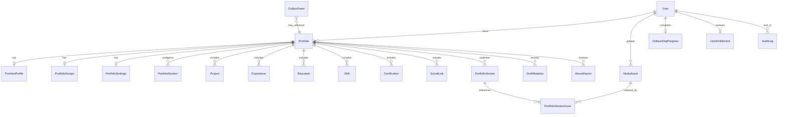

# Foliovanta — Backend Schema & Data Integrity Specification

> **Document:** `BACKEND_SCHEMA.md`  
> **Version:** 1.0 — implementation-oriented design draft  
> **Date:** 21 October 2026  
> **Status:** Proposed executable schema and migration plan; **not migrated, tested, or production-verified**  
> **Sources of truth:** `PRD.md` (product), `TRD.md` (technical architecture), `APP_FLOW.md` (navigation), `UI_UX_DESIGN_BRIEF.md` (interaction)  
> **Next artifact:** `IMPLEMENTATION_PLAN.md`

## 1. Scope, decisions, and assumptions

This specification defines Foliovanta's PostgreSQL persistence model, Prisma representation, integrity rules, ownership boundaries, lifecycle transitions, concurrency protocols, data retention, and migration/testing plan. It targets a **real multi-tenant SaaS**, not a demonstration. **Neon PostgreSQL + Prisma** is the agreed stack. Clerk is the authentication authority; the database is the authorization and product-data authority. A single Next.js modular monolith owns all application writes through server-only services.

### 1.1 Status terminology

- **Agreed:** established product/architecture decision.
- **Baseline:** concrete engineering choice recommended for implementation; subject to schema review and integration verification.
- **Proposed:** requires product/security/engineering sign-off.
- **Open:** must be resolved before the affected implementation is shipped.
- **Future:** intentionally not required for MVP.
- **Verified:** only after migration and automated tests have executed against PostgreSQL. **Nothing in this document is Verified.**

### 1.2 Non-negotiable invariants

1. A user's private draft and media cannot be read or changed by another user.
2. Public portfolio pages read **only the active immutable published snapshot**; never editable draft tables.
3. Draft writes use atomic optimistic concurrency and mutation idempotency; stale writes cannot silently overwrite newer work.
4. Publish creates and activates a complete snapshot atomically; failure leaves the prior public version unchanged.
5. Active published version must belong to its portfolio; moderation and account suspension override publish status.
6. Repeatable content uses relational rows; adding the 100th project does **not** require a schema change.
7. Product quotas are configurable, enforced on the server, and safe under concurrent creation.
8. Media referenced by any retained published version cannot be garbage-collected.
9. Privileged changes are auditable; operational side effects use durable outbox records where loss is unacceptable.
10. All tables containing private or personal data have explicit access, deletion, and retention policies.

### 1.3 MVP and future boundary

**MVP:** one active portfolio per user (product entitlement), guided onboarding, structured content, three templates, editable design, autosave, versioned publishing, rollback/unpublish, public slug subdomains, media, SEO, feedback, reports, Super Admin, audit, business events. **Future:** multiple portfolios, paid plans, custom domains, collaboration, rich public analytics, notification inbox, external API. Model extensibility for future features; do not prematurely build them.

### 1.4 Important deliberate choices

| Concern | Baseline decision | Notes |
|---|---|---|
| IDs | PostgreSQL UUID (`@default(uuid()) @db.Uuid`) | Avoid user-facing sequential identifiers |
| Timestamps | `timestamptz(3)` in UTC | `createdAt`, `updatedAt`, lifecycle timestamps |
| Public identity (M3) | Numeric `User.publicSlug` (sequence-generated, `@unique`, immutable via DB trigger) + editable non-unique `User.username` | URL is `/{publicSlug}/{username}`; see `docs/decisions/M3-URL-IDENTITY.md` |
| Internal portfolio slug | Server-generated, globally unique index, kept for legacy snapshots/links | No longer user-chosen or part of the public URL |
| One portfolio MVP | Transactionally guarded active-portfolio entitlement | **No permanent unique `ownerId`** preventing future multi-portfolio support |
| Content | Relational draft; JSON for constrained configuration | No numbered columns or arbitrary raw HTML |
| Revisions | One `Portfolio.draftRevision` | Every draft/content/design mutation increments it |
| Versions | Immutable JSON snapshots with schema/template versions | `Portfolio.activeVersionId` pointer |
| Publication vs moderation | Separate enums | Suspended user/portfolio cannot be served publicly |
| Idempotency | DB-backed mutation record | Unique `(actorId, scope, key)`; request fingerprint |
| Events | Transactional outbox | Dispatch provider still open |
| Deletion | Soft-delete first, policy-based erasure | Actual retention durations open |
| ORM boundaries | Prisma repository layer, `server-only` | No browser Prisma imports |
| Cross-tenant integrity | Composite FKs where applicable + service policies | DB FKs do not replace auth checks |

## 2. Entity inventory and cardinality

| Domain | Model | Relationship |
|---|---|---|
| Identity | `User` | 1:N Portfolio, MediaAsset, AuditLog, etc. |
| Onboarding | `OnboardingProgress` | 1:1 User |
| Portfolio | `Portfolio` | N:1 User; 1:1 Profile, Design, Settings; 1:N content, versions |
| Profile | `PortfolioProfile` | 1:1 Portfolio |
| Content | `PortfolioSection`, `Project`, `Experience`, `Education`, `Skill`, `Certification`, `SocialLink` | N:1 Portfolio |
| Design | `PortfolioDesign`, `PortfolioSettings` | 1:1 Portfolio |
| Publishing | `PortfolioVersion` | N:1 Portfolio; active version optional |
| Media | `MediaAsset`, `PortfolioVersionAsset` | User/portfolio ownership; snapshot references |
| Concurrency | `DraftMutation` | N:1 Portfolio and User |
| Abuse/feedback | `Feedback`, `AbuseReport`, `ModerationAction` | Optional actor/portfolio; moderator linkage |
| Governance | `AuditLog`, `BusinessEvent`, `OutboxEvent` | Append-only operational records |
| Entitlements | `UserEntitlement` | 1:1 User MVP; plan-independent configurable quotas |

**ERD (logical, simplified):**



**Notes:** This ERD omits some optional foreign keys for readability. `Portfolio.activeVersionId` references `PortfolioVersion` **for the same portfolio**. The SQL migration must enforce this composite relationship. User/account and portfolio soft deletion do not imply cascaded destruction of audit history.

## 3. Model-by-model requirements

### 3.1 `User`

`id UUID PK`, `clerkUserId TEXT UNIQUE NOT NULL`, `publicSlug BIGINT UNIQUE NOT NULL`, `username TEXT NOT NULL`, `primaryEmail TEXT?`, `displayName TEXT?`, `role UserRole DEFAULT USER`, `status UserStatus DEFAULT ACTIVE`, `createdAt`, `updatedAt`, `deletedAt?`. Suggested roles: `USER`, `ADMIN`, `SUPER_ADMIN`; statuses: `ACTIVE`, `SUSPENDED`, `DELETION_PENDING`, `DELETED`. Store the minimum necessary identity data; never store Clerk passwords or session tokens. Normalize email for lookup; do **not** assume email is globally immutable or a trustworthy principal key. The unique Clerk ID is the external identity mapping.

**Public identity (M3):** `publicSlug` is the immutable, globally unique, numeric public identifier — allocated by a Postgres sequence (`users_public_slug_seq`, `DEFAULT nextval(...)`), never reused, with a `BEFORE UPDATE` trigger forbidding changes. Serialized as a string at API boundaries. `username` is an editable, normalized, **non-unique** URL label (presentation only — never an identity/authorization key), seeded from display name → account name → default and freely edited thereafter. Enumerating `publicSlug` reveals nothing non-public (same visibility predicate; uniform 404).

**Provisioning:** verified Clerk webhook upsert plus idempotent first-authenticated-request reconciliation. An internal suspended/deleted account remains blocked even with a valid Clerk session. Role changes require privileged service + audit.

### 3.2 `Portfolio`

`id`, `ownerId`, `slug`, `title?`, `publicationStatus`, `moderationStatus`, `draftRevision BIGINT DEFAULT 0`, `activeVersionId?`, `nextVersionNumber INT DEFAULT 1`, `createdAt`, `updatedAt`, `lastDraftSavedAt?`, `publishedAt?`, `deletedAt?`. **Public URL identity is the owner's `User.publicSlug` + `username` (M3), not this slug.** `Portfolio.slug` is now an internal, **server-generated**, globally unique identifier (random-suffixed so it stays unique even against soft-deleted rows; retries on unique collision), kept only for legacy published snapshots/links and no longer user-chosen. Never store an untrusted full host as authority. `ownerId` indexed, not unique.

**Publication status:** `DRAFT`, `PUBLISHED`, `UNPUBLISHED`. **Moderation status:** `CLEAR`, `UNDER_REVIEW`, `SUSPENDED`. `UNDER_REVIEW` public visibility is a product policy to finalize; baseline is keep existing published content available unless explicitly suspended. Owner `ACTIVE`, portfolio `PUBLISHED`, moderation not `SUSPENDED`, nondeleted portfolio, and active version are all required for public eligibility. Use a single service predicate for public resolution and moderation invalidation.

**One-portfolio MVP guard:** a transaction locks the user's `UserEntitlement` row (or equivalent account guard), counts eligible portfolios, verifies `maxPortfolios`, and creates if permitted. No read-count-then-insert outside the lock. Later multi-portfolio plans only change entitlement, not the schema.

### 3.3 `PortfolioProfile`

One-to-one by unique `portfolioId`; `displayName`, `headline?`, `bio?`, `location?`, `avatarAssetId?`, `emailPublic?`, `updatedAt`. Publishing requires a nonempty display name; other fields may be optional per PRD. Contact information is opt-in public data; do not publish account email by default. Avatar asset must be `READY` and owned/authorized for portfolio association.

### 3.4 `PortfolioSection`

`id`, `portfolioId`, `sectionKey`, `isVisible`, `position`, `layoutVariant?`, `config JSONB`, timestamps. Unique `(portfolioId, sectionKey)` for singleton section categories (PROFILE, ABOUT, PROJECTS, EXPERIENCE, EDUCATION, SKILLS, CERTIFICATIONS, CONTACT). **Section keys are not arbitrary user HTML or component names.** Add new supported keys through explicit schema/versioned registry. Visibility and order do not delete content. Position uniqueness is intentionally **not** enforced initially; use ordered `(position, id)` deterministic fallback and transactional reorder validation to avoid swap conflicts.

### 3.5 Repeatable content

Every content model has `id`, `portfolioId`, `position`, `createdAt`, `updatedAt` and fields below. `portfolioId` must be included in service query predicates. Prefer hard deletion of individual draft rows only after version/media retention checks; published snapshots preserve prior content independently.

| Model | Core fields | Validation notes |
|---|---|---|
| `Project` | `title`, `summary?`, `description?`, `projectUrl?`, `repositoryUrl?`, `coverAssetId?`, `isFeatured` | URLs http(s), validated; images READY |
| `Experience` | `organization`, `roleTitle`, `location?`, `startDate?`, `endDate?`, `isCurrent`, `description?` | End >= start; `isCurrent` conflicts with end date |
| `Education` | `institution`, `degree?`, `fieldOfStudy?`, `startDate?`, `endDate?`, `description?` | End >= start |
| `Skill` | `name`, `category?`, `proficiency?` | No unverifiable numeric rating requirement |
| `Certification` | `title`, `issuer?`, `issuedAt?`, `expiresAt?`, `credentialUrl?` | Expiry >= issue |
| `SocialLink` | `platform`, `label?`, `url` | Allowlist URL protocols; external rel safety |

Dates representing calendar-only facts use PostgreSQL `date` rather than timestamps. Descriptions are **plain text baseline**; restricted rich text remains open and would require a versioned structured document schema before activation. Project galleries beyond a single cover require a `ProjectMedia` join model; **proposed** for MVP if multi-image projects are approved. Do not store a comma-separated array of image keys.

### 3.6 `PortfolioDesign` and `PortfolioSettings`

`PortfolioDesign`: unique `portfolioId`, `templateId`, `templateVersion`, `themeConfig JSONB`, `updatedAt`. `themeConfig` validated against versioned Zod schemas; curated palettes, font IDs, spacing, radius and supported layout variants. Arbitrary CSS/JS is prohibited. `PortfolioSettings`: unique `portfolioId`, `seoTitle?`, `seoDescription?`, `indexingEnabled`, `contactEnabled`, `updatedAt`. Indexing defaults and public contact exposure are product policies; baseline is opt-in public contact, published SEO enabled subject to user choice.

Template switching must not delete canonical content. Template IDs `minimal`, `professional`, `creative` are stable registry identifiers, not arbitrary DB-driven component imports. Published versions store resolved configuration and renderer compatibility identifiers.

### 3.7 `PortfolioVersion`

`id`, `portfolioId`, `versionNumber`, `sourceDraftRevision BIGINT`, `schemaVersion INT`, `templateId`, `templateVersion`, `snapshot JSONB`, `contentHash`, `publishedById`, `createdAt`. Unique `(portfolioId, versionNumber)` and unique `(portfolioId, id)` for composite active pointer. No `updatedAt`; ordinary application services have **no update or delete operation** for this model. Snapshot includes canonical content, section order/visibility, design, SEO, and asset references. Do not serialize private editor notes or account-only fields into snapshots.

**Immutability enforcement:** service/repository API restricts to insert; PostgreSQL trigger or privilege separation should prohibit UPDATE and DELETE in normal application role. **Open:** precise handling of statutory erasure/redaction requests; privileged compliance workflow must be separate and audited. Snapshots must be size-bounded and schema-versioned; template renderer must support retained versions or an explicit compatibility migration strategy.

### 3.8 `MediaAsset` and `PortfolioVersionAsset`

`MediaAsset`: `id`, `ownerId`, `portfolioId?`, `storageKey UNIQUE`, `originalFilename?`, `mimeType`, `byteSize BIGINT`, `width?`, `height?`, `checksum?`, `status`, `createdAt`, `updatedAt`, `deletedAt?`. Statuses `UPLOADING`, `PROCESSING`, `READY`, `REJECTED`, `DELETED`. Object key must be generated server-side; do not trust user-supplied keys. File signature and dimensions are verified server-side after upload. For avatars/project images, use authorized association checks (user/portfolio ownership, READY, quota).

`PortfolioVersionAsset`: `(versionId, assetId)` composite primary key, with foreign keys to retained versions and assets. Insert references transactionally during publish. A media garbage collector must consider **all retained published versions**, current draft references, active uploads, grace periods and deletion jobs. Database row deletion and R2 deletion cannot be one distributed transaction; use idempotent outbox-driven cleanup. A public asset URL must not inadvertently grant access to unpublished private media.

### 3.9 `DraftMutation`

`id`, `portfolioId`, `actorId`, `mutationKey`, `requestHash`, `expectedRevision`, `resultRevision?`, `status`, `response JSONB?`, `createdAt`, `expiresAt?`. Unique `(portfolioId, actorId, mutationKey)`. Store bounded response metadata, not arbitrary large PII payloads. Duplicate same-key/same-hash returns prior result; same-key/different-hash returns 409. The first mutation's record and portfolio/content write commit in **one transaction**. Define retention based on maximum client retry window; cleanup only after safety window.

### 3.10 `UserEntitlement`

Unique `userId`; `maxPortfolios`, `maxProjects`, `maxExperiences`, `maxEducation`, `maxSkills`, `maxCertifications`, `maxSocialLinks`, `maxMediaBytes`, `maxPublishedVersions?`, `updatedAt`. Values are **product-configurable**; any numbers in examples are not approved limits. Keep quotas outside content table constraints. Transactionally lock an entitlement/portfolio guard when enforcing concurrent creates. If quotas later become plan-based, add `Plan`, `Subscription`, and entitlement derivation without rewriting content tables. Quota reductions must not silently delete existing data; define grandfathering/blocked-additions policy.

### 3.11 Feedback, abuse and moderation

- `Feedback`: `id`, `userId?`, `portfolioId?`, `category`, `message`, `status`, `createdAt`, `resolvedAt?`, `assignedToId?`; restrict PII and rate limit submissions.
- `AbuseReport`: `id`, `portfolioId`, `reporterUserId?`, `reason`, `details?`, `status`, `createdAt`, `resolvedAt?`; anonymous reports may be permitted with abuse protection.
- `ModerationAction`: `id`, `portfolioId`, `actorId`, `action`, `reason`, `previousStatus`, `nextStatus`, `createdAt`; append-only.
- `AuditLog`: `id`, `actorId?`, `action`, `resourceType`, `resourceId?`, `metadata JSONB`, `requestId?`, `createdAt`; append-only, sensitive fields redacted. Consider partitioning only after measured volume.

Moderation actions must update portfolio state and write audit/outbox entries in the same transaction. Cached public content requires a reliable revocation mechanism; eventual cache invalidation alone is insufficient for suspension.

### 3.12 `BusinessEvent` and `OutboxEvent`

`BusinessEvent`: `id`, `eventName`, `actorId?`, `portfolioId?`, `occurredAt`, `properties JSONB`, `dedupeKey? UNIQUE`, `createdAt`. Do not store unnecessary personal content or IP addresses. Use authoritative DB events for signup, onboarding completion, publish, feedback and similar business transitions; GA4 is not the system of record.

`OutboxEvent`: `id`, `aggregateType`, `aggregateId`, `eventType`, `payload JSONB`, `status`, `attemptCount`, `nextAttemptAt`, `lockedUntil?`, `createdAt`, `processedAt?`, `lastError?`. Worker claims must be concurrency-safe (e.g. `FOR UPDATE SKIP LOCKED`), with leases, bounded retries, idempotent consumers, dead-letter handling and monitoring. Never send emails or call external APIs inside a database transaction. Delivery is **at least once**, not exactly once.

## 4. Prisma schema — implementation baseline

The following is a **coherent initial schema skeleton** intended for refinement and migration testing. It covers the full core model inventory; exact field lengths, optionality and database-level CHECK constraints follow in the SQL migration. The schema intentionally avoids implementing unsupported future billing/custom-domain models.

```prisma
// prisma/schema.prisma — proposed baseline; validate with prisma validate + migrate
// Generator output configuration may be adapted to the selected Prisma major version.
generator client {
  provider = "prisma-client-js"
}

datasource db {
  provider = "postgresql"
  // Connection URLs configured through Prisma config/runtime environment as
  // appropriate for the selected Prisma version; do not hardcode credentials.
}

enum UserRole { USER ADMIN SUPER_ADMIN }
enum UserStatus { ACTIVE SUSPENDED DELETION_PENDING DELETED }
enum PublicationStatus { DRAFT PUBLISHED UNPUBLISHED }
enum ModerationStatus { CLEAR UNDER_REVIEW SUSPENDED }
enum MediaStatus { UPLOADING PROCESSING READY REJECTED DELETED }
enum MutationStatus { COMMITTED }
enum WorkflowStatus { PENDING PROCESSING COMPLETED FAILED DEAD_LETTER }
enum FeedbackStatus { OPEN IN_REVIEW RESOLVED CLOSED }
enum ReportStatus { OPEN IN_REVIEW RESOLVED DISMISSED }

model User {
  id              String     @id @default(uuid()) @db.Uuid
  clerkUserId     String     @unique
  primaryEmail    String?
  displayName     String?
  role            UserRole   @default(USER)
  status          UserStatus @default(ACTIVE)
  createdAt       DateTime   @default(now()) @db.Timestamptz(3)
  updatedAt       DateTime   @updatedAt @db.Timestamptz(3)
  deletedAt       DateTime?  @db.Timestamptz(3)
  portfolios      Portfolio[]
  mediaAssets     MediaAsset[]
  entitlement     UserEntitlement?
  onboarding      OnboardingProgress?
  mutations       DraftMutation[]
  publishedVersions PortfolioVersion[] @relation("VersionPublisher")
  auditLogs       AuditLog[] @relation("AuditActor")
  businessEvents  BusinessEvent[] @relation("BusinessActor")
  feedback        Feedback[] @relation("FeedbackAuthor")
  assignedFeedback Feedback[] @relation("FeedbackAssignee")
  abuseReports    AbuseReport[] @relation("ReportAuthor")
  moderationActions ModerationAction[] @relation("ModerationActor")
  @@index([status, createdAt])
}

model UserEntitlement {
  userId               String @id @db.Uuid
  user                 User   @relation(fields: [userId], references: [id], onDelete: Restrict)
  maxPortfolios        Int    @default(1)
  maxProjects          Int    @default(50) // PROVISIONAL; replace with approved product policy
  maxExperiences       Int    @default(30) // PROVISIONAL
  maxEducation         Int    @default(30) // PROVISIONAL
  maxSkills            Int    @default(100) // PROVISIONAL
  maxCertifications    Int    @default(50) // PROVISIONAL
  maxSocialLinks       Int    @default(20) // PROVISIONAL
  maxMediaBytes        BigInt @default(524288000) // PROVISIONAL
  maxPublishedVersions Int?   // null = no product count cap; retention policy still applies
  updatedAt            DateTime @updatedAt @db.Timestamptz(3)
}

model OnboardingProgress {
  userId       String @id @db.Uuid
  user         User   @relation(fields: [userId], references: [id], onDelete: Restrict)
  persona      String?
  currentStep  String?
  completedAt  DateTime? @db.Timestamptz(3)
  stepData     Json @default("{}") @db.JsonB
  updatedAt    DateTime @updatedAt @db.Timestamptz(3)
}

model Portfolio {
  id                String @id @default(uuid()) @db.Uuid
  ownerId           String @db.Uuid
  owner             User @relation(fields: [ownerId], references: [id], onDelete: Restrict)
  slug              String @unique
  title             String?
  publicationStatus PublicationStatus @default(DRAFT)
  moderationStatus  ModerationStatus @default(CLEAR)
  draftRevision     BigInt @default(0)
  nextVersionNumber Int @default(1)
  activeVersionId   String? @db.Uuid
  activeVersion     PortfolioVersion? @relation("ActiveVersion", fields: [id, activeVersionId], references: [portfolioId, id], onDelete: NoAction, onUpdate: NoAction)
  profile           PortfolioProfile?
  design            PortfolioDesign?
  settings          PortfolioSettings?
  sections          PortfolioSection[]
  projects          Project[]
  experiences       Experience[]
  education         Education[]
  skills            Skill[]
  certifications    Certification[]
  socialLinks       SocialLink[]
  versions          PortfolioVersion[] @relation("PortfolioVersions")
  mediaAssets       MediaAsset[]
  mutations         DraftMutation[]
  feedback          Feedback[]
  abuseReports      AbuseReport[]
  moderationActions ModerationAction[]
  businessEvents    BusinessEvent[]
  createdAt         DateTime @default(now()) @db.Timestamptz(3)
  updatedAt         DateTime @updatedAt @db.Timestamptz(3)
  lastDraftSavedAt  DateTime? @db.Timestamptz(3)
  publishedAt       DateTime? @db.Timestamptz(3)
  deletedAt         DateTime? @db.Timestamptz(3)
  @@index([ownerId, createdAt])
  @@index([publicationStatus, moderationStatus])
  @@index([id, activeVersionId])
}

model PortfolioProfile {
  portfolioId String @id @db.Uuid
  portfolio Portfolio @relation(fields: [portfolioId], references: [id], onDelete: Cascade)
  displayName String @default("")
  headline String?
  bio String? @db.Text
  location String?
  avatarAssetId String? @db.Uuid
  emailPublic String?
  updatedAt DateTime @updatedAt @db.Timestamptz(3)
}

model PortfolioSection {
  id String @id @default(uuid()) @db.Uuid
  portfolioId String @db.Uuid
  portfolio Portfolio @relation(fields: [portfolioId], references: [id], onDelete: Cascade)
  sectionKey String
  isVisible Boolean @default(true)
  position Int @default(0)
  layoutVariant String?
  config Json @default("{}") @db.JsonB
  createdAt DateTime @default(now()) @db.Timestamptz(3)
  updatedAt DateTime @updatedAt @db.Timestamptz(3)
  @@unique([portfolioId, sectionKey])
  @@index([portfolioId, position])
}

model Project {
  id String @id @default(uuid()) @db.Uuid
  portfolioId String @db.Uuid
  portfolio Portfolio @relation(fields: [portfolioId], references: [id], onDelete: Cascade)
  title String
  summary String? @db.Text
  description String? @db.Text
  projectUrl String?
  repositoryUrl String?
  coverAssetId String? @db.Uuid
  isFeatured Boolean @default(false)
  position Int @default(0)
  createdAt DateTime @default(now()) @db.Timestamptz(3)
  updatedAt DateTime @updatedAt @db.Timestamptz(3)
  @@index([portfolioId, position, id])
}

model Experience {
  id String @id @default(uuid()) @db.Uuid
  portfolioId String @db.Uuid
  portfolio Portfolio @relation(fields: [portfolioId], references: [id], onDelete: Cascade)
  organization String
  roleTitle String
  location String?
  startDate DateTime? @db.Date
  endDate DateTime? @db.Date
  isCurrent Boolean @default(false)
  description String? @db.Text
  position Int @default(0)
  createdAt DateTime @default(now()) @db.Timestamptz(3)
  updatedAt DateTime @updatedAt @db.Timestamptz(3)
  @@index([portfolioId, position, id])
}

model Education {
  id String @id @default(uuid()) @db.Uuid
  portfolioId String @db.Uuid
  portfolio Portfolio @relation(fields: [portfolioId], references: [id], onDelete: Cascade)
  institution String
  degree String?
  fieldOfStudy String?
  startDate DateTime? @db.Date
  endDate DateTime? @db.Date
  description String? @db.Text
  position Int @default(0)
  createdAt DateTime @default(now()) @db.Timestamptz(3)
  updatedAt DateTime @updatedAt @db.Timestamptz(3)
  @@index([portfolioId, position, id])
}

model Skill {
  id String @id @default(uuid()) @db.Uuid
  portfolioId String @db.Uuid
  portfolio Portfolio @relation(fields: [portfolioId], references: [id], onDelete: Cascade)
  name String
  category String?
  proficiency String?
  position Int @default(0)
  createdAt DateTime @default(now()) @db.Timestamptz(3)
  updatedAt DateTime @updatedAt @db.Timestamptz(3)
  @@index([portfolioId, position, id])
}

model Certification {
  id String @id @default(uuid()) @db.Uuid
  portfolioId String @db.Uuid
  portfolio Portfolio @relation(fields: [portfolioId], references: [id], onDelete: Cascade)
  title String
  issuer String?
  issuedAt DateTime? @db.Date
  expiresAt DateTime? @db.Date
  credentialUrl String?
  position Int @default(0)
  createdAt DateTime @default(now()) @db.Timestamptz(3)
  updatedAt DateTime @updatedAt @db.Timestamptz(3)
  @@index([portfolioId, position, id])
}

model SocialLink {
  id String @id @default(uuid()) @db.Uuid
  portfolioId String @db.Uuid
  portfolio Portfolio @relation(fields: [portfolioId], references: [id], onDelete: Cascade)
  platform String
  label String?
  url String
  position Int @default(0)
  createdAt DateTime @default(now()) @db.Timestamptz(3)
  updatedAt DateTime @updatedAt @db.Timestamptz(3)
  @@index([portfolioId, position, id])
}

model PortfolioDesign {
  portfolioId String @id @db.Uuid
  portfolio Portfolio @relation(fields: [portfolioId], references: [id], onDelete: Cascade)
  templateId String @default("minimal")
  templateVersion String @default("1.0.0")
  themeConfig Json @default("{}") @db.JsonB
  updatedAt DateTime @updatedAt @db.Timestamptz(3)
}

model PortfolioSettings {
  portfolioId String @id @db.Uuid
  portfolio Portfolio @relation(fields: [portfolioId], references: [id], onDelete: Cascade)
  seoTitle String?
  seoDescription String? @db.Text
  indexingEnabled Boolean @default(true)
  contactEnabled Boolean @default(false)
  updatedAt DateTime @updatedAt @db.Timestamptz(3)
}

model PortfolioVersion {
  id String @id @default(uuid()) @db.Uuid
  portfolioId String @db.Uuid
  portfolio Portfolio @relation("PortfolioVersions", fields: [portfolioId], references: [id], onDelete: Restrict)
  activeFor Portfolio? @relation("ActiveVersion")
  versionNumber Int
  sourceDraftRevision BigInt
  schemaVersion Int
  templateId String
  templateVersion String
  snapshot Json @db.JsonB
  contentHash String
  publishedById String @db.Uuid
  publishedBy User @relation("VersionPublisher", fields: [publishedById], references: [id], onDelete: Restrict)
  createdAt DateTime @default(now()) @db.Timestamptz(3)
  assets PortfolioVersionAsset[]
  @@unique([portfolioId, versionNumber])
  @@unique([portfolioId, id])
  @@index([portfolioId, createdAt])
}

model MediaAsset {
  id String @id @default(uuid()) @db.Uuid
  ownerId String @db.Uuid
  owner User @relation(fields: [ownerId], references: [id], onDelete: Restrict)
  portfolioId String? @db.Uuid
  portfolio Portfolio? @relation(fields: [portfolioId], references: [id], onDelete: Restrict)
  storageKey String @unique
  originalFilename String?
  mimeType String
  byteSize BigInt
  width Int?
  height Int?
  checksum String?
  status MediaStatus @default(UPLOADING)
  createdAt DateTime @default(now()) @db.Timestamptz(3)
  updatedAt DateTime @updatedAt @db.Timestamptz(3)
  deletedAt DateTime? @db.Timestamptz(3)
  versionReferences PortfolioVersionAsset[]
  @@index([ownerId, status])
  @@index([portfolioId, status])
}

model PortfolioVersionAsset {
  versionId String @db.Uuid
  assetId String @db.Uuid
  version PortfolioVersion @relation(fields: [versionId], references: [id], onDelete: Restrict)
  asset MediaAsset @relation(fields: [assetId], references: [id], onDelete: Restrict)
  @@id([versionId, assetId])
  @@index([assetId])
}

model DraftMutation {
  id String @id @default(uuid()) @db.Uuid
  portfolioId String @db.Uuid
  portfolio Portfolio @relation(fields: [portfolioId], references: [id], onDelete: Restrict)
  actorId String @db.Uuid
  actor User @relation(fields: [actorId], references: [id], onDelete: Restrict)
  mutationKey String
  requestHash String
  expectedRevision BigInt
  resultRevision BigInt?
  status MutationStatus @default(COMMITTED)
  response Json? @db.JsonB
  createdAt DateTime @default(now()) @db.Timestamptz(3)
  expiresAt DateTime? @db.Timestamptz(3)
  @@unique([portfolioId, actorId, mutationKey])
  @@index([expiresAt])
}

model Feedback {
  id String @id @default(uuid()) @db.Uuid
  userId String? @db.Uuid
  user User? @relation("FeedbackAuthor", fields: [userId], references: [id], onDelete: SetNull)
  portfolioId String? @db.Uuid
  portfolio Portfolio? @relation(fields: [portfolioId], references: [id], onDelete: SetNull)
  category String
  message String @db.Text
  status FeedbackStatus @default(OPEN)
  assignedToId String? @db.Uuid
  assignedTo User? @relation("FeedbackAssignee", fields: [assignedToId], references: [id], onDelete: SetNull)
  createdAt DateTime @default(now()) @db.Timestamptz(3)
  resolvedAt DateTime? @db.Timestamptz(3)
  @@index([status, createdAt])
}

model AbuseReport {
  id String @id @default(uuid()) @db.Uuid
  portfolioId String @db.Uuid
  portfolio Portfolio @relation(fields: [portfolioId], references: [id], onDelete: Restrict)
  reporterUserId String? @db.Uuid
  reporter User? @relation("ReportAuthor", fields: [reporterUserId], references: [id], onDelete: SetNull)
  reason String
  details String? @db.Text
  status ReportStatus @default(OPEN)
  createdAt DateTime @default(now()) @db.Timestamptz(3)
  resolvedAt DateTime? @db.Timestamptz(3)
  @@index([status, createdAt])
  @@index([portfolioId, createdAt])
}

model ModerationAction {
  id String @id @default(uuid()) @db.Uuid
  portfolioId String @db.Uuid
  portfolio Portfolio @relation(fields: [portfolioId], references: [id], onDelete: Restrict)
  actorId String @db.Uuid
  actor User @relation("ModerationActor", fields: [actorId], references: [id], onDelete: Restrict)
  action String
  reason String @db.Text
  previousStatus ModerationStatus
  nextStatus ModerationStatus
  createdAt DateTime @default(now()) @db.Timestamptz(3)
  @@index([portfolioId, createdAt])
}

model AuditLog {
  id String @id @default(uuid()) @db.Uuid
  actorId String? @db.Uuid
  actor User? @relation("AuditActor", fields: [actorId], references: [id], onDelete: SetNull)
  action String
  resourceType String
  resourceId String?
  metadata Json @default("{}") @db.JsonB
  requestId String?
  createdAt DateTime @default(now()) @db.Timestamptz(3)
  @@index([actorId, createdAt])
  @@index([resourceType, resourceId, createdAt])
}

model BusinessEvent {
  id String @id @default(uuid()) @db.Uuid
  eventName String
  actorId String? @db.Uuid
  actor User? @relation("BusinessActor", fields: [actorId], references: [id], onDelete: SetNull)
  portfolioId String? @db.Uuid
  portfolio Portfolio? @relation(fields: [portfolioId], references: [id], onDelete: SetNull)
  occurredAt DateTime @default(now()) @db.Timestamptz(3)
  properties Json @default("{}") @db.JsonB
  dedupeKey String? @unique
  createdAt DateTime @default(now()) @db.Timestamptz(3)
  @@index([eventName, occurredAt])
  @@index([portfolioId, occurredAt])
}

model OutboxEvent {
  id String @id @default(uuid()) @db.Uuid
  aggregateType String
  aggregateId String
  eventType String
  payload Json @db.JsonB
  status WorkflowStatus @default(PENDING)
  attemptCount Int @default(0)
  nextAttemptAt DateTime @default(now()) @db.Timestamptz(3)
  lockedUntil DateTime? @db.Timestamptz(3)
  createdAt DateTime @default(now()) @db.Timestamptz(3)
  processedAt DateTime? @db.Timestamptz(3)
  lastError String? @db.Text
  @@index([status, nextAttemptAt])
  @@index([aggregateType, aggregateId])
}
```

**Schema review caveats:** This is a **design artifact**, not a claim that the Prisma schema has passed `prisma validate`. Composite active-version relation, mutual FK creation order, Prisma-version-specific datasource configuration and referential-action constraints require execution against the chosen Prisma release. The `Portfolio` ↔ `PortfolioVersion` cycle may require splitting FK creation into a post-create SQL migration. Do not paste the schema into production and deploy without resolving these items. Additionally, `@default(uuid())` UUID generation occurs through Prisma; raw SQL inserts require explicit UUIDs or a database default. Decide one convention before writing raw migrations.

## 5. Required custom PostgreSQL migrations

Prisma alone does not express every required invariant. Maintain reviewed, version-controlled SQL migrations. The examples below are illustrative and assume quoted Prisma-generated table/column names.

### 5.1 Checks and canonical slug

> M3: `Portfolio.slug` is now server-generated and internal (the public URL uses `User.publicSlug`/`username`). The format CHECK below still applies to the generated slug; the reserved-name note no longer affects users (they do not choose slugs).

```sql
ALTER TABLE "Portfolio"
  ADD CONSTRAINT portfolio_revision_nonnegative CHECK ("draftRevision" >= 0),
  ADD CONSTRAINT portfolio_version_sequence_positive CHECK ("nextVersionNumber" >= 1),
  ADD CONSTRAINT portfolio_slug_format CHECK (
    "slug" ~ '^[a-z0-9](?:[a-z0-9-]{0,61}[a-z0-9])?$'
  ),
  ADD CONSTRAINT portfolio_published_requires_version CHECK (
    "publicationStatus" <> 'PUBLISHED' OR "activeVersionId" IS NOT NULL
  );

ALTER TABLE "MediaAsset"
  ADD CONSTRAINT media_size_nonnegative CHECK ("byteSize" >= 0),
  ADD CONSTRAINT media_width_positive CHECK ("width" IS NULL OR "width" > 0),
  ADD CONSTRAINT media_height_positive CHECK ("height" IS NULL OR "height" > 0);

ALTER TABLE "Experience"
  ADD CONSTRAINT experience_dates_valid CHECK (
    "startDate" IS NULL OR "endDate" IS NULL OR "endDate" >= "startDate"
  ),
  ADD CONSTRAINT experience_current_has_no_end CHECK (
    NOT "isCurrent" OR "endDate" IS NULL
  );

ALTER TABLE "Education"
  ADD CONSTRAINT education_dates_valid CHECK (
    "startDate" IS NULL OR "endDate" IS NULL OR "endDate" >= "startDate"
  );

ALTER TABLE "Certification"
  ADD CONSTRAINT certification_dates_valid CHECK (
    "issuedAt" IS NULL OR "expiresAt" IS NULL OR "expiresAt" >= "issuedAt"
  );
```

**Caution:** Enum literal comparisons and quoting must be checked against actual generated PostgreSQL enum types. The slug regex above allows a single-character slug; reserved words (`app`, `admin`, `api`, `www`, `support`, etc.) require a centralized reserved-name policy, and optionally a reserved-slug table. Do not rely on a front-end regex alone.

### 5.2 Active version belongs to the portfolio

```sql
-- Requires UNIQUE("portfolioId", "id") on PortfolioVersion.
-- Prisma may generate this FK; inspect migration before adding manually.
ALTER TABLE "Portfolio"
  ADD CONSTRAINT portfolio_active_version_same_portfolio_fk
  FOREIGN KEY ("id", "activeVersionId")
  REFERENCES "PortfolioVersion"("portfolioId", "id")
  DEFERRABLE INITIALLY IMMEDIATE;
```

**Avoid duplicate FK creation:** If Prisma generated a non-deferrable equivalent, replace it deliberately rather than adding a second constraint. `activeVersionId` nullable means the composite FK is not checked while it is NULL; when set, the pair must match. Published snapshot row must be inserted before the pointer is activated. PostgreSQL deferred constraints can help with lifecycle operations but are not a substitute for transaction design.

### 5.3 Snapshot immutability

```sql
CREATE OR REPLACE FUNCTION reject_portfolio_version_change()
RETURNS trigger LANGUAGE plpgsql AS $$
BEGIN
  RAISE EXCEPTION 'PortfolioVersion is immutable';
END;
$$;

CREATE TRIGGER portfolio_version_no_update_delete
BEFORE UPDATE OR DELETE ON "PortfolioVersion"
FOR EACH ROW EXECUTE FUNCTION reject_portfolio_version_change();
```

**Operational note:** A legal erasure workflow cannot casually `DELETE` these rows. Define a separate privileged, audited retention/erasure process, with explicit change control and a deliberate trigger-bypass/migration mechanism if required. A dedicated least-privilege runtime DB role and restricted migration role provide defense in depth.

### 5.4 Ownership consistency for referenced assets

Foreign keys from `Project.coverAssetId` and `PortfolioProfile.avatarAssetId` are intentionally not fully represented in the skeleton. **Before production migration, add proper FK relations and enforce that referenced assets belong to an authorized owner/portfolio**. Options: composite `(portfolioId, assetId)` FK to a unique asset key where all assets are portfolio-bound, or an association table validated transactionally. This is a **P0 schema gap**, not optional cleanup. Similarly, `PortfolioVersionAsset` references must be checked against the version's portfolio before insertion; a trigger or composite FK can enforce portfolio consistency if asset ownership is strictly portfolio-bound. Avoid an ownership model that permits linking a private asset from another account merely by guessing its UUID.

### 5.5 Partial indexes and operational indexes

Use partial indexes only when query plans justify them, e.g. `OutboxEvent(status, nextAttemptAt)` filtered to pending/retryable states, and `Portfolio(ownerId)` filtered to nondeleted records. Keep migrations reversible where possible and use `CREATE INDEX CONCURRENTLY` for large production tables in a migration workflow that supports nontransactional statements. Monitor index bloat and write amplification.

## 6. Transaction protocols

### 6.1 Autosave (atomic CAS + idempotency)

**Input:** authenticated actor, portfolio ID, expected revision, mutation key, canonical validated patch, request fingerprint.

1. Authenticate Clerk session; resolve active internal user; verify account status.
2. Validate patch shape, ownership, allowed fields, quotas, asset references and request size.
3. Begin short transaction; lock portfolio row or use atomic conditional update.
4. Look up mutation key under unique `(portfolioId, actorId, mutationKey)`. If committed with same hash, return stored result; if different hash, 409.
5. Check `draftRevision == expectedRevision`; otherwise return 409 with safe current revision metadata.
6. Apply content mutation and increment `draftRevision` exactly once in same transaction; persist `DraftMutation` committed result.
7. Commit; return new revision and timestamp.

**Concurrency detail:** Two requests with the same key can race. The unique constraint plus transaction isolation and a retry/read-after-unique-conflict path must resolve duplicates correctly. A request that times out after commit must be safely retryable. Do not update the revision outside the content transaction. Do not send the entire portfolio for a one-field patch unless intentionally designed.

**Prisma pattern (illustrative):** `updateMany({ where: { id, ownerId, draftRevision: expected }, data: { draftRevision: { increment: 1 } } })` followed by content writes and mutation record in the **same** `$transaction`. Reject if `count !== 1`. For idempotent retry, inspect mutation record **before** returning a stale-revision error. Use bounded retries only for recognized serialization/deadlock errors.

### 6.2 Publishing (consistent snapshot + atomic pointer)

**Input:** portfolio, expected revision, idempotency key, authenticated publisher.

1. Flush browser edits and require acknowledged revision (client UX); server independently verifies revision.
2. Validate actor, account, moderation state, and publish entitlement.
3. Begin transaction; serialize on portfolio row (`SELECT ... FOR UPDATE` via reviewed SQL or equivalent).
4. Recheck ownership and revision, read all relational draft rows in deterministic order under the same transaction, and validate required fields, media status and template/schema compatibility.
5. Build canonical snapshot; compute deterministic hash from canonical serialization; ensure JSON size within approved limit.
6. Allocate version number under lock; insert `PortfolioVersion` and `PortfolioVersionAsset` rows.
7. Atomically update active pointer, publication status and published timestamp; insert audit, business event and outbox rows.
8. Commit. Post-commit worker invalidates public caches, updates sitemaps and sends optional notifications; retry failures safely.

**Consistency requirement:** Avoid doing expensive image processing or network calls inside transaction. Under PostgreSQL `READ COMMITTED`, row-locking the portfolio alone is insufficient if some draft writers can modify child rows without first locking/updating the portfolio. **All draft writers must serialize through the same portfolio revision guard**, and publishing must acquire that guard before reading. If this cannot be guaranteed, use a stronger isolation protocol with appropriate retries. The public route resolves only the committed active snapshot.

**Publish idempotency:** `DraftMutation` is specific to draft writes; create a distinct `PublicationCommand` model or generalized `OperationIdempotency` record for publish/unpublish/rollback. **This is a P0 addition before implementation.** Do not use `DraftMutation` ambiguously for unrelated commands.

### 6.3 Rollback, unpublish, suspend

- **Rollback:** verify target version belongs to portfolio and is render-compatible; update pointer/status and audit/outbox transactionally. Historical snapshot remains unchanged. Define whether rollback creates a new publication event/version number or merely reactivates an old version; **baseline: pointer reactivation with audit event**, pending product sign-off.
- **Unpublish:** set publication status `UNPUBLISHED`; preserve draft, versions and assets; invalidate cache.
- **Suspend:** set moderation `SUSPENDED` and write moderation/audit/outbox records atomically. Public resolver must enforce current eligibility even if a cached HTML response exists; design edge/cache revocation behavior and test it. A user cannot bypass suspension by republishing.

### 6.4 Media lifecycle

1. Authorize upload, quota, content type/size and portfolio association.
2. Insert `UPLOADING` asset with generated storage key and upload expiry metadata.
3. Issue short-lived signed R2 upload URL; client uploads directly.
4. Server verifies object presence, actual MIME/signature, dimensions, malware policy where applicable, ownership and size; mark `READY` or `REJECTED`.
5. Draft association occurs through normal revision-aware mutation.
6. On removal, retain asset if any draft or version reference remains; enqueue cleanup after grace period.

**Storage quotas:** enforce reserved/in-progress bytes as well as completed bytes to prevent parallel-upload quota bypass. Consider a `MediaUploadReservation` model or reserved-byte accounting; **P0 to finalize before direct upload rollout**. Avoid trusting client-reported file size.

## 7. Query patterns and indexes

| Use case | Predicate/order | Index baseline |
|---|---|---|
| User lookup after Clerk auth | `clerkUserId = ?` | Unique Clerk ID |
| User portfolios | `ownerId = ? AND deletedAt IS NULL ORDER BY createdAt` | `(ownerId, createdAt)`; partial index if justified |
| Public portfolio lookup (M3) | owner `publicSlug = ?` + visibility predicate | Unique `users.publicSlug`; legacy `/p/{slug}` still resolves by unique `portfolios.slug` |
| Portfolio editor load | `id = ? AND ownerId = ?` | PK + owner index; authorize before relations |
| Content list | `portfolioId = ? ORDER BY position, id` | `(portfolioId, position, id)` |
| Versions | `portfolioId = ? ORDER BY versionNumber DESC` | Unique `(portfolioId, versionNumber)` |
| Media by user | `ownerId = ? AND status = ?` | `(ownerId, status)` |
| Abuse queue | `status = ? ORDER BY createdAt` | `(status, createdAt)` |
| Audit investigation | actor/resource and time | Composite indexes shown in Prisma |
| Outbox dispatch | `status, nextAttemptAt` | Composite/partial index |
| Event reporting | `eventName, occurredAt` | Composite index |

**Query safety:** select only needed fields; avoid N+1 joins in editor loaders; paginate admin datasets; use cursor pagination where appropriate. Public snapshot lookup should be one indexed portfolio lookup plus active version fetch, subject to visibility checks and cache strategy. Explain plans and actual telemetry determine later index additions.

## 8. Security and tenant isolation matrix

| Resource/action | Owner | Other user | Super Admin | Anonymous |
|---|---|---|---|---|
| Read draft | Allowed when active | Deny | Privileged audited access only | Deny |
| Edit draft | Allowed when active and unsuspended | Deny | Explicit moderation policy, not implicit | Deny |
| Publish/rollback | Allowed when eligible | Deny | Restricted policy | Deny |
| Read active public snapshot | Allowed | Allowed | Allowed | Allowed, if public eligible |
| Read historical version | Allowed privately | Deny | Privileged audited access | Deny |
| Sign/associate media | Allowed if ownership/quota verified | Deny | Policy-bound | Deny |
| View admin queues | Deny | Deny | Allowed | Deny |
| Suspend portfolio | Deny | Deny | Allowed with reason/audit | Deny |
| Read audit logs | Own limited events if product exposes | Deny | Allowed by policy | Deny |

A valid Clerk session is **authentication**, not authorization. All services resolve the internal `User`, check status/role and portfolio ownership, then access data. Never rely on route guards, frontend checks, slug secrecy, or UUID unpredictability as authorization. Avoid unscoped `findUnique({id})` followed by an unauthorized update; use ownership-scoped reads/updates and/or transactional checks. Tenant isolation must be tested with two distinct users and portfolios for every resource type.

**RLS:** PostgreSQL Row-Level Security is not assumed in the initial Prisma design. Application-level enforcement is mandatory. Evaluate RLS as defense in depth only if connection identity propagation and operational complexity are designed and tested; do not claim RLS protection without implementing it.

## 9. JSON schemas, versioning and backward compatibility

JSONB is allowed only for **versioned, validated** documents: `PortfolioDesign.themeConfig`, `PortfolioSection.config`, `OnboardingProgress.stepData`, `PortfolioVersion.snapshot`, sanitized event/audit metadata. Each has a Zod schema and explicit maximum serialized size. Snapshot `schemaVersion` is mandatory. A renderer must declare supported schema and template versions. Compatibility options: maintain old renderers, migrate snapshots via controlled privileged process, or define a deterministic adapter; never silently interpret old fields as current without validation. Unknown enum/section keys fail safely or use a documented fallback.

Example conceptual snapshot envelope:

```json
{
  "schemaVersion": 1,
  "template": { "id": "minimal", "version": "1.0.0" },
  "profile": { "displayName": "Example Person", "headline": "Software Engineer" },
  "sections": [
    { "key": "PROJECTS", "visible": true, "position": 1, "items": [] }
  ],
  "design": { "paletteId": "slate", "headingFontId": "inter" },
  "seo": { "title": "Example Person — Portfolio", "indexingEnabled": true },
  "assetIds": []
}
```

This example is **not** the final Zod snapshot contract. Avoid storing presigned URLs in snapshots because they expire; reference stable validated asset identifiers/keys resolved through approved delivery URLs.

## 10. Privacy, deletion and retention

- **User soft deletion:** disable account operations and public eligibility immediately; mark `deletedAt`; begin grace period.
- **Permanent erasure:** coordinate Clerk deletion, database PII anonymization/deletion, R2 media cleanup, business events, logs and backup retention. Record lawful retention exceptions and ensure the user cannot access old content during recovery.
- **Portfolio deletion:** soft-delete, unpublish, invalidate cache; preserve published versions/media until grace period and legal/retention checks.
- **Audit logs:** minimize PII; retain according to security/legal policy; use actor pseudonymization where appropriate.
- **Backups:** encrypted managed backups; tested restore; deleted data may remain in backups until expiry, which must be documented.
- **Open:** exact recovery window, media grace period, audit retention, event retention, deletion SLA, backup PITR period and regional data-processing obligations. Do not invent durations.

## 11. Migration and deployment strategy

1. Pin Node, Prisma, PostgreSQL compatibility and generator configuration. Use `prisma validate` and generated client checks in CI.
2. Generate migration from reviewed schema; inspect SQL rather than blindly accepting generated operations.
3. Add custom CHECK constraints, composite active-version FK, immutability trigger, and asset ownership enforcement.
4. Apply migrations to isolated disposable PostgreSQL and seeded staging; run `migrate deploy` in deployment pipeline, never `db push` in production.
5. Use expand-and-contract for breaking changes: add nullable/new columns → dual-read/write or backfill → switch consumers → enforce constraints → remove old fields later.
6. Plan large backfills in bounded batches with progress checkpoints and idempotency. Consider lock timeouts and concurrent index creation.
7. Keep schema migration separate from app rollback; destructive migrations require backup and explicit rollback/recovery plan.
8. Use least-privilege runtime credentials separate from migration/admin credentials. Validate Neon pooled runtime and direct migration connection behavior.
9. Never run unreviewed schema changes automatically on each serverless function cold start.

**Critical compatibility tests:** current and previous app versions must coexist safely during rolling deploy; historical snapshot versions remain renderable; cache invalidation works after publish/unpublish/suspend; migrations preserve existing data.

## 12. Database integration test plan

| ID | Scenario | Expected result |
|---|---|---|
| DB-001 | Same Clerk user webhook delivered twice | Exactly one internal User |
| DB-002 | Two concurrent first portfolio creates at max 1 | Exactly one succeeds; other quota conflict |
| DB-003 | Duplicate slug allocation requests | Unique canonical slug; no duplicate |
| DB-004 | Add 1, 10, 100 projects | Same schema; quota enforcement only |
| DB-005 | Two autosaves from same revision | Exactly one commits; other 409 |
| DB-006 | Retry committed autosave with same mutation key/hash | Original result returned; revision unchanged |
| DB-007 | Reuse mutation key with different payload | 409; no data change |
| DB-008 | Mutation fails halfway through child writes | No partial writes or revision increment |
| DB-009 | Publish races with autosave | Consistent snapshot or explicit revision conflict |
| DB-010 | Two concurrent publishes | No duplicate version number; idempotent command behavior |
| DB-011 | Snapshot insert succeeds but pointer update fails | Entire transaction rolls back |
| DB-012 | Point portfolio to another portfolio's version | Database rejects FK violation |
| DB-013 | Update/delete historical version via runtime role | Rejected |
| DB-014 | Owner changes draft after publish | Public snapshot unchanged |
| DB-015 | Unpublish/suspend with cached public page | Public access blocked per revocation SLO |
| DB-016 | Cross-user draft/project/media access | Denied; no data leak |
| DB-017 | Delete draft image still referenced by old version | R2 object retained |
| DB-018 | Two parallel uploads at quota boundary | Quota cannot be bypassed |
| DB-019 | Outbox worker crashes after delivery | Retry is idempotent; no duplicated effect |
| DB-020 | Migrate populated staging database | Data preserved; no incompatible snapshot |
| DB-021 | Soft-delete account with published portfolio | Public route unavailable immediately |
| DB-022 | Historical version uses older template/schema | Compatible render or explicit safe failure |
| DB-023 | Invalid URLs, excessive payload, bad dates | Validation/DB constraints reject safely |
| DB-024 | Backup restore exercise | Recovery verified against defined RPO/RTO |

Use a **real isolated PostgreSQL database** for transaction, constraint and concurrency tests. SQLite or mocked Prisma is not a substitute. Unit tests cover pure snapshot serialization, Zod validation and quota policy; integration tests cover actual FK/transaction semantics; Playwright tests cover user-facing autosave/publish behavior. Capture SQLSTATE/Prisma error handling and bounded retry behavior.

## 13. Open decisions and P0 gaps before declaring schema final

| Priority | Decision/gap | Proposed owner | Exit condition |
|---|---|---|---|
| P0 | Prisma version-specific generator/datasource config and composite relation validation | Backend | `prisma validate` and migration pass |
| P0 | Asset association FKs and cross-portfolio ownership constraint | Backend/security | DB constraint or rigorously tested alternative |
| P0 | Publication command idempotency table and retention | Backend | Model + race tests |
| P0 | Upload reservations/concurrent storage quota enforcement | Backend/media | Model + parallel-upload tests |
| P0 | One-portfolio transactional entitlement lock | Backend | Concurrent create test |
| P0 | Exact Zod field limits and snapshot max size | Product/backend | Approved validation catalog |
| P0 | Supported template/snapshot schema versions | Frontend/backend | Compatibility matrix |
| P0 | Public suspension cache revocation design | Infra/backend | Verified revocation behavior |
| P0 | Rich text plain vs structured editor | Product/design | Approved content schema |
| P1 | Project image gallery model | Product/design | MVP requirement decision |
| P1 | Version retention limits and rollback semantics | Product | Approved lifecycle policy |
| P1 | Deletion/retention periods, backup RPO/RTO | Product/security/ops | Written policies and restore test |
| P1 | Under-review portfolio public visibility | Trust/safety | Approved moderation policy |
| P1 | Worker provider for outbox delivery | Backend/infra | Integration PoC |
| P1 | Database-level RLS defense-in-depth | Security/backend | Threat-model-based decision |

## 14. Implementation acceptance checklist

- [ ] Schema validated with pinned Prisma and PostgreSQL versions.
- [ ] Initial migration and custom SQL applied to disposable PostgreSQL.
- [ ] Every FK, unique index, CHECK and trigger inspected and tested.
- [ ] Media and active-version cross-portfolio integrity enforced.
- [ ] One-portfolio creation quota proven concurrency-safe.
- [ ] Draft mutation idempotency and revision conflicts tested with parallel clients.
- [ ] Publication command idempotency, snapshot consistency and rollback tested.
- [ ] Runtime role cannot update/delete immutable published versions.
- [ ] Public snapshot never reads draft; account/moderation visibility enforced.
- [ ] Media upload reservations, ownership and retention tested.
- [ ] Cross-tenant security matrix covered by integration tests.
- [ ] Staging migration, backup restore, and rolling-deploy compatibility verified.
- [ ] Open P0 decisions resolved and reflected in schema/ADRs.

## 15. Traceability and handoff

- **PRD:** portfolio ownership, user onboarding, dynamic content, templates, publishing, media, feedback, moderation, analytics, privacy.
- **TRD:** ADR-002 API transport; ADR-003 revision-aware autosave; ADR-006 Clerk sessions; snapshot/versioning; outbox; security and operational gates.
- **APP_FLOW:** editor save states, publish/rollback/unpublish navigation, public visibility, admin moderation and account deletion.
- **UI/UX brief:** section editing, reorder, design controls, save/conflict states, media interaction and accessible error feedback.
- **Next `IMPLEMENTATION_PLAN.md`:** turn P0 gaps into ordered engineering tickets, dependencies, migrations, tests, owners and release gates. The final `prisma/schema.prisma` must be extracted, validated and revised as its own tracked source file before implementation; this Markdown document does not substitute for an executable migration.

---

**Sign-off:** Architecture/design baseline complete for review. **Production-ready schema: NOT YET.** Pending P0 constraints, exact Prisma validation, migrations and concurrency/security tests are explicitly required before sign-off.
