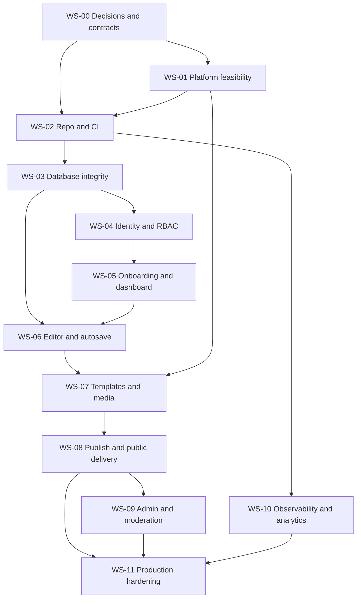

# Foliovanta — Production Implementation Plan

**Document ID:** FV-PLAN-001  
**Version:** 1.0 (implementation planning baseline)  
**Date:** 2026-10-21  
**Status:** Proposed for engineering/product sign-off; no implementation or infrastructure validation has been completed  
**Primary references:** `PRD.md`, `TRD.md`, `APP_FLOW.md`, `UI_UX_DESIGN_BRIEF.md`, `BACKEND_SCHEMA.md`  
**Audience:** Product, engineering, design, security, QA, operations, and release owners

> **Authority and scope:** This is an executable *plan*, not evidence that any requirement has been built, tested, or deployed. “Agreed” means the architecture direction was selected; “verified” requires recorded test evidence. Where source documents leave a product or technical decision open, this plan assigns an owner and a closure gate rather than inventing a final answer. A single engineer may hold several roles, but independent review is recommended for security and production release.

---

## 1. Executive implementation strategy

Foliovanta is a production multi-tenant portfolio-builder SaaS. A creator signs up, completes guided onboarding, edits structured portfolio content, chooses among **Minimal / Professional / Creative** templates, customizes validated design tokens, previews changes, and explicitly publishes an SEO-friendly portfolio at a generated `*.foliovanta.com` subdomain. Public pages serve **immutable published snapshots**, not editable drafts. Super Admin manages users, moderation, abuse reports, feedback, and audit history.

**Architecture baseline:** One Next.js 16 App Router modular monolith with strict server-only service boundaries; TypeScript, Tailwind, shadcn/ui/Radix, Clerk sessions, Neon PostgreSQL + Prisma, native `fetch` + TanStack Query, React Hook Form + Zod, selective Zustand, Cloudflare R2, Vercel, GA4 + database business events, Sentry, GitHub Actions, Vitest/RTL/Playwright.

**Delivery philosophy:** Build vertical slices, verify the riskiest platform assumptions first, enforce database/security invariants before feature UI, and keep every increment deployable to staging. Do not confuse a functioning happy path with production readiness.

### 1.1 Non-negotiable invariants

1. No authenticated user may read or mutate another user's private portfolio or assets.
2. Public visitors never receive draft content, private profile fields, or unpublished versions.
3. Autosave never silently overwrites a newer revision; lost acknowledgments and duplicate submissions are safe.
4. Publishing creates a complete, validated, immutable version and atomically changes the active version pointer.
5. Unpublish, suspension, account restrictions, and moderation cannot be bypassed by a warm cache or stale CDN response beyond the approved revocation objective.
6. Every user-controlled input, URL, media object, and template setting is validated at its trust boundary.
7. Production data is recoverable via an exercised backup/restore procedure, and deployments have a tested rollback path.
8. No production release without blocking security, accessibility, integration, and E2E gates passing.

### 1.2 Scope boundary

**MVP in scope:** marketing and template discovery; Clerk auth; one portfolio per user; resumable/skippable onboarding; creator dashboard; structured editor for Profile, About, Experience, Education, Projects, Skills, Certifications, Contact/Social; section visibility/reorder; three responsive templates; controlled appearance options; autosave and preview; explicit publish, republish, unpublish, version history/rollback capability; generated public subdomains; SEO/sharing; R2 media; Super Admin moderation/feedback/reports/audit; GA4 and durable business events; security/operability/testing.

**Future, not MVP commitments:** paid subscriptions, custom domains, multiple portfolios per user, generic drag-and-drop page builder, arbitrary HTML/CSS/JS, live collaborative editing, native mobile app, advanced creator analytics, real-time inbox/push, third-party public API, AI-generated content. Design for evolution, but do not implement speculative infrastructure.

---

## 2. Source-of-truth documents and change control

| Document | Owns | Required update when changed |
|---|---|---|
| `PRD.md` | Product behavior, personas, scope, business rules, release acceptance | Any user-facing feature/scope change |
| `TRD.md` | Architecture, security and NFR requirements | Technology, boundaries, infrastructure, security or performance decision |
| `APP_FLOW.md` | Routes, navigation, state transitions, errors | Any changed redirect, user journey or screen state |
| `UI_UX_DESIGN_BRIEF.md` | Design patterns, responsive behavior, accessibility, screen specifications | Any changed visual/interaction contract |
| `BACKEND_SCHEMA.md` | Domain models, DB invariants, transaction protocols | Any schema, ownership, persistence, retention change |
| `IMPLEMENTATION_PLAN.md` | Work sequencing, milestones, ownership, tests, release gates | Dependencies, delivery priorities or release strategy change |
| `docs/decisions/ADR-*.md` | Accepted decision, alternatives, consequences, triggers | Material architecture decisions |
| `docs/api/API_CONTRACTS.md` (to create) | Endpoint DTOs, errors, auth, idempotency, pagination | Any API contract change |
| `docs/security/THREAT_MODEL.md` (to create) | Threats, trust boundaries, mitigations | New sensitive flow or trust boundary |
| `docs/operations/RUNBOOKS.md` (to create) | Incident, restore, migration, cache revocation and rollback | Any operational process change |

**Change process:** Proposal → affected document/ADR updates → owner/reviewer approval → implementation and test updates → release notes. Do not silently promote “proposed” into “confirmed.” Version template schemas and public snapshot schemas independently of UI releases.

---

## 3. Delivery organization and working agreements

### 3.1 Accountability roles

| Role | Responsibility | Can be combined? |
|---|---|---|
| Product owner (PO) | MVP scope, publish readiness, quotas, consent, policy decisions | Yes |
| Technical lead (TL) | Architecture, ADRs, design reviews, quality gates | Yes |
| Frontend engineer (FE) | UI, editor, forms, client state, accessibility | Yes |
| Backend engineer (BE) | Domain services, Prisma, transactions, APIs, media | Yes |
| Platform/DevOps (OPS) | Vercel/Neon/R2/Clerk integration, CI/CD, observability, recovery | Yes |
| Design (UX) | Figma, design tokens, templates, user testing | Yes |
| QA/security reviewer (QA/SEC) | Automated test plans, adversarial tests, security sign-off | Prefer independent review |

**Single-engineer reality:** A solo builder can implement most work, but plan external review for auth/tenant isolation, publish concurrency, legal/privacy policy, and production operations. Estimates below are *effort ranges*, not calendar promises.

### 3.2 Definition of Ready (DoR) for an implementation ticket

- Traceable PRD/TRD requirement and explicit in/out scope.
- API/data/UI contract exists or ticket explicitly creates it.
- Dependencies, edge cases, acceptance criteria, test level, and owner identified.
- Privacy/security implications reviewed; design provided for visible work.
- No blocking unresolved P0 product decision.

### 3.3 Definition of Done (DoD)

- Code merged with peer review; strict typecheck, lint, formatting and build pass.
- Unit/integration/E2E tests added at the appropriate layer and pass in CI.
- Authz, validation, errors, loading/empty/conflict states, responsive behavior and accessibility addressed.
- Database migrations backward-compatible and tested; no secrets or sensitive data logged.
- Logs/metrics/alerts and support diagnostics added for critical flows.
- Relevant docs, API schemas, ADRs, and runbooks updated.
- Staging acceptance and rollback considerations reviewed. A deployed feature is not automatically “done.”

### 3.4 Branch and environment conventions (proposed)

- Protected `main`; short-lived feature branches; required PR checks; no direct production pushes.
- `local`, isolated `test`, `staging`, and `production` configurations with distinct Clerk/Neon/R2/Vercel credentials and datasets.
- Preview deployments use non-production resources; never leak production secrets to untrusted PRs.
- Prefer trunk-based integration and feature flags for incomplete features. Staging mirrors production topology where feasible.
- Pin Node/pnpm and all dependency versions via lockfile; pin Prisma/Next.js/Clerk SDK versions and validate compatibility before upgrades.

---

## 4. Workstream map and critical path

| ID | Workstream | Primary outputs | Depends on | Priority |
|---|---|---|---|---|
| WS-00 | Decisions, design and specifications | ADRs, UI tokens, API contracts, threat model | Existing docs | P0 |
| WS-01 | Infrastructure feasibility spikes | Working wildcard/TLS, Clerk, Neon, R2, caching experiments | WS-00 partial | P0 |
| WS-02 | Repository and CI foundation | App scaffold, modules, quality gates, staging deploy | WS-01 key results | P0 |
| WS-03 | Database and domain integrity | Validated Prisma schema, SQL migrations, concurrency tests | WS-00, WS-01 Neon | P0 |
| WS-04 | Identity and authorization | Clerk, internal users, RBAC, secure bootstrap | WS-02, WS-03 | P0 |
| WS-05 | Marketing, design system and onboarding | Public marketing, auth flows, onboarding, dashboard | WS-02, WS-04, UX | P0 |
| WS-06 | Editor and draft engine | CRUD, autosave, conflicts, preview projection | WS-03–05 | P0 |
| WS-07 | Media and design/template engine | R2 pipeline, token system, 3 templates | WS-01, WS-03, WS-06 | P0 |
| WS-08 | Publishing and public delivery | Snapshots, subdomains, SEO, rollback/unpublish | WS-01, WS-03, WS-06–07 | P0 |
| WS-09 | Super Admin, moderation and feedback | Admin screens, reports, audit trail | WS-03–04, WS-08 | P0 |
| WS-10 | Analytics, notifications and operations | Events, Sentry, jobs, alerts, runbooks | WS-02 onward | P0 |
| WS-11 | Hardening and production launch | Security, load, recovery, accessibility, release | All MVP workstreams | P0 |

**Critical path:** Feasibility + P0 decisions → DB/auth → editor concurrency → snapshot/template compatibility → public delivery/moderation → security/recovery/launch. Design, marketing UI, analytics plumbing, and observability can proceed in parallel once interfaces are defined.



---

## 5. Phase 0 — Close blocking decisions and prove infrastructure

**Goal:** Avoid building core product behavior on unverified platform assumptions. Start this phase before extensive feature development.

### P0-01 — Resolve product and contract decisions

- [ ] **P0-01.01 [PO/TL]** Approve publish-ready minimum fields, template selection behavior, and optional onboarding skip rules. **Evidence:** PRD acceptance table.
- [ ] **P0-01.02 [PO/BE]** Approve configurable free-tier entry limits, media size/storage, request/snapshot payload caps, and abuse thresholds. **Evidence:** versioned entitlement policy + Zod limits.
- [ ] **P0-01.03 [PO/UX]** Decide plain text versus restricted Tiptap rich text and supported formatting; avoid arbitrary HTML. **Evidence:** content schema + renderer contract.
- [ ] **P0-01.04 [PO/UX]** Approve immutable MVP slug, version-history/rollback UI scope, public contact mechanism, abuse-report anonymity, and moderation under-review behavior. **Evidence:** PRD/APP_FLOW updates.
- [ ] **P0-01.05 [PO/LEGAL/SEC]** Approve privacy/consent, retention/erasure, analytics retention, Terms/Privacy content and brand/domain clearance. **Evidence:** written policy approvals; legal review where required.
- [ ] **P0-01.06 [UX/TL]** Approve per-template customization matrix, font/color constraints, design token defaults, and mobile behavior. **Evidence:** Figma + token registry specification.
- [ ] **P0-01.07 [TL/BE]** Complete `docs/api/API_CONTRACTS.md` with Zod DTOs, auth, errors, idempotency, pagination, and cache policy. **Evidence:** contract review and example payloads.
- [ ] **P0-01.08 [TL/SEC]** Complete threat model and cross-tenant permission matrix. **Evidence:** threat register and test IDs.
- [ ] **P0-01.09 [OPS/PO]** Propose numeric SLO, RTO, RPO, public cache revocation objective, and performance budgets; approve after PoC/load baseline. **Evidence:** operational objectives document.

### P0-02 — Blocking platform spikes

| Spike ID | Experiment | Required evidence / pass condition | Failure response |
|---|---|---|---|
| SP-01 | Vercel wildcard DNS + TLS | Real generated slug HTTPS works; marketing/app/portfolio hosts route correctly; unknown host rejected | Revisit hostname architecture/hosting ADR |
| SP-02 | Clerk sessions and hostname boundaries | Login/logout, callback, SSR auth, app/admin authorization, no session leakage to public hosts | Rework auth/host boundary before editor |
| SP-03 | Neon + Prisma connections | Pooled runtime requests and direct migration connection work under representative concurrency | Revise pooling/deployment strategy |
| SP-04 | R2 signed upload and delivery | Short-lived upload, size/type/ownership checks, completion verification, image delivery tested | Revise media pipeline |
| SP-05 | Warm-cache publish/unpublish/suspend | Correct version and bounded revocation time across edge caches | Change caching/eligibility architecture |
| SP-06 | DB concurrency | CAS autosave, duplicate mutation, parallel publish, active-version FK and immutability constraints pass | Correct schema/transaction protocol |
| SP-07 | Snapshot renderer compatibility | Old version still renders after simulated template/schema upgrade | Define migration/compatibility adapter |
| SP-08 | Monitoring and recovery | Controlled error generates trace/alert; isolated DB restore works | Block launch until remediated |

**Exit gate G0:** SP-01 through SP-06 demonstrated or architecture amended with a passing replacement design. SP-07 and SP-08 must pass before public launch; run them early enough to avoid rework. Record command/configuration, environment, screenshots/logs, result, and ADR link in `docs/spikes/`.

---

## 6. Phase 1 — Repository, quality baseline, and environment setup

**Goal:** A secure, reproducible, deployable skeleton with automated verification.

- [ ] **FND-01 [TL]** Initialize Next.js App Router + React + strict TypeScript + pnpm; lock Node and package versions; configure env validation (server/client separation).
- [ ] **FND-02 [FE]** Configure Tailwind, shadcn/ui, Radix, Lucide, Sonner, typography, shared platform tokens, responsive shells and error boundaries.
- [ ] **FND-03 [TL]** Establish feature modules and server-only boundaries: `src/features/{auth,users,portfolios,onboarding,editor,templates,design,publishing,media,seo,analytics,feedback,notifications,admin}`; `src/lib/{db,auth,permissions,api,storage,env}`. Avoid importing Prisma into client bundles.
- [ ] **FND-04 [BE]** Implement standardized `ApiError`, Zod validation helpers, request IDs, safe error mapping, and typed native-fetch client. Do not hide failures behind HTTP 200.
- [ ] **FND-05 [FE]** Install TanStack Query provider and query-key factory, RHF/Zod resolver, selective Zustand editor UI store, and route error/loading patterns.
- [ ] **FND-06 [QA]** Configure Vitest, React Testing Library, MSW, Playwright, axe checks, test DB isolation, fixtures and deterministic clocks/IDs where necessary.
- [ ] **FND-07 [OPS]** GitHub Actions: install → lint → typecheck → unit → integration → production build → E2E on preview/staging; secrets isolation, required branch checks, dependency scanning.
- [ ] **FND-08 [OPS]** Create Vercel staging and production projects/environments, DNS ownership controls, Neon branches/databases, R2 buckets, Clerk instances, Sentry projects; secure secret management.
- [ ] **FND-09 [OPS]** Add structured JSON logs, correlation IDs, redaction policy, health checks, error tracking, deployment annotations, and baseline alerts.
- [ ] **FND-10 [TL]** Write README, local setup, environment inventory, ADR index, module import rules, and contribution/review guidelines.

**Gate G1:** Fresh clone boots locally; isolated test suite passes; staging deploy builds and serves expected hosts; unauthorized server imports and missing env vars fail fast; secret scan and basic monitoring work.

---

## 7. Phase 2 — Database schema and domain integrity (WP-02 completion)

**Goal:** Convert `BACKEND_SCHEMA.md` into executable, tested Prisma/SQL migrations, not just a conceptual ERD.

### 7.1 Models and migrations

- [ ] **DB-01 [BE]** Pin Prisma/PostgreSQL compatibility; extract `prisma/schema.prisma` from reviewed design; run `prisma validate`, generate client, inspect SQL migration.
- [ ] **DB-02 [BE]** Implement identity/portfolio: `User`, `Portfolio`, profile, settings, design, section metadata, account state and ownership indexes.
- [ ] **DB-03 [BE]** Implement repeatable `Project`, `Experience`, `Education`, `Skill`, `Certification`, `SocialLink` models with stable IDs, position and explicit FK behavior; no fixed count columns.
- [ ] **DB-04 [BE]** Implement `PortfolioVersion`, snapshot schema/template version fields, content hash, publication status and active-version pointer.
- [ ] **DB-05 [BE]** Implement `DraftMutation` idempotency, publication-command idempotency, `UserEntitlement`, and transactional quota enforcement (including concurrent one-portfolio creation).
- [ ] **DB-06 [BE]** Implement `MediaAsset`, asset associations and `PortfolioVersionAsset` reference retention; upload reservations/quotas and lifecycle statuses.
- [ ] **DB-07 [BE]** Implement `Feedback`, `AbuseReport`, `ModerationAction`, `AuditLog`, `BusinessEvent`, and `OutboxEvent`.
- [ ] **DB-08 [BE]** Add custom PostgreSQL CHECKs, partial/unique indexes, canonical slug rules, composite active-version ownership FK, cross-portfolio asset constraints and immutable snapshot enforcement (triggers/privileges as appropriate).
- [ ] **DB-09 [BE/OPS]** Define expand/contract migrations, separate runtime/migration DB privileges, production migration order, backups, rollback compatibility, and seed fixtures.
- [ ] **DB-10 [QA/SEC]** Execute migration and constraints against disposable PostgreSQL; test all referential actions, delete behavior, unique keys and check constraints.

### 7.2 Transaction tests (mandatory)

| Test ID | Scenario | Required result |
|---|---|---|
| DB-T01 | Two tabs save expected revision N | One commits N+1; other gets conflict; no lost data |
| DB-T02 | Save commits, response lost, same mutation retried | Original result returned; no duplicate change |
| DB-T03 | Same mutation ID with different payload | Rejected; no silent replay of wrong payload |
| DB-T04 | Parallel first-portfolio creates | MVP entitlement enforced atomically |
| DB-T05 | Parallel quota-consuming uploads | No quota over-allocation |
| DB-T06 | Concurrent publish requests | Unique ordered versions; pointer consistent; idempotent replay |
| DB-T07 | Publish while draft mutates | Snapshot reflects exactly one confirmed revision |
| DB-T08 | Active version from another portfolio | DB rejects cross-portfolio pointer |
| DB-T09 | Asset from another portfolio | Ownership/association violation rejected |
| DB-T10 | Update/delete immutable version | Application/runtime DB privileges reject |
| DB-T11 | Soft delete/suspend/unpublish | Public eligibility fails; audit preserved per policy |
| DB-T12 | Schema migration and rollback compatibility | Old/new app versions operate safely during rollout |

**Gate G2:** All P0 gaps in `BACKEND_SCHEMA.md` §13 resolved, migration reproducible on clean database, required constraints inspected in PostgreSQL, DB-T01–DB-T12 pass. Do not start production data ingestion with an unvalidated schema.

---

## 8. Phase 3 — Identity, sessions, roles, and account lifecycle

**Goal:** Secure Clerk-managed browser sessions and database-backed authorization; no custom token storage.

- [ ] **AUTH-01 [BE/FE]** Integrate Clerk sign-up/sign-in, Google and email/password, email verification, redirects, sign-out, session expiration and reauthentication UX.
- [ ] **AUTH-02 [BE]** Implement internal user provisioning and idempotent verified Clerk webhooks, with reconciliation for webhook delays/failures.
- [ ] **AUTH-03 [BE]** Implement `getCurrentActor()` and centralized permission policies for USER/ADMIN/SUPER_ADMIN; deny-by-default for missing/disabled accounts.
- [ ] **AUTH-04 [BE]** Authorize every resource query/mutation by ownership and status; route/proxy checks are convenience only, not security boundaries.
- [ ] **AUTH-05 [SEC]** Implement CSRF/origin policy for cookie-authenticated mutations, session fixation/cross-host checks, webhook signature verification and rate limits.
- [ ] **AUTH-06 [FE]** Handle loading, logged-out, unverified, suspended, disabled, deleted and account-switch states without private-data flash.
- [ ] **AUTH-07 [BE]** Implement account profile/preferences, soft deletion initiation, recovery/erasure workflow per approved policy.
- [ ] **AUTH-08 [QA]** Cross-tenant API matrix, admin role escalation attempts, cookie/session leakage, webhook replay, logout/account-switch cache invalidation tests.

**Gate G3:** Unauthorized requests fail at service boundary; no client token stored in localStorage/Zustand; Clerk and DB identities reconcile; all cross-tenant tests pass.

---

## 9. Phase 4 — Marketing, onboarding, and creator dashboard

**Goal:** Deliver the first coherent authenticated creator journey before the complex editor.

### Marketing and template discovery

- [ ] **MKT-01 [FE/UX]** Landing `/` with product value, CTA, accessibility and responsive behavior.
- [ ] **MKT-02 [FE]** Template gallery `/templates` and details `/templates/[templateId]` with safe example content and working preview.
- [ ] **MKT-03 [FE/BE]** Marketing SEO metadata, canonical URLs, robots/sitemap rules, basic analytics consent wiring.

### Onboarding and dashboard

- [ ] **ONB-01 [FE/BE]** Persona/welcome `/onboarding/welcome`; profile `/onboarding/profile`; background `/onboarding/background`; projects `/onboarding/projects`; template `/onboarding/template`.
- [ ] **ONB-02 [BE]** Server-side validation, idempotent draft creation, resumable progress, skip/return behavior, and entitlement checks.
- [ ] **ONB-03 [FE]** Accessible form feedback, progress, empty states, keyboard navigation, mobile layouts and safe redirects.
- [ ] **DASH-01 [FE/BE]** Dashboard `/dashboard`: portfolio state, completion/publish readiness, preview/edit/publish entry points, public link and errors.
- [ ] **DASH-02 [QA]** E2E first signup → onboarding skip/resume → dashboard; existing account redirect; session expiry and denied states.

**Gate G4:** Creator can authenticate, initialize exactly one portfolio, resume onboarding and enter editor without duplicate records or losing progress.

---

## 10. Phase 5 — Structured editor, autosave and preview (critical path)

**Goal:** Correct editing semantics under real latency, retries, navigation, multiple tabs and failure.

### Editor shell and content features

- [ ] **ED-01 [FE]** Shared editor shell with sidebar, section routing, responsive panel layout, save indicator, preview toggle, publish entry point and keyboard support.
- [ ] **ED-02 [FE/BE]** Profile and About editors with RHF/Zod, field-level errors and validated external links.
- [ ] **ED-03 [FE/BE]** Experience, Education, Projects, Skills, Certifications and Contact/Social repeatable CRUD; add/remove/reorder, stable IDs, empty states, quota feedback.
- [ ] **ED-04 [FE/BE]** Section visibility, ordering and supported layout variants with dnd-kit and accessible keyboard alternatives.
- [ ] **ED-05 [BE]** Atomic revision compare-and-swap mutation service and durable mutation-idempotency ledger.
- [ ] **ED-06 [FE]** Single portfolio-scoped autosave coordinator: debounce (~800ms starting hypothesis), one in-flight mutation, coalesced queue, acknowledged revision tracking, cancellation where safe.
- [ ] **ED-07 [FE/BE]** Conflict UX (409), reload/compare/reapply choices, multi-tab coordination via BroadcastChannel plus authoritative server revision.
- [ ] **ED-08 [FE]** Network failure/retry states, unsaved navigation handling, error recovery, reload/termination recovery strategy (explicitly designed, not implied by beforeunload).
- [ ] **ED-09 [FE]** Local preview projection merges acknowledged draft + current unsaved changes without corrupting TanStack Query server cache.
- [ ] **ED-10 [BE]** Read APIs, query key scoping, mutation invalidation and logout/account-switch cache isolation.
- [ ] **ED-11 [QA]** Simulated slow/out-of-order responses, rapid typing, tab switching, duplicate requests, lost acknowledgment, offline reconnect, conflicts and publish barrier tests.

### Required editor state transitions

`SAVED → DIRTY → SAVING → SAVED` is the happy path. The product must also implement `SAVING → DIRTY` (new edits during request), `SAVING → ERROR`, `SAVING → CONFLICT`, and `DIRTY/SAVING → OFFLINE` without losing local changes.

**Gate G5:** ED-11 passes against real PostgreSQL plus browser E2E; no silent data loss; the preview shows local edits; save acknowledgment never resets newer form state. Do not enable Publish until this gate passes.

---

## 11. Phase 6 — Media pipeline, template registry and design customization

**Goal:** Safe creator-controlled assets and three interchangeable accessible public templates.

### Media

- [ ] **MED-01 [BE]** Signed R2 upload initiation, ownership/entitlement checks, short expiration, server-generated object keys and quota reservation.
- [ ] **MED-02 [FE]** Upload UI, progress where supported, cancellation, validation errors, crop interaction only if product-approved.
- [ ] **MED-03 [BE/OPS]** Completion verification, actual file signature/size checks, image metadata, processing/variants, safe serving headers and content-type enforcement.
- [ ] **MED-04 [BE]** Asset associations, published-version references, retention-aware garbage collection, orphan cleanup, idempotent delete jobs.
- [ ] **MED-05 [QA/SEC]** Cross-user uploads, forged MIME, oversized/animated/problematic files, signed URL reuse, quota races, orphan recovery and media exposure tests.

### Templates and appearance

- [ ] **TPL-01 [FE/UX]** Canonical renderer input schema, typed template registry, `templateId`/`templateVersion`, snapshot schema compatibility adapters.
- [ ] **TPL-02 [FE/UX]** Minimal template, responsive/a11y/SEO reviewed.
- [ ] **TPL-03 [FE/UX]** Professional template, responsive/a11y/SEO reviewed.
- [ ] **TPL-04 [FE/UX]** Creative template, responsive/a11y/SEO reviewed.
- [ ] **TPL-05 [FE]** Curated palette/fonts, validated custom colors, token resolution, contrast checks, light/dark and layout variants where approved.
- [ ] **TPL-06 [FE/QA]** Template switching preserves all canonical content and hidden sections; visual regression snapshots and representative long/short content tests.
- [ ] **TPL-07 [TL/QA]** Compatibility fixture suite for every supported historical snapshot/template version; deployment cannot drop a renderer while published versions still need it.

**Gate G6:** R2 lifecycle and quota tests pass; all three templates render identical canonical content without loss, remain usable on mobile and keyboard, and old snapshot fixtures render correctly.

---

## 12. Phase 7 — Publishing, public routing, SEO and rollback

**Goal:** Public portfolios are consistent, fast, crawlable, and immediately controllable through explicit lifecycle actions.

- [ ] **PUB-01 [BE]** Publish-readiness validator: approved minimum fields, account verification, template support, media READY state, quota/size and schema validation.
- [ ] **PUB-02 [FE/BE]** Publish barrier: flush pending edits, wait for acknowledgment, block unresolved conflicts, submit confirmed expected revision and idempotency key.
- [ ] **PUB-03 [BE]** Transactional publish: authorize; lock/serialize per portfolio; read consistent draft; validate; create immutable snapshot; allocate version; update pointer; write audit + outbox; commit.
- [ ] **PUB-04 [BE]** Idempotent republish and version history; rollback changes active pointer only; unpublish and moderation eligibility independent of draft.
- [ ] **PUB-05 [OPS/BE]** Hostname routing for `foliovanta.com`, `app.foliovanta.com`, and `<slug>.foliovanta.com`; canonical slug reservation; unknown host/slug behavior.
- [ ] **PUB-06 [FE/BE]** SSR public renderer reads active snapshot only; no Clerk requirement for visitors; appropriate 404/unavailable status and noindex behavior.
- [ ] **PUB-07 [BE/OPS]** Cache design with publication invalidation and bounded revocation for suspend/unpublish; never cache private editor data publicly.
- [ ] **PUB-08 [FE/BE]** Next.js Metadata API, Open Graph/Twitter cards, canonical URLs, JSON-LD, sitemap, robots, Search Console readiness.
- [ ] **PUB-09 [FE]** Private preview, readiness screen, publish success, version history/rollback UI per approved MVP scope.
- [ ] **PUB-10 [QA/SEC]** Concurrent publish/edit, immutable version attempts, cache-warm suspension, stale content, invalid host, template upgrade, SEO and status-code tests.

**Gate G7:** Full publish/republish/rollback/unpublish/suspend matrix passes with warmed caches; public content never exposes draft; Google-facing metadata/status behavior validated; public hosts work with real TLS.

---

## 13. Phase 8 — Super Admin, feedback and trust/safety

**Goal:** The operator can investigate and mitigate abuse without bypassing tenant boundaries or losing auditability.

- [ ] **ADM-01 [BE]** Server-enforced USER/ADMIN/SUPER_ADMIN policy matrix; no role trust from client UI; admin session and access logging.
- [ ] **ADM-02 [FE/BE]** Admin overview `/admin`, users list/detail, portfolio list/detail, feedback queue, abuse report queue and audit log screens.
- [ ] **ADM-03 [BE]** Moderation actions (suspend/reinstate/under-review per approved policy) with reason, actor, timestamp, audit record and public cache revocation.
- [ ] **ADM-04 [BE/FE]** Feedback submission, abuse report validation, anti-spam controls, reporter privacy and status workflow.
- [ ] **ADM-05 [BE]** Paginated/filterable admin queries, server-side permission checks, appropriate redaction of personal data.
- [ ] **ADM-06 [QA/SEC]** Privilege escalation, admin direct URL, unauthorized API access, audit integrity, suspension race and report-spam tests.

**Gate G8:** Super Admin can safely moderate and review reports; regular users cannot access admin data/actions; audit history captures every privileged mutation; public suspension takes effect within approved bound.

---

## 14. Phase 9 — Analytics, notifications, asynchronous work and observability

**Goal:** Understand product behavior and reliably detect/handle failures without making critical workflows depend on analytics providers.

### Analytics

- [ ] **OBS-01 [BE]** Typed business event catalog: signup, onboarding milestones, template selection, draft save aggregate, publish/unpublish/rollback, portfolio view and contact click where consent/policy permits.
- [ ] **OBS-02 [FE]** GA4 events with consent-aware instrumentation and route/event deduplication; do not send sensitive profile content or credentials.
- [ ] **OBS-03 [BE]** Durable business events and outbox insertion within critical transactions; idempotent consumers and retry strategy.
- [ ] **OBS-04 [PO/QA]** Verify GA4 against consent policy, event taxonomy and expected dashboard semantics; document that GA4 is not authoritative for business records.

### Notifications and background work

- [ ] **JOB-01 [FE]** Sonner for transient messages; persistent inline autosave state for critical save feedback.
- [ ] **JOB-02 [BE]** Clerk-managed authentication emails; introduce Resend + React Email only for approved transactional use cases.
- [ ] **JOB-03 [BE/OPS]** Choose job runner (Inngest/Trigger.dev/other) based on actual outbox/media cleanup workloads; configure retries, idempotency, dead-letter visibility, rate limits and replay tooling.
- [ ] **JOB-04 [QA]** Prove database commit survives provider outage; replay does not duplicate side effects; stuck jobs alert and recover.

### Monitoring and operations

- [ ] **OPS-01 [OPS]** Sentry client/server error capture, release tagging, privacy-safe breadcrumbs and request correlation.
- [ ] **OPS-02 [OPS]** Structured logs for auth failures, save conflicts, publish events, moderation, upload failures, jobs and DB errors; no secrets/PII beyond approved policy.
- [ ] **OPS-03 [OPS]** Dashboards and actionable alerts for 5xx, p95 latency, failed publishes, save failures, webhook drift, queue backlog, R2 errors, DB connection pressure and cache revocation.
- [ ] **OPS-04 [OPS]** Incident runbooks: auth outage, DB unavailable, broken deployment, stuck jobs, media leak, stale suspended portfolio, accidental deletion, compromised admin.
- [ ] **OPS-05 [QA/OPS]** Inject representative failures and verify alert delivery, ownership and recovery procedure.

**Gate G9:** Critical failure paths are observable and actionable; asynchronous delivery is idempotent; analytics respects consent and does not break core workflows.

---

## 15. Phase 10 — Production hardening and launch

### 15.1 Security verification

- [ ] **SEC-01** Full tenant isolation matrix for every resource and method; horizontal and vertical privilege escalation attempts.
- [ ] **SEC-02** CSRF, XSS, unsafe URLs, CSP, HTML/rich-text rendering, SSRF through URL/media features, open redirects, upload content spoofing, signed URL abuse.
- [ ] **SEC-03** Clerk session/logout/verification, admin access, webhook replay and identity reconciliation.
- [ ] **SEC-04** Rate limits, bot controls and cost-abuse testing on signups, reports, uploads, public traffic and expensive APIs.
- [ ] **SEC-05** Dependency vulnerability review, secret scanning, least-privilege cloud credentials, audit of production access.
- [ ] **SEC-06** Privacy review: data export/deletion, retention, backup policy, consent, Terms/Privacy, support and incident contact.

### 15.2 Reliability and performance verification

- [ ] **REL-01** Load test public SSR/cache and authenticated CRUD against approved p95/p99 and error-rate targets; measure DB pool saturation and storage/CDN cost.
- [ ] **REL-02** Test long portfolios, many repeated entries, large images, 3 templates, low-end mobile, throttled network, poor connectivity and slow API responses.
- [ ] **REL-03** Verify cache revocation after unpublish/suspend, stale-while-revalidate behavior, failed invalidation and fallback authorization.
- [ ] **REL-04** Exercise database restore into isolated environment and reconcile snapshot/R2 references; measure actual RPO/RTO.
- [ ] **REL-05** Exercise application rollback, migration compatibility, partial deployment failure and controlled outage response.
- [ ] **REL-06** Accessibility audit (keyboard, focus, semantics, labels, color contrast, reduced motion, screen reader critical journeys) and supported browser/device matrix.
- [ ] **REL-07** Verify historical published snapshots render after upgrade; no destructive template/schema deployment.

### 15.3 Launch sequence

1. **Feature complete in staging:** All MVP features behind tested contracts, three templates, admin moderation, analytics/monitoring and release gates.
2. **Internal alpha:** Seed/test accounts, destructive and concurrency tests, no external public promotion.
3. **Closed beta:** Limited real creators; consent and support processes live; capture reliability/performance/cost baselines; triage defects.
4. **Go/no-go review:** PO + TL + QA/SEC + OPS approve evidence and open risk register; no unaccepted P0/P1 launch blockers.
5. **Production deployment:** Verify backup, run compatible migrations, deploy with flags, execute smoke tests, confirm alerts and public routing.
6. **Controlled rollout:** Invite a limited cohort, monitor error rate, auth, publish success, cache revocation, abuse and costs; expand only if healthy.
7. **Post-launch review:** Incident/defect summary, actual performance and SLOs, cost and usage, prioritized backlog, ADR updates.

### 15.4 Hard launch blockers

Production launch is **NO-GO** if any of the following remains true: wildcard DNS/TLS unverified; tenant isolation bypass; autosave data loss; non-atomic publishing; broken historical snapshots; suspended content publicly accessible beyond approved objective; unsafe media upload; admin RBAC bypass; unresolved critical/high security vulnerability without formal acceptance; failed required CI/E2E; untested backup restore; unknown deployment/migration rollback path; missing legal/privacy/consent approvals; missing production alert ownership.

---

## 16. API implementation inventory and contract sequencing

The endpoint paths below are **proposed**, not finalized public interfaces. Exact DTOs belong in `docs/api/API_CONTRACTS.md` before implementation.

| API family | Example routes | Auth/authorization | Key contract concern |
|---|---|---|---|
| Session/account | Clerk SDK routes, `/api/me` | Session, account state | Provisioning, logout, identity switching |
| Onboarding | `/api/onboarding`, `/api/onboarding/complete` | Owner | Resumable/idempotent |
| Portfolio | `/api/portfolios`, `/api/portfolios/[id]` | Owner/admin policy | One-portfolio entitlement, slug |
| Draft | `/api/portfolios/[id]/draft` | Owner | Expected revision, mutation ID, 409 |
| Content | `/api/portfolios/[id]/projects`, analogous sections | Owner | Stable IDs, ordering, quotas |
| Design | `/api/portfolios/[id]/design` | Owner | Validated tokens/template version |
| Media | `/api/media/uploads`, `/api/media/[id]` | Owner | Reservations, signed URL, verification |
| Publish | `/api/portfolios/[id]/publish` | Owner | Revision barrier, idempotency, transaction |
| Versions | `/api/portfolios/[id]/versions`, `/rollback` | Owner | Historical compatibility, pointer integrity |
| Visibility | `/api/portfolios/[id]/unpublish` | Owner | Revocation bound |
| Feedback/reports | `/api/feedback`, `/api/reports` | As policy allows | Spam controls, privacy |
| Admin | `/api/admin/users`, `/api/admin/portfolios`, `/api/admin/reports` | Server-enforced admin role | Audit and redaction |
| Webhooks | `/api/webhooks/clerk`, job callbacks | Verified signature | Replay protection and idempotency |

**Transport policy:** Server Components call domain services directly; client interactive reads/mutations use TanStack Query and typed native fetch to Route Handlers; simple Server Actions may be used selectively if they invoke the same services. Route Handlers do not own business logic.

**Contract acceptance:** Every endpoint defines input Zod schema, response schema, status/error codes, auth policy, tenant scoping, pagination where needed, idempotency and rate limits, cache policy, and unit/integration tests. Public endpoints must not accidentally return internal draft fields.

---

## 17. Test strategy and coverage matrix

| Layer | Tool | Mandatory scope | Trigger |
|---|---|---|---|
| Static | TypeScript strict, ESLint, Prettier | Types, import boundaries, style | Every PR |
| Unit | Vitest | Validators, token resolution, permission policies, snapshot builder, autosave reducer | Every PR |
| Component | React Testing Library | Forms, save indicators, error/conflict states, accessible controls | Every PR touching UI |
| API/service integration | Vitest + disposable PostgreSQL | Authz, constraints, transactions, idempotency, quotas | Every PR touching server/data |
| Contract | Zod fixtures, API integration | DTOs, errors, version compatibility | Every API/schema change |
| Browser E2E | Playwright | Signup/onboarding/editor/publish/public/admin critical paths | Required pre-merge or staging gate |
| Accessibility | axe + manual screen reader/keyboard | Editor, onboarding, public templates, admin | Feature sign-off and pre-launch |
| Security | Automated + manual adversarial cases | Tenant isolation, CSRF/XSS, upload, RBAC | Each security-sensitive slice and release |
| Performance | Load and browser profiling | Public traffic, draft save, DB pool, image rendering | Before beta and launch |
| Recovery | Isolated restore/deploy drills | DB/R2 reconciliation, rollback, stale cache | Before launch and periodically |

### Critical E2E scenarios

- **E2E-01:** New visitor → sign up → verify → onboarding → dashboard → editor → publish → visit generated HTTPS subdomain.
- **E2E-02:** Skip optional onboarding → resume later → publish readiness blocks only missing required fields.
- **E2E-03:** Add/reorder/delete multiple entries → switch templates → content remains intact.
- **E2E-04:** Rapid typing + slow network + navigation → latest acknowledged draft survives refresh.
- **E2E-05:** Two tabs edit same revision → one conflict; reconciliation prevents silent loss.
- **E2E-06:** Publish with unsaved edits → flush/confirm revision → public snapshot matches preview.
- **E2E-07:** Edit after publish → public stays unchanged until republish.
- **E2E-08:** Rollback to prior version → active public snapshot changes without rewriting history.
- **E2E-09:** Unpublish/suspend with warmed cache → public eligibility correctly revoked.
- **E2E-10:** User A requests User B's draft/media/admin data → access denied.
- **E2E-11:** Upload invalid or cross-owned media → rejected without quota leak.
- **E2E-12:** Admin suspends/reinstates with audit trail; non-admin cannot perform action.
- **E2E-13:** Public metadata, canonical, sitemap, OG and status behavior for published/unknown/suspended slugs.
- **E2E-14:** Account switch/logout clears private cached content and editor state.
- **E2E-15:** Old snapshot fixture still renders after template/schema upgrade.

---

## 18. Milestones, estimates, and staffing assumptions

**Estimation method:** Rough engineer-effort ranges for planning, **not** fixed delivery dates or quotations. They assume one experienced full-stack engineer familiar with Next.js, access to design decisions and service accounts, and reusable libraries. QA, security review, legal approvals, vendor delays, and design production can add elapsed time. Parallel work reduces calendar time but not total effort. Re-estimate after Phase 0 spikes and backlog refinement.

| Milestone | Scope | Indicative engineering effort | Exit |
|---|---|---:|---|
| M0 | Decisions, API/schema contracts, infrastructure PoCs | 2–4 engineer-weeks | G0 |
| M1 | Repo, CI, staging, schema and identity | 3–5 engineer-weeks | G1–G3 |
| M2 | Marketing, onboarding, dashboard | 2–4 engineer-weeks | G4 |
| M3 | Editor, autosave, content CRUD and preview | 4–7 engineer-weeks | G5 |
| M4 | Media, three templates, design tokens | 4–7 engineer-weeks | G6 |
| M5 | Publish, subdomains, SEO, rollback | 3–5 engineer-weeks | G7 |
| M6 | Admin, moderation, analytics and jobs | 3–5 engineer-weeks | G8–G9 |
| M7 | Security, accessibility, load, recovery, beta and launch | 3–6 engineer-weeks | Launch sign-off |

**Illustrative total:** ~24–43 engineer-weeks across engineering tasks, excluding significant custom visual design, legal/compliance effort, major infrastructure surprises and ongoing operations. This is a broad planning envelope, not a commitment. A solo engineer's elapsed timeline will likely be longer due to context switching, testing, reviews and vendor dependencies. Avoid deriving exact calendar dates until Phase 0 closes.

### Milestone demo artifacts

| Milestone | Review artifact |
|---|---|
| M0 | ADR pack, tested platform spikes, approved P0 decisions |
| M1 | Staging app, migrations, secure auth and CI reports |
| M2 | Recorded new-user onboarding E2E and accessible dashboard |
| M3 | Autosave/concurrency test report and editor demo |
| M4 | Three template gallery with content-preservation/visual test report |
| M5 | Live generated subdomain with publish/rollback/cache tests |
| M6 | Admin moderation workflow, alerts, analytics event verification |
| M7 | Signed go/no-go checklist, restore/rollback drill, controlled launch |

---

## 19. Prioritized initial backlog (first implementation cycle)

These are the first tickets to create. Do **not** begin complex UI work before the blocking architectural contracts and PoCs.

| Order | Ticket | Priority | Dependency | Acceptance evidence |
|---:|---|---|---|---|
| 1 | P0-01.01–09: close product/technical P0 decisions | P0 | Existing docs | Signed decisions/ADRs |
| 2 | SP-01: wildcard host/TLS proof | P0 | Domain/test host | HTTPS and routing logs |
| 3 | SP-02: Clerk session/host proof | P0 | Test app | Session/role security tests |
| 4 | SP-03: Neon/Prisma pool proof | P0 | DB credentials | Migration/concurrency report |
| 5 | SP-04: R2 upload proof | P0 | R2 credentials | Signed upload validation report |
| 6 | FND-01/03/07: repo, modules and CI | P0 | Key spikes | Clean CI + staging build |
| 7 | DB-01/08/10: schema extraction and SQL constraints | P0 | P0 decisions | Migration + integrity tests |
| 8 | DB-05/06: idempotency, quotas, media references | P0 | Schema | Parallel race tests |
| 9 | AUTH-01–05: Clerk bootstrap and policy layer | P0 | DB, repo | Authz/adversarial tests |
| 10 | ONB-01/02 and DASH-01: first creator slice | P0 | Auth | Signup-to-dashboard E2E |
| 11 | ED-05/06/11: autosave coordinator and protocol | P0 | DB/API contracts | Concurrency/loss tests |
| 12 | TPL-01/PUB-03: versioned renderer and publish transaction | P0 | Editor, schema | Snapshot compatibility/race tests |

### Ticket template

```md
## [ID] Title
**Owner:**
**Priority:** P0/P1/P2
**Source requirements:** PRD §..., TRD §..., APP_FLOW §...
**Dependencies:**
**Scope / out of scope:**
**Implementation notes:**
**Security and privacy considerations:**
**Acceptance criteria (Given / When / Then):**
**Tests:** Unit / Integration / E2E / Accessibility / Security
**Observability:** Logs, metrics, alerts
**Docs / migration / rollback impact:**
**Evidence links:** PR, CI, staging run, screenshots, logs
```

---

## 20. Risk register and contingency plans

| Risk | Severity | Early warning | Mitigation / contingency | Owner |
|---|---|---|---|---|
| Wildcard routing/TLS unsupported or costly | High | SP-01 fails | Amend host/deployment ADR before public renderer work | OPS/TL |
| Clerk session behavior differs across subdomains | High | SP-02 mismatch | Keep auth on app origin; rework routing/security boundary | BE/SEC |
| Prisma/Neon pooling or migration limitations | High | SP-03 connection/migration failure | Separate pooled runtime/direct migrations; tune/revise driver | BE/OPS |
| Autosave loses data under latency | Critical | DB-T/E2E failures | Serialize saves, atomic CAS, durable idempotency, conflict UX | FE/BE |
| Public cache leaks suspended content | Critical | SP-05/PUB-10 fails | Eligibility checks/revocation strategy; fail closed | BE/OPS |
| Snapshot schema upgrade breaks old sites | High | TPL-07 fixture fails | Compatibility adapters and staged migrations | FE/BE |
| Cross-tenant media association | Critical | DB-T09/MED-05 fails | DB constraints + service checks; block release | BE/SEC |
| R2 object orphaning/storage cost | Medium | Cleanup backlog/storage growth | Asset reference tracking, retention GC, quota reservation | BE/OPS |
| Scope creep in template/page builder | High | Arbitrary layout feature requests | Enforce structured content + supported variants; defer generic builder | PO/TL |
| Underestimated visual/template effort | Medium | UX specs incomplete | Complete Figma/token matrix; adjust schedule | UX/PO |
| Analytics/privacy policy incomplete | High | Consent or retention unresolved | Block tracking/release until approved | PO/LEGAL |
| Insufficient solo-engineer capacity | High | CI/security/recovery work deferred | Reduce noncritical scope, obtain independent review, extend schedule | PO/TL |
| Vendor outage / webhook delivery gap | Medium | Failed jobs, unsynced accounts | Reconciliation, idempotency, alerting, documented degraded UX | BE/OPS |
| No verified brand/domain rights | High | Clearance fails | Resolve before public brand launch | PO/LEGAL |

---

## 21. Requirement-to-delivery traceability

| Product capability | PRD reference | App flow / UX | Primary implementation | Verification |
|---|---|---|---|---|
| Sign up, sign in, account | PRD §8 | APP_FLOW §8; UX §8.4 | AUTH-01–08 | E2E-01, E2E-14 |
| Onboarding | PRD §9 | APP_FLOW §9; UX §8.5–8.9 | ONB-01–03 | E2E-01/02 |
| Dashboard | PRD §10 | APP_FLOW §10; UX §8.10 | DASH-01 | E2E-01 |
| Structured content | PRD §11 | APP_FLOW §11; UX §8.11–8.20 | DB-03, ED-01–04 | E2E-03 |
| Autosave and consistency | PRD §12 | APP_FLOW §12; UX §10 | DB-05, ED-05–11 | DB-T01–03, E2E-04/05 |
| Templates and design | PRD §13 | APP_FLOW §11; UX §8.19–8.20 | TPL-01–07 | E2E-03/15 |
| Publish/version/rollback | PRD §14 | APP_FLOW §13; UX §8.21–8.23 | DB-04, PUB-01–04 | DB-T06/07, E2E-06–09 |
| Public subdomains | PRD §15 | APP_FLOW §16; UX §8.28–8.29 | SP-01, PUB-05–07 | E2E-01/09/13 |
| Media | PRD §16 | APP_FLOW §15; UX media specs | DB-06, MED-01–05 | DB-T05/09, E2E-11 |
| SEO | PRD §17 | APP_FLOW §16; UX public templates | MKT-03, PUB-08 | E2E-13 |
| Admin and moderation | PRD §18 | APP_FLOW §18; UX §8.31–8.38 | ADM-01–06 | E2E-12, SEC-01 |
| Feedback/reports | PRD §19 | APP_FLOW §17–18 | ADM-04 | E2E-12, abuse tests |
| Analytics | PRD §20 | UX/APP_FLOW events | OBS-01–04 | Event QA and consent tests |
| Security/privacy | PRD §21 | All protected flows | AUTH, SEC, DB, MED | SEC-01–06 |
| Nonfunctional requirements | PRD §22 | All flows | FND, OPS, REL | REL-01–07 |
| Entitlements | PRD §23 | Editor/onboarding | DB-05, ED-03, MED-01 | DB-T04/05 |
| Failure states | PRD §24 | APP_FLOW §12, §19+ | ED, PUB, OPS | E2E-04/05/09 |
| Release criteria | PRD §25 | All | WS-11 | Signed launch gates |

**Traceability rule:** Each accepted PRD requirement must have at least one implementation ticket and a verifiable acceptance test before launch. This table is a baseline; expand to requirement-level IDs as the ticket backlog is created.

---

## 22. Release readiness checklist and sign-off record

### Product and UX
- [ ] MVP scope frozen and all P0 product decisions signed.
- [ ] All supported screens/routes and empty/error states match approved flow.
- [ ] Minimal, Professional and Creative templates approved on desktop/tablet/mobile.
- [ ] Publish readiness, version history/rollback, account deletion and moderation UX approved.

### Engineering and security
- [ ] Schema and custom SQL constraints validated in actual PostgreSQL.
- [ ] All critical API contracts implemented and tested.
- [ ] Autosave CAS, idempotency, quota races and concurrent publishing tests pass.
- [ ] Cross-tenant, admin RBAC, CSRF, XSS and media security review pass.
- [ ] Historical snapshot/template compatibility tests pass.
- [ ] No known unmitigated release-blocking vulnerabilities.

### Infrastructure and operations
- [ ] Wildcard DNS/TLS, Clerk, Neon, R2, caching and webhook PoCs verified.
- [ ] Staging and production isolated; secrets and least privilege reviewed.
- [ ] SLO/performance budgets, RTO/RPO and revocation objective approved and measured.
- [ ] Alerts, runbooks, backup restore and deployment rollback drills completed.
- [ ] Analytics consent, privacy, retention, brand/domain and legal requirements approved.
- [ ] Production smoke test, canary/controlled rollout and rollback owner assigned.

### Sign-off table (not yet approved)

| Approver | Required evidence | Status |
|---|---|---|
| Product | Scope and acceptance report | Pending |
| Engineering | Architecture, DB/API, CI, test report | Pending |
| Design | Template/UX/a11y review | Pending |
| Security | Threat model and adversarial results | Pending |
| Operations | PoCs, SLOs, restore/rollback, alerts | Pending |
| Legal/privacy (as applicable) | Terms, Privacy, consent, retention, domain | Pending |

**Go/no-go decision:** Not yet eligible. No implementation, tests, infrastructure spikes or production validation have been executed as of this document version.

---

## 23. Immediate next actions

1. **Approve or amend this plan** and assign actual owners; decide which roles are handled by the same engineer.
2. **Close Phase 0 product/security decisions** that affect database fields and UX (rich text, quotas, minimum publish fields, media caps, version retention, deletion/consent).
3. **Run SP-01–SP-04 first** to verify wildcard routing, Clerk, Neon/Prisma and R2 before deep implementation.
4. **Extract and validate executable `schema.prisma` and SQL migrations** from `BACKEND_SCHEMA.md`; resolve all §13 P0 gaps.
5. **Write `docs/api/API_CONTRACTS.md`** with endpoint-by-endpoint Zod DTOs, error registry, ownership and idempotency semantics.
6. **Create tickets from the backlog IDs** and configure CI/staging with evidence links for each gate.
7. **Implement the first secure vertical slice:** Clerk signup → user provisioning → portfolio creation → onboarding → dashboard, then proceed to editor autosave.

### Appendix A — Recommended repository skeleton (subject to validation)

```text
foliovanta/
├── docs/
│   ├── PRD.md
│   ├── TRD.md
│   ├── APP_FLOW.md
│   ├── UI_UX_DESIGN_BRIEF.md
│   ├── BACKEND_SCHEMA.md
│   ├── IMPLEMENTATION_PLAN.md
│   ├── api/API_CONTRACTS.md
│   ├── decisions/ADR-*.md
│   ├── security/THREAT_MODEL.md
│   ├── operations/RUNBOOKS.md
│   └── spikes/
├── prisma/
│   ├── schema.prisma
│   ├── migrations/
│   └── seed.ts
├── src/
│   ├── app/               # route groups, API handlers, public renderer
│   ├── features/          # domain-oriented modules
│   ├── components/        # shared platform UI
│   ├── lib/               # db/auth/api/storage/env
│   ├── config/
│   └── proxy.ts           # routing aid, never sole auth boundary
├── tests/
│   ├── unit/
│   ├── integration/
│   ├── contracts/
│   └── e2e/
└── .github/workflows/
```

### Appendix B — Status vocabulary

- **Proposed:** Recommendation pending review.
- **Agreed:** Architectural direction selected in planning.
- **Specified:** Written contract and acceptance criteria exist.
- **Implemented:** Code exists and is reviewed.
- **Verified:** Recorded tests/evidence demonstrate behavior.
- **Released:** Deployed to production and monitored.

**Final note:** This plan intentionally prioritizes correctness and recoverability of identity, draft edits, publishing, media and public access over cosmetic feature velocity. It is the implementation roadmap, not a substitute for validated code, actual infrastructure spikes, or formal production sign-off.
