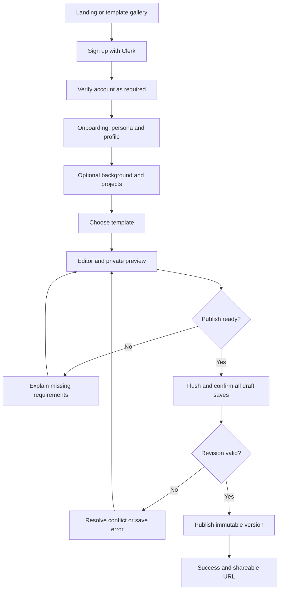
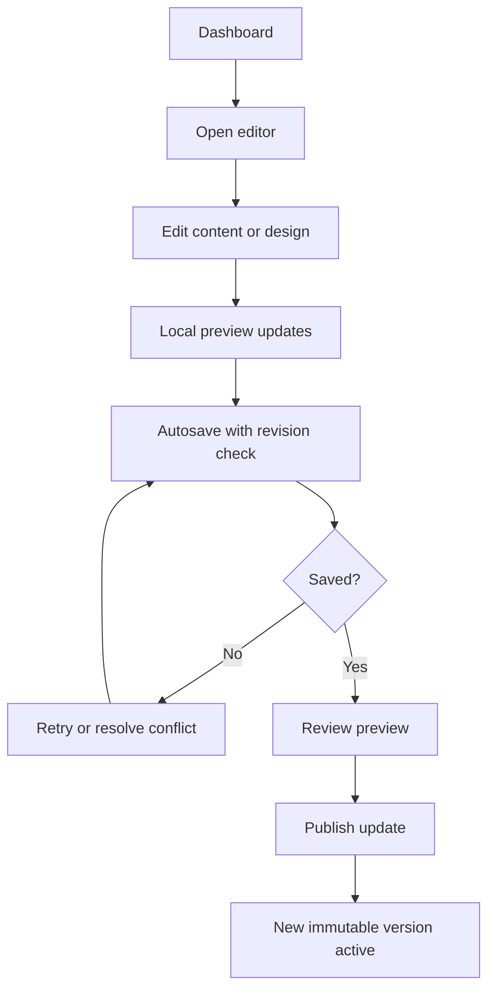
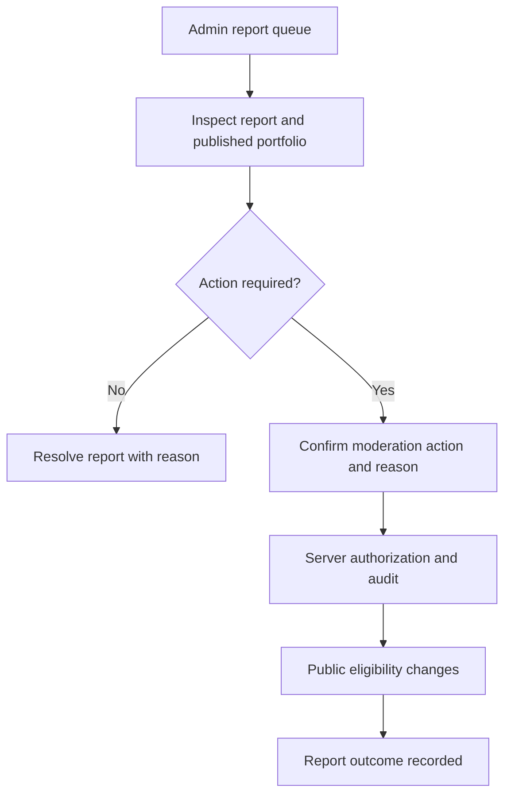

# Foliovanta — UI/UX Design Brief

> **Document:** `UI_UX_DESIGN_BRIEF.md`  
> **Version:** 1.0 — comprehensive design baseline  
> **Date:** 21 October 2026  
> **Status:** Design specification for review; no screens, tokens, prototypes, or usability results are implementation-verified  
> **Source of truth:** `PRD.md` (product scope), `TRD.md` (engineering/security), `APP_FLOW.md` (navigation/state transitions)  
> **Companion documents:** `BACKEND_SCHEMA.md` and `IMPLEMENTATION_PLAN.md` (planned)

---

## 1. Purpose, scope, and authority

This brief specifies the **visual language, information architecture at the screen level, component patterns, interaction behavior, responsive rules, accessibility expectations, error/recovery states, and design deliverables** for Foliovanta. It is intended for product designers, frontend engineers, QA, content designers, and reviewers. It is a **buildable design specification**, not a set of screenshots or an assertion that visual designs already exist.

**Decision vocabulary:** **Agreed** = already established; **Baseline** = recommended working default; **Proposed** = requires product/design approval; **Open** = unresolved; **Future** = out of MVP; **Verified** = demonstrated in tests or production. No item is Verified merely because it appears here.

**Precedence when documents conflict:** PRD for *what* the product does; APP_FLOW for routes and transitions; TRD for security, persistence, and technical invariants; this brief for *how it looks, feels, and communicates*. Conflicts must be logged and resolved explicitly, not silently overridden in Figma or code.

### 1.1 Core experience promise

A first-time creator should be able to sign up, enter meaningful information, choose a polished template, preview it, and publish with confidence. Returning creators should be able to update content quickly without fearing data loss. Visitors should see a fast, credible, accessible public website—not a dashboard or editing tool.

### 1.2 Design principles

1. **Content first:** user achievements and work must remain the focus; platform chrome stays secondary.
2. **Guided, not restrictive:** defaults reduce decisions; optional detail remains discoverable.
3. **Progressive disclosure:** show common controls first; advanced design settings live behind clearly named groups.
4. **Trust through accurate feedback:** “Saved” only after server acknowledgement; “Published” only after successful commit.
5. **One canonical content model:** switching templates changes presentation, never deletes content.
6. **Accessible by default:** keyboard, screen reader, touch, motion and contrast are first-class requirements.
7. **Responsive by design:** no desktop-only editor workflows or inaccessible drag-only controls.
8. **Recoverable failures:** errors state what happened, what was retained, and the next action.
9. **Consistent patterns:** one shared platform UI system across marketing, onboarding, dashboard, editor and admin, with a separately scoped public-template system.
10. **Real-world constraints:** performance, media, localization, long content, account restrictions and moderation are included in design reviews.

### 1.3 Explicit exclusions

No freeform canvas, pixel-precise page positioning, arbitrary HTML/CSS injection, real-time collaboration, custom-domain onboarding, billing screens, AI writing assistant, blog CMS, native mobile app, or per-portfolio analytics dashboard in MVP. These must not appear as working affordances in MVP mockups.

---

## 2. Audience, jobs-to-be-done, and usability outcomes

| Audience | Primary job | Likely friction | UX response |
|---|---|---|---|
| Student / early-career | Build a credible first portfolio quickly | Limited work history, uncertainty about content | Examples, optional sections, starter guidance, sensible defaults |
| Developer | Showcase projects, links, tech stack | Many projects, technical metadata | Clear project structure, external links, responsive previews |
| Designer / creative | Present visual work professionally | Media quality, template expressiveness | Strong imagery, controlled visual variants, media preview/crop |
| Freelancer | Establish trust and contactability | Need quick updates and prominent contact | Contact CTAs, experience/projects, fast publishing |
| Experienced professional | Summarize career clearly | Long histories, many entries | Scannable timelines, section order, repeatable entries |
| Public visitor / recruiter | Understand person and work quickly | Slow load, clutter, poor mobile layout | Fast SSR content, readable hierarchy, accessible contact links |
| Super Admin | Review abuse, support users, audit actions | Large lists, ambiguous state, accidental destructive actions | Clear statuses, filters, confirmation, reason capture, audit trails |

**Usability objectives (proposed measurement targets, not verified):** first-time creators can identify the next step without instruction; no critical workflow requires drag-and-drop; users can tell saved draft from published site; critical errors explain recovery; all primary workflows are keyboard operable. Set numeric completion/time targets after baseline usability sessions rather than inventing them now.

---

## 3. Product surfaces and design boundaries

| Surface | Planned origin | Shell | Primary CTA | Data visibility |
|---|---|---|---|---|
| Marketing | `foliovanta.com` | Public marketing shell | Create your portfolio | Public |
| Template discovery | `foliovanta.com/templates` | Marketing shell | Use this template | Public previews |
| Authentication | `app.foliovanta.com/sign-in`, `/sign-up` | Clerk-integrated auth shell | Continue | Auth/session |
| Onboarding | `app.foliovanta.com/onboarding/**` | Focused wizard shell | Continue | Private draft |
| Creator dashboard | `app.foliovanta.com/dashboard` | Creator shell | Edit / Publish | Private |
| Editor | `app.foliovanta.com/editor/**` | Editor shell | Preview / Publish | Private draft |
| Preview / publish | `app.foliovanta.com/preview`, `/publish/**` | Creator/editor shell | Publish changes | Private until committed |
| Account/portfolio settings | `app.foliovanta.com/settings/**` | Creator shell | Save / Manage | Private |
| Super Admin | `app.foliovanta.com/admin/**` | Admin shell | Contextual admin action | Privileged |
| Public portfolio | `<slug>.foliovanta.com` | Template-specific | Contact / view work | Active published snapshot only |

**Baseline:** public templates do **not** inherit creator-dashboard chrome, fonts, spacing, or color tokens. Marketing may share brand foundations with the app but has its own expressive layout. Host routing, wildcard TLS and cross-origin Clerk behavior are pending infrastructure validation.

---

## 4. Visual direction and brand identity

### 4.1 Personality

**Agreed:** brand is **Foliovanta**; tagline **“Your story. Your work. Your identity.”**  
**Proposed direction:** calm, editorial, credible, contemporary and quietly expressive. The product should feel premium without becoming visually noisy. Public templates should allow users' identities to differ from the Foliovanta platform brand.

### 4.2 Brand vocabulary

- **Clear:** short labels, visible next steps, plain-language status.
- **Confident:** strong headings, generous whitespace, deliberate composition.
- **Human:** approachable microcopy and helpful examples, not corporate jargon.
- **Crafted:** thoughtful typography and image framing, consistent alignment.
- **Respectful:** no manipulative upgrade prompts or fake urgency.

### 4.3 Color strategy

**Do not treat unapproved hex values as a finalized brand palette.** Define semantic tokens before picking decorative colors:

| Token family | Purpose | Notes |
|---|---|---|
| `background`, `surface`, `surface-raised` | Page, cards, overlays | Distinct elevation without excessive shadows |
| `foreground`, `foreground-muted` | Body and secondary text | Accessible contrast |
| `border`, `divider` | Structural separation | Must remain perceivable |
| `brand`, `brand-hover`, `brand-foreground` | Primary actions and identity | Proposed brand color needs visual sign-off |
| `focus-ring` | Keyboard focus | Never depend solely on browser defaults being visible |
| `success`, `warning`, `danger`, `info` | Semantic feedback | Pair color with text/icon; never color alone |
| `disabled` | Disabled controls | Must remain distinguishable and understandable |

**Baseline:** light theme for platform MVP; dark mode for platform chrome is **Open** and not required to ship. Public template dark/light support is template-capability-driven and may vary by template. Avoid binding semantic state to one hue without testing light/dark contrast.

### 4.4 Typography

**Proposed platform type system:** a modern, highly readable sans-serif for UI; an optional editorial display treatment for marketing headings. Final typefaces must be chosen based on licensing, language coverage, performance, and design review. Public portfolios use a curated font registry with separate heading/body selections and safe fallbacks.

| Role | Proposed desktop scale | Mobile behavior |
|---|---|---|
| Marketing hero | 48–72 px | Fluid clamp; avoid oversized wrapping |
| Page title | 28–36 px | 24–30 px |
| Section heading | 20–28 px | 20–24 px |
| Card heading | 16–20 px | 16–18 px |
| Body | 16 px | 16 px |
| Supporting text | 14 px | 14 px minimum where feasible |
| Form labels | 14–16 px | Remain readable; never rely on placeholders |

These are **initial design targets**, not immutable CSS values. Test with real text, browser zoom and accessibility settings. Avoid 12 px body copy for primary workflows.

### 4.5 Spacing, geometry and elevation

**Baseline:** 4 px spacing unit with common steps 4/8/12/16/24/32/48/64; consistent layout containers; restrained radii; borders before heavy shadows. Choose one radius family for the platform and let public templates own their own card/button geometry. Avoid decorative gradients on every surface.

### 4.6 Imagery and illustration

- Use authentic-looking portfolio examples that demonstrate varied personas and content density.
- Marketing template screenshots must represent actual supported layouts; avoid mockups showing nonexistent functionality.
- Use curated example assets with verified rights and attribution where required.
- Do not require an avatar or project cover for a portfolio to look complete.
- Provide meaningful fallback/empty-image states; never show broken image icons.

---

## 5. Design system architecture

### 5.1 Two layers, one accessibility standard

**Platform design system:** marketing/app/admin primitives built with Tailwind and shadcn/ui/Radix (agreed stack), shared typography, spacing, focus, feedback and form conventions.  
**Portfolio template system:** template-scoped components and validated design tokens, separate from dashboard tokens. Same canonical content, different rendering composition.

### 5.2 Token taxonomy

```text
Foundation tokens (spacing, type scale, radii, z-index, motion)
       |
       +-- Platform semantic tokens (brand, surface, text, border, status)
       |
       +-- Template defaults (per template/version)
                 |
                 +-- Validated user design overrides
                            |
                            +-- Resolved public CSS variables
```

Token resolution order: template defaults → permitted user overrides → safe fallback values. Reject invalid color/font/layout values at the server boundary; preview and published renderers must use the same resolver. No arbitrary user CSS/JS.

### 5.3 Component inventory

| Category | Required patterns |
|---|---|
| Navigation | Header, desktop sidebar, mobile drawer, breadcrumbs, tabs, stepper |
| Inputs | Text, textarea, URL, select, checkbox, radio, switch, date/month picker, repeatable field groups |
| Actions | Primary/secondary/tertiary/destructive buttons, icon buttons, links, split actions only if justified |
| Feedback | Sonner toast, inline validation, save status, alerts, confirmation dialogs, progress |
| Data | Cards, lists, tables, empty states, pagination, filters, status labels |
| Editor | Section navigator, repeatable-entry card, reorder controls, design token picker, preview frame |
| Media | Upload dropzone/input, progress, crop dialog if required, gallery selector, fallback |
| Overlay | Dialog, sheet, popover, tooltip, command/search where needed |
| Public | Hero, about, timeline, project grid, skill groups, credentials, contact CTA, social links |

**Library baseline:** shadcn/ui + Radix, Lucide icons (recommended), Sonner notifications (recommended), dnd-kit (agreed direction), React Hook Form + Zod. Rich text with restricted Tiptap remains **Open**. Avoid adding heavyweight libraries without a demonstrated interaction requirement.

### 5.4 Component state requirements

Every interactive component needs: default, hover (where relevant), focus-visible, active/pressed, selected, disabled, loading, success, error and empty states as applicable. Include destructive-action confirmations and asynchronous interruption. Do not design only the happy path.

### 5.5 Accessibility baseline

Target **WCAG 2.2 AA** for creator and public experiences. Provide semantic HTML, correct labels, visible focus, keyboard navigation, accessible dialog focus management, meaningful status announcements, sufficient contrast, non-color cues, accessible errors, and motion reduction. Avoid claiming conformance without testing.

---

## 6. Responsive layout system

### 6.1 Breakpoints and containers

**Proposed design breakpoints** (align with final Tailwind config): small phone ~320–479 px; large phone ~480–767 px; tablet ~768–1023 px; desktop ~1024–1439 px; wide desktop ≥1440 px. Treat these as design test ranges, not fixed device assumptions. Test zoom, landscape, narrow desktop and virtual keyboard.

**Baseline:** max-width content container around 1200–1280 px for creator/marketing pages; editor may use wider workspace. Public templates set their own readable text widths and image grid limits.

### 6.2 Layout adaptations

| Area | Desktop | Tablet | Mobile |
|---|---|---|---|
| Marketing nav | Full links + CTA | Condensed | Accessible menu drawer |
| Onboarding | Form with optional supporting preview | Form first | Single-column, persistent progress |
| Dashboard | Card/grid with sidebar | Reduced columns | One-column cards, compact nav |
| Editor | Section rail + form + preview when space permits | Form + switchable preview | Single active panel; preview toggle |
| Design controls | Grouped sidebar and live preview | Collapsible controls | Full-width controls, preview in separate view |
| Admin | Table + filters + detail panels | Horizontal scroll only for true tabular data | Filter drawer, responsive record cards/detail |
| Public template | Template-defined grid | Responsive collapse | Legible single-column priority |

**Do not** force a three-column editor onto small screens. Preview must remain accessible but not consume most of the viewport while typing. Avoid nested scrolling traps.

### 6.3 Touch and pointer

Touch targets should meet at least WCAG 2.2 AA target-size requirements and preferably approach 44×44 CSS px for primary controls. Drag handles require an equivalent keyboard/button-based move action. Hover-only controls need touch-visible alternatives.

---

## 7. Navigation, hierarchy, and shell patterns

### 7.1 Marketing shell

Top-level: Foliovanta logo → home; Templates; Sign in; prominent Create portfolio CTA. Footer: product, help/contact, privacy, terms, and relevant legal links (actual policy content must be provided before launch). Avoid overcrowding the first navigation level.

### 7.2 Creator shell

Global destinations: Dashboard, Editor, Preview/Publish, Settings, Feedback, Account. The active portfolio and its publication state must be visible. **One portfolio per user MVP**, so do not design a multi-workspace switcher as a functioning control.

### 7.3 Editor shell

Desktop proposed arrangement: section navigation rail (left), editable form (center), live preview (right) when width permits. Sticky top bar: portfolio identity, save status, Preview, Publish/Update. On mobile, section navigation is a sheet/selectable list; form and preview are switchable, not side by side.

### 7.4 Admin shell

Visually distinct from creator shell, with overview, users, portfolios, feedback, reports, audit logs. Advanced analytics/settings are **Future**. Privileged actions must show subject, consequence and reason.

### 7.5 Navigation safety

- Deep links and browser back/forward must restore the correct screen and section.
- Unknown or unauthorized routes use explicit, privacy-safe not-found/access-denied states.
- Onboarding return paths are preserved only when safe and authorized.
- Do not navigate away from dirty forms without handing edits to the autosave coordinator.
- Session expiry while editing must preserve locally held changes where feasible and provide a re-authentication path.

---

## 8. Screen-by-screen design requirements

**Route names below follow APP_FLOW proposals, not finalized filesystem routing.** Screen IDs should match APP_FLOW where available. Every screen needs desktop and mobile layouts, loading/empty/error states, and keyboard behavior.

### 8.1 M01 — Landing page (`/`)

**Purpose:** communicate value and lead users into signup or template exploration.  
**Hierarchy:** navigation → concise hero (headline, benefit, CTA, supporting example) → real template previews → how it works (create, customize, publish) → audience/use-case examples → trust/FAQ if substantiated → footer.  
**Primary CTA:** Create your portfolio. **Secondary:** Explore templates.  
**Interaction:** authenticated visitors proceed to onboarding/dashboard; unauthenticated visitors enter signup.  
**Design rules:** clear above-the-fold value; no fabricated customer logos, testimonials or statistics; prioritize actual template quality over decorative mockups.  
**States:** responsive nav, slow image loads, CTA focus/keyboard, optional marketing cookie/consent UI subject to policy.

### 8.2 M02 — Template gallery (`/templates`)

**Purpose:** compare the three MVP templates.  
**Content:** Minimal, Professional, Creative cards; representative screenshot, name, short positioning, Preview and Use template actions.  
**Interaction:** inspect previews without signup; selecting a template carries its validated ID into onboarding/editor.  
**Design rules:** show comparable viewport thumbnails; avoid implying unsupported customization; filters not needed for three templates.  
**States:** image fallback, loading, unknown template, keyboard navigation.

### 8.3 M03 — Template details (`/templates/[templateId]`)

**Purpose:** evaluate one template.  
**Layout:** large responsive preview, design traits, supported sections/layouts, CTA.  
**Interaction:** desktop/mobile preview modes; CTA stores intended template safely.  
**States:** unsupported/retired template, preview loading, unavailable demo data.

### 8.4 A01/A02 — Sign-up and sign-in (`/sign-up`, `/sign-in`)

**Purpose:** secure low-friction access.  
**Baseline:** Clerk-managed components or supported customized UI; Google and email/password.  
**Content:** brand, concise value reassurance, authentication form, alternate sign-in path, legal links.  
**Rules:** do not create custom token-storage UI; no misleading claims about session persistence; use Clerk-supported error states and email verification.  
**States:** invalid credentials, existing account, unverified email, rate limiting, popup/provider failure, expired session, disabled account, return URL handling.  
**Accessibility:** accessible provider button labels, autofill, password manager support, visible errors.

### 8.5 O01 — Persona/welcome (`/onboarding/welcome`)

**Purpose:** tailor guidance, not restrict functionality.  
**UI:** short welcome, persona choices (student/developer/designer/freelancer/professional/other), clear Continue and Skip.  
**Rule:** persona must not silently hide content types or determine a permanent template restriction.  
**States:** no selection, skip, returning user with saved selection.

### 8.6 O02 — Profile (`/onboarding/profile`)

**Purpose:** establish core identity.  
**Fields:** display name, headline, bio/about, optional location/avatar and relevant links as defined by PRD.  
**UI:** focused form with helpful examples, optional preview, field-level errors.  
**States:** empty, validation, upload progress/error, saved/unsaved, skip where allowed.  
**Rule:** clearly indicate which fields are required to publish versus optional for onboarding.

### 8.7 O03 — Background (`/onboarding/background`)

**Purpose:** capture education, experience and skills without overwhelming first-time users.  
**UI:** expandable repeatable groups, Add experience, Add education, Add skill, optional skip.  
**Rules:** one entry at a time, sensible date input, current-role toggle, remove confirmation only where loss is significant.  
**States:** empty examples, invalid date range, reorder, save interruption.

### 8.8 O04 — Projects (`/onboarding/projects`)

**Purpose:** highlight work.  
**UI:** project card builder with title, description, URLs, optional cover/media, reorder and preview.  
**Rules:** zero projects may be allowed during onboarding; publishing readiness follows product rules.  
**States:** empty, malformed URL, upload failure, quota reached, remove/undo where feasible.

### 8.9 O05 — Template choice (`/onboarding/template`)

**Purpose:** pick initial presentation.  
**UI:** three equal-priority template cards, live sample previews, selected state, Continue to editor/dashboard.  
**Rules:** show safe default; switching selection never deletes entered content.  
**States:** previously selected template, retired template fallback, slow preview.

### 8.10 D01 — Dashboard (`/dashboard`)

**Purpose:** orient creators and surface next action.  
**Layout:** greeting/context → portfolio status and public URL if published → primary Edit/Continue setup CTA → Preview/Publish/Update → checklist for missing recommended content → account/help shortcuts.  
**States:** new user/no portfolio, incomplete onboarding, draft, published, unpublished, suspended, restricted account, backend error.  
**Rule:** show draft update time and published time separately. Never imply autosaved edits are already public.

### 8.11 E01 — Profile editor (`/editor/profile`)

**Purpose:** edit identity and avatar.  
**UI:** grouped identity fields, avatar preview/upload, inline field hints, save indicator in shell.  
**States:** dirty, saving, saved, invalid, conflict, offline, upload pending.  
**Rule:** changes immediately affect private preview, not public website.

### 8.12 E02 — About editor (`/editor/about`)

**Purpose:** tell personal/professional story.  
**UI:** multiline biography; optional supported formatting controls only if rich text is approved.  
**Rules:** character guidance and safe URL handling; never expose raw HTML entry as a design feature.  
**States:** long content, empty text, unsupported formatting paste, validation.

### 8.13 E03 — Experience editor (`/editor/experience`)

**Purpose:** manage employment timeline.  
**UI:** repeatable cards, organization, role, dates, current role, location, description; reorder.  
**States:** no entries, overlapping dates (warning not necessarily error), invalid date order, move/delete.

### 8.14 E04 — Education editor (`/editor/education`)

**Purpose:** present education.  
**UI:** institution, degree, field, dates, description; repeatable cards and reorder.  
**States:** incomplete education, ongoing study, optional dates, invalid range.

### 8.15 E05 — Projects editor (`/editor/projects`)

**Purpose:** showcase portfolio work.  
**UI:** project list/cards; Add project; title, summary, description, cover, demo/source URLs, featured flag, reorder.  
**Rules:** show supported image crop/ratio guidance, preview long descriptions, explain external-link behavior.  
**States:** empty, multiple projects, upload processing, invalid links, quota exceeded, conflict.

### 8.16 E06 — Skills editor (`/editor/skills`)

**Purpose:** organize capabilities.  
**UI:** searchable/addable skill chips or rows, category grouping, keyboard-friendly add/remove/reorder.  
**Rules:** don't force proficiency percentages; avoid duplicate skills within defined normalization rules.  
**States:** empty, duplicate, many skills, quota.

### 8.17 E07 — Certifications editor (`/editor/certifications`)

**Purpose:** list credentials.  
**UI:** issuer, title, issue/expiry date, credential link; repeatable entries.  
**States:** no expiry, invalid date, missing optional URL, many entries.

### 8.18 E08 — Contact/social editor (`/editor/contact`)

**Purpose:** make contact and identity links easy to manage.  
**UI:** email/contact visibility controls (as approved), social platform, label, URL, reorder.  
**Rules:** explain public exposure of contact details; no custom contact-form backend unless scoped.  
**States:** invalid URL, duplicate platform, private email toggle, empty social list.

### 8.19 E09 — Design editor (`/editor/design`)

**Purpose:** customize appearance safely.  
**Groups:** template, curated palette, validated custom colors, heading/body fonts, light/dark where supported, spacing/radius/button/card variants.  
**Interaction:** changes update private preview immediately; Reset to template defaults; changes autosave like other draft edits.  
**Rules:** expose only options supported by selected template; warn if color contrast becomes unacceptable; avoid arbitrary CSS.  
**States:** invalid custom color, incompatible option, reset confirmation if destructive, template switch, unsaved changes.

### 8.20 E10 — Layout editor (`/editor/layout`)

**Purpose:** control section order, visibility and supported layout variants.  
**UI:** section list with visible/hidden switches, reorder handles and explicit Move up/down actions, variant selectors.  
**Rules:** hiding preserves content; mandatory structural sections cannot be removed if required by template; preview matches order.  
**States:** all optional sections hidden, reorder keyboard mode, unsupported variant fallback.

### 8.21 P01 — Private preview (`/preview`)

**Purpose:** review portfolio as a visitor would see it, including unsaved local edits when reached from active editor.  
**UI:** desktop/tablet/mobile viewport presets, template rendering, Back to edit, Publish/Update CTA.  
**Rules:** preview is clearly labeled private; viewport presets simulate layout, not exact devices; never expose private preview to anonymous visitors.  
**States:** preview with dirty changes, stale server state, unsupported template version, loading, validation warnings.

### 8.22 P02 — Publish readiness (`/publish`)

**Purpose:** prevent accidental or incomplete publication.  
**UI:** checklist of required content and verification, URL preview, clear summary of what becomes public, publish button.  
**Interaction:** flush autosave, wait for server acknowledgement, then submit expected revision.  
**States:** missing required fields, unverified email, pending upload, saving, conflict, restricted account, quota violation, publish error.  
**Rule:** never show success optimistically.

### 8.23 P03 — Publish success (`/publish/success`)

**Purpose:** confirm committed publication and facilitate sharing.  
**UI:** success heading, canonical public URL, Open portfolio, Copy link, Continue editing.  
**States:** public cache propagation delay, link copy failure, no active published version after unexpected recovery.  
**Rule:** success screen is driven by verified server response, not navigation alone.

### 8.24 S01 — Portfolio settings (`/settings/portfolio`)

**Purpose:** manage portfolio identity and lifecycle.  
**UI:** current slug/public URL (MVP slug immutable), publication state, unpublish control, version entry point, relevant SEO/indexing settings if supported.  
**States:** unpublished, published, suspended, slug reserved/error, unavailable operation.  
**Rule:** distinguish Unpublish from Delete; moderation restrictions cannot be bypassed.

### 8.25 S02 — Version history (`/settings/portfolio/versions`)

**Purpose:** inspect and restore published versions.  
**UI:** version list (number/date/template/actor), current badge, Preview version, Restore version action with confirmation.  
**Rules:** rollback changes active pointer; it does not overwrite historical snapshots or automatically replace draft.  
**States:** no versions, single version, version incompatibility, rollback failure, cache propagation.

### 8.26 S03 — Account settings (`/settings/account`)

**Purpose:** manage profile/account/security and deletion.  
**UI:** Clerk-managed account/security links or embedded controls, account status, deletion request flow.  
**Rules:** clear distinction between logout, unpublish and account deletion; retention/recovery policy must be approved before final destructive copy.  
**States:** re-auth required, deletion pending, account restricted, provider error.

### 8.27 F01 — Product feedback (`/feedback`)

**Purpose:** collect actionable product feedback.  
**UI:** category, optional rating if approved, description, submission acknowledgement.  
**Rules:** limit spam, show privacy context, do not promise response times without policy.  
**States:** empty/invalid, sending, success, rate limited, failure/retry.

### 8.28 U01 — Public portfolio (`https://<slug>.foliovanta.com`)

**Purpose:** present an individual's professional identity.  
**UI:** template-specific hero, about, experience, education, projects, skills, certifications, contact/social sections based on snapshot visibility/order.  
**Rules:** no editor controls, no private draft data, responsive SSR, accessible landmarks, descriptive links, sensible empty-section omission.  
**States:** long/short content, absent avatar, broken external link (browser-level), image fallback, template version compatibility, reduced motion.  
**SEO:** proper title/description/OG/canonical/structured data and indexing controls per TRD.

### 8.29 U02 — Unavailable portfolio (`404` / unavailable state)

**Purpose:** handle unknown, unpublished, suspended or ineligible portfolios without disclosing sensitive moderation details.  
**UI:** calm, generic unavailable message; optional return to Foliovanta homepage.  
**Rules:** status code and indexing behavior follow TRD; do not leak owner data or reasons.  
**States:** not found, unpublished, suspended, deleted, internal error; design may share safe public presentation while HTTP semantics differ.

### 8.30 Public abuse report

**Purpose:** let visitors flag harmful portfolio content.  
**UI:** contextual Report link where required, reason category, optional details, submit confirmation.  
**Rules:** avoid publishing reporter identity; bot/rate-limit protection; no automatic promise of removal.  
**States:** submitted, duplicate, rate-limited, validation error.

### 8.31 AD01 — Admin overview (`/admin`)

**Purpose:** surface operational workload.  
**UI:** actionable summary (pending reports, restricted portfolios, recent feedback), navigation to queues; only metrics supported by actual data.  
**States:** no pending items, delayed data, partial errors, insufficient privilege.

### 8.32 AD02 — Users (`/admin/users`)

**Purpose:** find and review accounts.  
**UI:** searchable/filterable table, role/status, created date, pagination, detail action.  
**Rules:** minimize personal data shown by default; no raw authentication tokens.  
**States:** empty results, filter reset, loading, query error.

### 8.33 AD03 — User detail (`/admin/users/[id]`)

**Purpose:** inspect account state and perform permitted actions.  
**UI:** account summary, portfolio links, moderation history, audit context; restrictive actions require confirmation/reason.  
**Rules:** fresh server authorization; show action consequences and prevent self-lockout where policy requires.  
**States:** deleted user, stale record, action conflict, permission changed.

### 8.34 AD04 — Portfolios (`/admin/portfolios`)

**Purpose:** discover and moderate portfolios.  
**UI:** search/filter by status/owner, published URL, recent activity, moderation state.  
**States:** empty, stale state, loading, pagination.

### 8.35 AD05 — Portfolio detail (`/admin/portfolios/[id]`)

**Purpose:** inspect public portfolio and moderation context.  
**UI:** status summary, active published version preview, reports, moderation actions/history.  
**Rules:** admin preview must not imply permission to edit owner draft; suspend/reinstate is audited and requires reason.  
**States:** no active version, already suspended, simultaneous moderation, deleted owner.

### 8.36 AD06 — Feedback queue (`/admin/feedback`)

**Purpose:** triage product feedback.  
**UI:** status filters, summary, details, assignment/triage controls only if supported by backend.  
**States:** empty queue, duplicate submission, failed update.

### 8.37 AD07 — Abuse reports (`/admin/reports`)

**Purpose:** investigate reports.  
**UI:** severity/reason/status filters, report detail, associated portfolio, resolution actions and notes.  
**Rules:** report content may be malicious; display safely; preserve audit trail.  
**States:** duplicate reports, false positive, removed portfolio, rate-limit abuse.

### 8.38 AD08 — Audit logs (`/admin/audit-logs`)

**Purpose:** support accountability and investigation.  
**UI:** immutable-looking chronological event table, actor, action, target, timestamp, filters and detail view.  
**Rules:** no editable audit log affordances; redact secrets/PII as policy dictates.  
**States:** no results, pagination, restricted fields, retention boundary.

### 8.39 Future screens — intentionally not designed as MVP functionality

Advanced admin analytics (`/admin/analytics`), admin configuration (`/admin/settings`), subscription checkout, custom-domain setup, multiple-portfolio switcher, creator analytics, collaboration, realtime inbox and AI assistance. Placeholder links must not imply availability.

---

## 9. Core end-to-end UX flows

### 9.1 New creator: first publish



### 9.2 Returning creator: update public site



### 9.3 Admin moderation



**UX invariant:** design cannot mask a server-side failure as success; all optimistic or local feedback must be visually distinguished from confirmed persistence.

---

## 10. Editor interaction specification

### 10.1 Form patterns

Use visible labels, concise helper text, inline validation at appropriate times (usually on blur/submission; avoid error spam on each keystroke), optional-field indicators and realistic examples. Preserve cursor/focus when autosave completes. Avoid whole-form remounts and field jumps. Prefer native controls where they improve accessibility.

### 10.2 Repeatable items

Each repeatable section supports Add, Edit, Reorder, Remove, and Cancel where appropriate. Show entries as collapsible cards or list rows. Stable keys prevent data/focus loss. Use explicit “Move up/down” controls in addition to drag-and-drop. Removal confirmation should reflect whether the action is immediately reversible or still draft-only.

### 10.3 Save status state machine

| State | Label | Visual treatment | Available action |
|---|---|---|---|
| Clean | Saved | Quiet confirmation with timestamp if useful | Continue editing |
| Dirty | Unsaved changes | Neutral non-alarming status | Wait for autosave / manual retry if needed |
| Pending | Saving… | Subtle progress, no blocking overlay | Continue typing |
| Offline | Offline — changes not saved | Persistent notice | Retry when connected; preserve local work |
| Error | Couldn't save changes | Persistent warning, not toast-only | Retry; keep edits |
| Conflict | Newer changes found | Prominent conflict UI | Review/reload/reconcile |

**No false promises:** local input change is not a successful save; browser-close protection is not guaranteed persistence. Design an optional local recovery banner if recovery storage is implemented; do not advertise offline editing unless supported and tested.

### 10.4 Conflict resolution

Show what happened (“This portfolio changed in another tab”), what remains locally, and safe options: Review latest saved version; Keep a copy of my edits; Retry after reconciling. Do not offer “Overwrite anyway” without an explicit, authorized, reviewed conflict policy. No silent last-write-wins.

### 10.5 Publish barrier

Publish button is unavailable or transitions into a clearly labeled waiting state while saves/uploads are pending. If validation, revision, email verification, moderation or quota checks fail, show a concise actionable list with deep links to the relevant fields/sections. Publish confirmation must state that content becomes publicly visible.

### 10.6 Template switching

Show before/after preview; retain canonical content; explain that certain layout variants may not exist in the target template. Invalid overrides fall back safely, but user-entered content remains intact. Do not display misleading previews for incompatible historical template versions.

### 10.7 Undo and recovery

Use reversible local operations where practical (reorder, temporary remove before save). For committed deletions, show confirmation or provide an actual undo mechanism only if supported by the backend. Avoid toast-based “Undo” that cannot restore data reliably.

---

## 11. Public portfolio template design brief

### 11.1 Shared content contract

All three MVP templates consume the same normalized published snapshot: profile, about, experience, education, projects, skills, certifications, contact/social, section visibility/order, design settings and media references. Templates must handle missing optional sections, very long titles, many items, no images and varying language lengths gracefully.

### 11.2 Template A — Minimal

**Audience:** users prioritizing clarity, typography and restraint.  
**Direction:** editorial whitespace, simple navigation, clean typographic hierarchy, restrained accent color, low-decoration project list/grid.  
**Hero:** name, role/headline, short introduction, clear contact CTA.  
**Sections:** compact timeline/list treatment, simple skill tags, text-forward projects.  
**Risks:** can feel sparse with little content; provide elegant empty/short-content compositions.

### 11.3 Template B — Professional

**Audience:** recruiters, consultants, experienced professionals, students seeking conventional credibility.  
**Direction:** structured sections, legible chronology, predictable card/grid system, clear credentials and employment history.  
**Hero:** identity, professional headline, optional portrait, key contact links.  
**Sections:** experience/education timeline, balanced project cards, certifications and skills.  
**Risks:** overly corporate appearance; use thoughtful spacing and selective emphasis.

### 11.4 Template C — Creative

**Audience:** designers, creators and portfolio owners with visually rich projects.  
**Direction:** stronger typographic expression, larger project media, asymmetrical accents within responsive constraints, curated visual contrast.  
**Hero:** expressive but readable introduction; imagery optional.  
**Sections:** prominent project gallery, flexible image treatments, concise supporting content.  
**Risks:** media-heavy performance, contrast failures, content overflow and accessibility; impose guardrails.

### 11.5 Template comparison matrix

| Capability | Minimal | Professional | Creative |
|---|---|---|---|
| All canonical sections | Required | Required | Required |
| Missing image fallback | Required | Required | Required |
| Section show/hide/order | Required | Required | Required |
| Curated palettes | Required | Required | Required |
| Validated custom colors | Where supported | Where supported | Where supported |
| Font pairing options | Required | Required | Required |
| Light/dark variant | Capability-dependent | Capability-dependent | Capability-dependent |
| Project grid/list variations | Capability-dependent | Capability-dependent | Capability-dependent |
| Mobile/keyboard accessibility | Required | Required | Required |
| SSR/SEO-ready | Required | Required | Required |

**Open:** exact template screenshots, final typography, palette, variants and which templates support dark mode. These require design sign-off, not inference.

### 11.6 Design configuration controls

- Palette selector with visual swatches and names; custom color field with validation and contrast guidance.
- Heading/body font dropdown with real preview and safe fallbacks.
- Spacing density selector using named presets rather than raw arbitrary pixel input.
- Radius/card/button styles only when template supports them.
- Layout variant previews using actual sample content.
- Reset to defaults with clear scope (current setting vs all design settings).

---

## 12. Content design and microcopy

### 12.1 Tone

Clear, supportive, professional, concise. Avoid jargon (“hydration”, “revision conflict”) in end-user copy unless paired with plain explanation. Do not over-celebrate routine saves. No blame-oriented error language.

### 12.2 Sample UX copy (proposed)

| Context | Copy |
|---|---|
| Empty projects | “Show what you've built. Add a project when you're ready.” |
| Empty experience | “No experience added yet. You can come back to this later.” |
| Save pending | “Saving changes…” |
| Save confirmed | “All changes saved” |
| Save failed | “We couldn't save your latest changes. They're still here—try again.” |
| Conflict | “This portfolio was updated elsewhere. Review the latest version before saving.” |
| Publish readiness | “Review what will appear on your public portfolio.” |
| Unverified email | “Verify your email to publish your portfolio.” |
| Publish success | “Your portfolio is live.” |
| Unpublish confirmation | “Your public portfolio will no longer be accessible until you publish again.” |
| Suspended public site | “This portfolio is currently unavailable.” |
| Media failure | “This image couldn't be uploaded. Choose another file or try again.” |

**Rule:** do not promise “your changes are safe” if they exist only in volatile memory. Copy must match actual persistence/recovery behavior.

### 12.3 Dates, names, and internationalization

Avoid assumptions about Western-only names, required surnames, phone numbers or US-specific dates. Display dates in human-readable formats; use accessible input labels and unambiguous date controls. Text containers must tolerate expansion, Unicode and long unbroken URLs. Localization is not a committed MVP feature; build layouts to avoid blocking future translation.

### 12.4 Privacy-sensitive copy

Explain which information becomes public. Treat email, location and social URLs as user-controlled visibility choices only where the product supports those choices. Do not imply private contact data is hidden if the published snapshot includes it.

---

## 13. Feedback, errors, and system status

### 13.1 Feedback hierarchy

- **Inline:** field errors, save state, upload state, publish readiness; persistent until resolved.
- **Toast:** short noncritical acknowledgements, copy-link confirmation, reversible actions where supported.
- **Dialog:** destructive/privileged confirmation, high-impact conflicts.
- **Full-page state:** unavailable portfolio, account restriction, authorization failure, unrecoverable screen error.

**Baseline:** Sonner for toasts, but toast must not be the only channel for critical failures.

### 13.2 Loading strategy

Use skeletons matching final layout for meaningful wait times; avoid indefinite spinners without explanation. Preserve existing data during background refetches when safe. Avoid layout shifts on images and previews. Auth state unknown should never flash protected content.

### 13.3 Empty-state system

Every collection has a tailored empty state: icon/illustration optional, plain-language explanation, single primary next action. Admin empty results distinguish “no records exist” from “filters returned nothing.” Public templates simply omit hidden/empty optional sections unless a design-specific fallback is appropriate.

### 13.4 Destructive and privileged actions

For Unpublish, account deletion, suspend/reinstate, and rollback: clear subject, consequence, confirmation, in-progress state, error recovery. Require reason entry for audited admin moderation actions. Use stronger confirmation for irreversible erasure; don't require theatrical confirmation for routine draft editing.

### 13.5 Offline, latency and retries

Show connectivity and save failure in a persistent editor status area. Do not silently retry destructive or non-idempotent operations. Avoid duplicated submit buttons during pending requests. Provide actionable recovery when a publish succeeds server-side but the browser loses the acknowledgement (re-fetch active version before retrying).

---

## 14. Media UX

### 14.1 Upload interaction

Choose file → client-side guidance/initial validation → upload progress → server processing/verification → ready/failed state → attach to content. The UI must not label a media asset ready before server verification. Signed uploads and R2 storage are technical details hidden from users.

### 14.2 Guidance and crop

Explain accepted types, size limits and recommended aspect ratios once finalized. Optional crop UI is **Proposed** (e.g. `react-easy-crop`); no crop affordance until processing/storage supports the result. Allow alt text for meaningful project images; decorative images should be identified appropriately.

### 14.3 Fallbacks

No avatar → initials or typographic identity; no project cover → attractive text-based card; broken image → safe placeholder without blocking the rest of the portfolio. Never rely on imagery for basic navigation or contact details.

### 14.4 Removal

Removing an image from a draft does not necessarily delete the stored object because a published historical version may reference it. The UI should say “Remove from this project” rather than “Delete permanently” unless permanent deletion is guaranteed and permitted.

---

## 15. Accessibility specification and audit checklist

**Target:** WCAG 2.2 AA; verify through automated checks, manual keyboard and screen-reader testing, and representative device testing.

| Area | Required design/implementation evidence |
|---|---|
| Keyboard | Logical tab order; all actions accessible; no keyboard traps |
| Focus | Visible focus indicator; focus restored after dialogs and route transitions |
| Forms | Persistent labels; error descriptions connected to inputs; grouped controls |
| Live status | Save/upload/publish updates announced without overwhelming screen readers |
| Dialogs | Correct role, title, focus containment, Escape/close behavior |
| Drag/reorder | Keyboard alternative and understandable position announcements |
| Color | Text/nontext contrast tested; status never color-only |
| Motion | Respect `prefers-reduced-motion`; no essential information conveyed by animation |
| Zoom/reflow | Functional at 200% zoom and applicable 400% reflow scenarios |
| Target size | WCAG 2.2 AA minimum; comfortable mobile touch targets preferred |
| Images | Meaningful alt text; decorative media excluded from accessibility tree |
| Links | Descriptive labels; external destinations clearly identifiable |
| Landmarks | One meaningful main region, headings in logical order, skip navigation |
| Public templates | All three tested independently; not only the platform shell |
| Authentication | Clerk-integrated controls tested for keyboard and assistive technology |

**Accessibility is a release gate**, not a post-launch polish task. Any exception requires a documented severity, mitigation, owner and remediation date.

---

## 16. Motion and interaction polish

Use motion sparingly to communicate continuity: panel transitions, expandable cards, template selection, upload progress and success acknowledgement. Prefer CSS transitions for simple effects; introduce Motion only when justified. Avoid animated typing in forms, persistent parallax or performance-heavy scroll effects. Respect reduced-motion settings; keep loading and success semantics independent of animation.

**Proposed timing guidance:** micro-interactions ~120–220 ms; panel transitions ~180–300 ms, subject to usability testing. No artificial delays before navigation or publication.

---

## 17. Performance-aware design requirements

- Marketing hero and public portfolio above-the-fold content must not depend on large client-side animation bundles.
- Use responsive images with explicit dimensions/aspect ratios; prefer optimized media and appropriate `sizes`.
- Avoid rendering the entire editor preview as a heavyweight nested browser unless technically justified.
- Limit live-preview rerender scope; typing in one field should not unnecessarily rerender every editor control.
- Avoid unbounded DOM lists in admin tables and extremely large repeatable sections; pagination/virtualization when warranted.
- Public templates must work with JavaScript reduced/disabled where the SSR content contract permits.
- Define and measure Core Web Vitals budgets in TRD/implementation plan; do not assert unmeasured performance claims.
- Template screenshot generation and image transformation need real infrastructure validation.

---

## 18. Design QA and scenario matrix

Each critical screen must be reviewed against the following scenarios, with screenshots or test evidence where relevant.

| Scenario | Expected UX outcome |
|---|---|
| First-time user, no content | Guided next action, no broken empty layouts |
| Returning user, large portfolio | Navigation remains usable, long lists manageable |
| Slow network | Meaningful loading; no false saved/published status |
| Save request times out after server commit | Reconcile state; avoid duplicate/incorrect overwrite |
| Two tabs edit same portfolio | Conflict surfaced; local edits not silently discarded |
| User changes section mid-save | Pending edits retained and eventually reconciled |
| User closes tab with unsaved edits | Honest warning/recovery behavior according to implementation |
| Publish with pending upload | Block or clearly resolve before publish |
| Publish with stale revision | Explain conflict and offer recovery |
| Template switch | Content preserved; preview adjusts safely |
| Hidden section | Data remains in editor; public site omits it |
| Account becomes restricted | Privileged actions denied; safe explanatory state |
| Public portfolio unpublished/suspended | No private data leakage; correct unavailable UI |
| Image missing or corrupt | Safe fallback; layout remains stable |
| 320 px viewport | No clipped primary action; form usable |
| 200% zoom / keyboard only | Navigation, dialogs, forms and editor usable |
| Reduced motion | All functions remain available |
| Screen reader | Inputs, status, errors and reorder controls understandable |
| Long name, URL or multilingual text | Wrapping and layout remain usable |
| Admin action race | Clear failure or updated state; no misleading confirmation |

### 18.1 Device/browser test baseline

Latest stable Chrome, Firefox, Safari and Edge; iOS Safari and Android Chrome; keyboard-only and at least one representative screen reader/browser combination. Exact supported-version policy must be signed off in the TRD/release plan.

---

## 19. Figma / design-file deliverables

A complete design handoff should contain:

1. **Foundations:** semantic color tokens, typography styles, spacing, radii, shadows, iconography, focus and motion tokens.
2. **Components:** variants, interaction states, accessibility annotations and responsive rules.
3. **Marketing:** landing, gallery and template detail desktop/mobile.
4. **Authentication/onboarding:** all entry and five onboarding steps, error and skip states.
5. **Creator:** dashboard, all editor sections, design/layout, preview/publish, settings, feedback.
6. **Public templates:** Minimal, Professional and Creative, each with short/long content and mobile variants.
7. **Admin:** overview, users, user detail, portfolios, portfolio detail, feedback, reports, audit logs.
8. **State library:** empty, loading, saving, saved, offline, error, conflict, restricted, unavailable and success.
9. **Prototype flows:** signup→publish, edit→autosave→preview→publish, multi-tab conflict, admin moderation.
10. **Handoff notes:** component mapping, token references, image rules, breakpoint adaptations, keyboard/focus behavior, exact approved copy.

**File organization proposal:** `00 Foundations`, `01 Components`, `02 Marketing`, `03 Auth & Onboarding`, `04 Dashboard & Editor`, `05 Publishing & Settings`, `06 Public Templates`, `07 Super Admin`, `08 States & Edge Cases`, `09 Prototypes & Handoff`.

Design artifacts should use consistent screen IDs (`M01`, `O01`, `E01`, `AD01`, etc.) from APP_FLOW. Track design revisions and approvals, not just latest screenshots.

---

## 20. Screen-level acceptance and handoff criteria

A screen is **design-ready** only when:

- Its purpose, user role, primary action and navigation destination are defined.
- Desktop and mobile layouts are supplied; tablet behavior is described where materially different.
- Loading, empty, error, disabled and success states are documented.
- Inputs have labels, validation behavior and keyboard interactions.
- Any save/publish state accurately reflects backend acknowledgement.
- Text overflow, optional/missing data, long lists and images are handled.
- Token usage and component variants are mapped to the design system.
- Accessibility annotations and contrast/focus checks are present.
- Unresolved requirements are explicitly tagged and owned.
- Product, design and engineering reviewers have approved the design baseline.

A screen is **implementation-ready** only when its supporting API/schema and state contracts are also defined. A visually approved screen alone is insufficient.

---

## 21. Product/design decisions still open

| ID | Decision | Recommended direction | Needed before |
|---|---|---|---|
| UX-01 | Final Foliovanta brand palette/logo | Explore 2–3 restrained directions; select through review | Final visual design |
| UX-02 | Platform typeface | Readable licensed sans-serif; test performance/language coverage | Token freeze |
| UX-03 | Platform dark mode | Defer unless user research establishes MVP need | App design freeze |
| UX-04 | Template font/palette catalog | Curated, versioned, contrast-checked options | Template build |
| UX-05 | Rich text | Start with plain text unless formatting use cases justify restricted Tiptap | About/project editor |
| UX-06 | Custom color validation UX | Inline contrast feedback and safe fallback | Design editor |
| UX-07 | Mobile editor preview mode | Dedicated preview toggle/view rather than simultaneous panels | Editor design |
| UX-08 | Local draft crash recovery | Design only when persistence behavior is defined and tested | Autosave sign-off |
| UX-09 | Content/media quotas | Show clear limits and actionable upgrade-neutral messaging | Form validation/copy |
| UX-10 | Public contact exposure | Explicit visibility and privacy copy | Contact editor/publishing |
| UX-11 | Public abuse report placement | Discreet, discoverable footer/action | Public templates |
| UX-12 | Legal/help pages and content | Obtain approved legal/support copy; no placeholders at launch | Release |
| UX-13 | Template screenshot and demo data | Use accurate, rights-cleared examples | Marketing/gallery |
| UX-14 | Version rollback confirmation | Explain public-only pointer change vs draft | Version history design |
| UX-15 | Design review metrics | Establish task-completion baseline with usability testing | Release readiness |

Open decisions must not be disguised as implemented functionality or silently decided by a UI library's defaults.

---

## 22. Suggested design sequence and milestones

**D0 — Foundations:** brand explorations, semantic tokens, type scale, responsive grid, component patterns.  
**D1 — First-time creator journey:** marketing, auth, onboarding, dashboard, first preview/publish.  
**D2 — Editor reliability:** all section forms, repeatable items, autosave states, conflict, design controls, mobile preview.  
**D3 — Public templates:** Minimal, Professional, Creative; content-density stress tests, responsive/accessibility reviews.  
**D4 — Account/admin:** settings, versions, feedback, moderation, audit views.  
**D5 — Design QA:** usability tests, accessibility audits, real-content checks, final annotated handoff.

These are **work packages, not calendar commitments**. Parallel work is possible once shared tokens and interaction contracts stabilize.

---

## 23. Traceability matrix

| UX area | PRD section | APP_FLOW section | TRD dependency |
|---|---|---|---|
| Marketing/templates | 6–7, 13 | 7 | 10, 13 |
| Auth/account | 8 | 8, 14 | 5 |
| Onboarding | 9 | 9 | 6 |
| Dashboard | 10 | 10 | 7 |
| Editor/content | 11 | 11 | 9–10 |
| Autosave/conflicts | 12 | 12 | 8–9 |
| Preview/publish | 14 | 13 | 11 |
| Public site/SEO | 15, 17 | 16 | 12–13 |
| Media | 16 | 15 | 14 |
| Super Admin | 18 | 18 | 15, 18 |
| Feedback/reports | 19 | 17–18 | 15–16 |
| Analytics | 20 | 19 | 17 |
| Security/privacy | 21 | 3, 20 | 18 |
| Accessibility/performance | 22 | 21–24 | 13, 20–21 |

Section references are document-level anchors, not a replacement for requirement IDs. The implementation plan should map individual stories and tests to the relevant requirements.

---

## 24. Risks, dependencies and mitigations

| Risk | Impact | Mitigation |
|---|---|---|
| Over-customization in editor | Complexity, inconsistent public output | Curated options, template capability registry, safe token resolver |
| Form/preview state divergence | User distrust, wrong published content | Shared projection, revision-aware autosave, publish barrier |
| Excessive visual polish before flow validation | Slow iteration | Prototype core journeys first; test with real users |
| Creative template harms accessibility/performance | Exclusion, SEO/performance regressions | Same AA/performance gates for all templates |
| Too many responsive editor panels | Unusable mobile experience | Single active panel with preview toggle |
| Missing legal/brand approvals | Launch risk | Separate approval gate, no invented policy claims |
| Inaccurate marketing template screenshots | Broken expectations | Screenshots generated from actual renderer |
| Clerk cross-origin limitations | Auth flow friction | Early infrastructure PoC; design safe redirects/loading |
| Ambiguous save status | Lost trust/data | Server-acknowledged statuses and persistent errors |
| Admin UX permits accidental moderation | Harm to creators | Reason capture, confirmation, role checks, audit logs |

---

## 25. Review and sign-off checklist

- [ ] Product confirms MVP screen inventory and navigation destinations.
- [ ] Brand palette, logo, typography and voice approved.
- [ ] Semantic tokens and core components documented.
- [ ] Mobile/desktop designs exist for all MVP screens.
- [ ] All three public templates handle short/long/missing content.
- [ ] Editor dirty/saving/saved/error/offline/conflict states prototyped.
- [ ] Publish readiness and version rollback flows prototyped.
- [ ] Media and quota UX matches actual backend rules.
- [ ] Admin moderation/abuse/reporting flows reviewed for safety.
- [ ] Accessibility and reduced-motion behavior reviewed.
- [ ] Real-content and device usability sessions completed.
- [ ] All open decisions either resolved or explicitly deferred.
- [ ] Handoff includes exact component states, token values and acceptance criteria.

**Current sign-off:** Not approved or implementation-verified. This document is the detailed design brief from which Figma screens, prototypes, frontend component specifications and design QA can be produced.

---

## 26. Glossary

- **Platform UI:** Foliovanta marketing, creator app and admin interface.
- **Public template:** Portfolio presentation rendered for visitors from an immutable published snapshot.
- **Canonical content:** Structured portfolio information independent of any template.
- **Design token:** Named visual value resolved from template defaults and validated user settings.
- **Draft:** Private editable portfolio data.
- **Published version:** Immutable snapshot activated for public visitors.
- **Preview:** Private representation of current draft and supported design settings.
- **Save acknowledgement:** Server-confirmed persistence of a specific draft revision.
- **Conflict:** Attempt to save using an outdated expected draft revision.
- **Moderation state:** Independent restriction status that can override publication visibility.
- **Design-ready:** Approved visual/interaction specification, not necessarily supported by implemented backend contracts.

---

**Next document:** `BACKEND_SCHEMA.md` — executable Prisma model specification, SQL constraints, ownership rules, transactional invariants, indexing, migrations, and test cases. Then `IMPLEMENTATION_PLAN.md` to sequence work against product, technical, navigation and design requirements.
